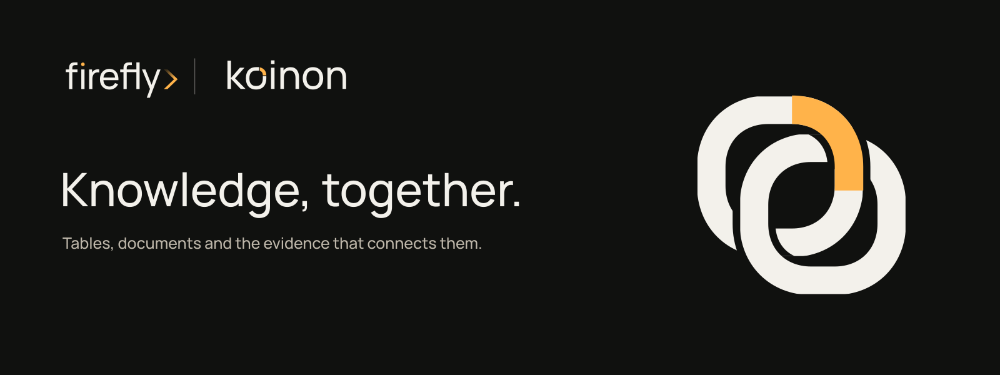

# firefly koinon

koinon brings documents, datasets and reviewed knowledge into one place so people can find what their organization knows, ask questions and inspect the evidence behind an answer.

Use Library to organize and update sources, Chat to explore knowledge, and Settings to manage access and configuration. Proposed knowledge changes require human approval before they are applied. Use **Save as knowledge** below a completed Chat answer to edit one selected reply, choose a Library destination, and review a draft or publication proposal before separately confirming it. See the [reviewed knowledge flow](docs/guides/agents.md#save-a-reviewed-answer-as-knowledge).

Version 26.11.5 follows CalVer `YY.MM.Patch`. Read the [release notes](docs/releases/26.11.5.md), follow the [guided setup](docs/guides/knowledge-setup.md), and obtain versioned packages from [GitHub Releases](https://github.com/fireflyframework/firefly-koinon/releases). Start with [installation](docs/operations/installation.md), the [reference architecture](docs/concepts/architecture.md#reference-deployment) and [first start](docs/operations/first-start.md). Use the [deployment guide](docs/operations/production.md) to configure your environment and the [migration guide](docs/operations/storage-migration.md) to preserve existing installations and retained data.

The backend uses pyfly for application services, security, data access and agents. The API and durable workers run independently of the frontend. Typed Python, TypeScript and Java SDKs let Forge and other products add knowledge capabilities without installing Angular. Hosts that need an interface can use the Angular library or encapsulated custom elements.

PostgreSQL stores operational state, access grants, conversations and provenance. OIDC handles sign-in; persisted membership and scoped personal tokens control API access. Documents and datasets keep distinct identities and source bindings.

Original files, processed snapshots and private attachments support explicit local, S3, Azure Blob Storage and Google Cloud Storage profiles. See [storage configuration](docs/operations/storage.md) for provider installation, workload identity, bounds and the separate live-cloud acceptance requirements.

Read the [documentation](docs/index.md), [headless integration guide](docs/guides/headless.md) and [qualification record](docs/operations/qualification.md).

Code uses [Apache-2.0](LICENSE). Firefly names and marks remain protected trademarks; the code license grants no trademark rights.

Copyright 2026 Firefly Software Foundation. Made with ♥.
