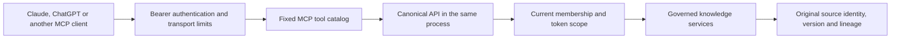

<!-- Copyright 2026 Firefly Software Foundation -->
<!-- SPDX-License-Identifier: Apache-2.0 -->
# Canonical MCP access

The adapter exposes existing koinon operations using the official Python MCP SDK (`mcp` 2.3.0 in the backend lockfile). Its `MCPServer` serves stateless Streamable HTTP with JSON responses at `/mcp`.



Each tool has an explicit schema and fixed endpoint. There is no arbitrary route, URL or HTTP method tool. An in-process ASGI request runs the canonical authentication filters, permission checks, token restrictions, services and error handling. The dispatcher uses a fixed internal authority, excludes browser cookies and client authority headers, follows no redirects and makes no network request. A fresh asynchronous task context isolates nested authentication, request and transaction state from the parent request.

PATs are reauthenticated for every request and canonical operation. MCP OAuth credentials map on the server to an associated canonical scoped credential; the dedicated MCP resource credential is never forwarded to an unrelated API. The canonical operation rechecks current membership and resource restrictions. Revocation and workspace changes take effect without restarting a session.

| Tool | Canonical operation | Result |
| --- | --- | --- |
| `koinon_context` | `GET /api/v1/context` | Authorized organizations, workspaces and memberships |
| `koinon_list` | Tenant catalog | Filtered, paginated catalog |
| `koinon_search` | Tenant search | Original source and retrieval metadata; answer generation disabled |
| `koinon_fetch` | Catalog entry, document chunks or curated version | Original source/version identity |
| `koinon_dataset_schema` | Dataset schema | Governed table and source identity |
| `koinon_query` | Tenant query | Governed query result, audit and lineage |
| `koinon_answer_audit` | Existing chat run audit | Owner-authorized audit with explicit unknown provenance |
| `koinon_provenance` | Asset lineage or exact table snapshot | Canonical source relationships |

Query uses the canonical POST endpoint because execution records its audit and result. Its read-only annotation describes dataset access; execution can have audit and metering side effects. No tool mutates knowledge, confirms an intent, impersonates a human statement or bypasses the trusted UI's exact consent flow. Document reads return the current canonical extraction with its version IDs; historical reads are exposed only for curated versions supported by the API.

Source text is untrusted content. Server instructions tell clients to preserve source IDs, versions and lineage and keep absent provenance unknown. The adapter returns canonical JSON without manufacturing citations or promoting model output to authoritative knowledge.

## Deployment

MCP is disabled by default. Set its exact public URL before enabling:

```yaml
koinon:
  mcp:
    enabled: true
    public_url: https://knowledge.example.org/mcp
    allowed_hosts: []
    allowed_origins: []
    max_request_bytes: 131072
    max_response_bytes: 2097152
    timeout_seconds: 30
    max_concurrency: 8
```

`public_url` requires HTTPS, except HTTP on loopback for development. Its path must be exactly `/mcp`, without query or fragment. Its authority and origin are trusted automatically. Additional hosts and origins must be explicit, without wildcards. Native clients may omit Origin; an untrusted supplied Origin is rejected. Public URLs and discovery documents come from configuration, never reflected request headers.

The endpoint requires bearer credentials and rejects browser cookies. Generic REST API tokens do not automatically become MCP OAuth credentials. OAuth deployment has separate registration, issuer, resource, PKCE, consent and encryption configuration. The stdio integration forwards the server's contracts instead of maintaining a second tool catalog.

Inputs bound identifiers, questions, SQL length, counts and pagination. The dispatcher bounds response bytes, elapsed time and concurrent operations. Oversized results return a narrowing instruction, never silently truncated evidence. Errors expose a canonical status and bounded code, excluding internal details and credentials.

## Tool authorization and scope upgrades

When OAuth is enabled, each tool declares its required scopes in the official Python SDK's supported `_meta.securitySchemes` field, the documented compatibility mirror for tool authentication policies. Browse, fetch, schema and provenance use `catalog:read`; search additionally uses `knowledge:search`, query uses `query:execute`, and answer audit uses `chat:use`.

The initial connection asks for the baseline catalog permission. If an operation requires an additional token scope, the canonical permission service distinguishes that condition from a denied membership, role, workspace, asset boundary or organization-level projection. Only a verified scope-only denial can produce an error result with `_meta["mcp/www_authenticate"]`. The challenge includes the configured protected-resource metadata URL, `insufficient_scope`, a fixed description and the tool's exact required scopes.

The server also checks that the authenticated OAuth client's current configured grant permits every requested scope. Unsupported client grants return an ordinary access denial. PAT-only connections receive ordinary permission errors and require the user to manage their scoped token. An OAuth relink never grants permissions or workspace access beyond the user's current authority, and knowledge mutation consent remains a separate trusted UI action.

Official SDK tests verify discovery metadata, scope-upgrade error results, a newly consented grant succeeding, and the absence of relink prompts for foreign workspaces, denied roles or unsupported client scopes. This follows the [official OpenAI authentication contract](https://developers.openai.com/plugins/build/auth) and its [documented metadata fields](https://developers.openai.com/plugins/reference). Hosted linking UI acceptance still requires client testing.

## Verification boundary

Tests exercise official SDK initialization, discovery and calls over in-process Streamable HTTP, response bounds, source identity preservation, path injection and authentication-context isolation. Native application tests cover PAT scope, cross-organization denial, membership changes and revocation. These tests do not establish hosted Claude or ChatGPT connector acceptance, deployed reverse-proxy behavior or live model-provider acceptance.

The transport follows the [official Python SDK](https://github.com/modelcontextprotocol/python-sdk). The explicit credential and trust boundaries follow the [MCP security guidance](https://modelcontextprotocol.io/docs/2026-07-28/tutorials/security/security_best_practices).
