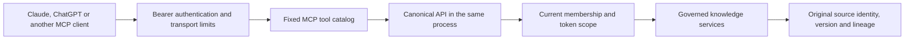

<!-- Copyright 2026 Firefly Software Foundation -->
<!-- SPDX-License-Identifier: Apache-2.0 -->
# Canonical MCP access

The adapter exposes existing koinon operations using the official Python MCP SDK (`mcp` 2.3.0 in the backend lockfile) through the native pyfly JSON transport. Tools, resources, prompts and MCP Apps extension checks share one handler registry at `/mcp`. Modern per-request capability envelopes remain stateless; bounded legacy initialization metadata is shared in the primary repository.



Each tool has an explicit schema and a fixed canonical operation. There is no arbitrary route, URL or HTTP method tool. Fixed API-backed tools use an in-process ASGI request with canonical authentication, authorization, services and error handling. Source-evidence reads invoke the same governed native services in a fresh authenticated task, capture the actual operation once and persist a credential-bound read receipt. No query is replayed to manufacture a receipt. The dispatcher uses a fixed internal authority, excludes browser cookies and client authority headers, follows no redirects and makes no network request. A fresh asynchronous task context isolates nested authentication, request and transaction state from the parent request.

PATs are reauthenticated for every request and canonical operation. MCP OAuth credentials map on the server to an associated private application-purpose credential and durable user authorization; the dedicated MCP resource credential is never forwarded to an unrelated API. The canonical operation rechecks current membership and resource restrictions. Revocation and workspace changes take effect without restarting a session. OAuth authorizations belong to the Authorized applications domain; manually created API tokens remain a separate credential workflow.

| Tool | Canonical operation | Result |
| --- | --- | --- |
| `koinon_context` | `GET /api/v1/context` | Authorized organizations, workspaces and memberships |
| `koinon_list` | Tenant catalog | Filtered, paginated catalog |
| `koinon_search` | Tenant search | Original source and retrieval metadata; answer generation disabled |
| `koinon_fetch` | Catalog entry, document chunks or curated version | Original source/version identity |
| `koinon_dataset_schema` | Dataset schema | Governed table and source identity |
| `koinon_query` | Tenant query | Governed query result, audit and lineage |
| `koinon_answer_audit` | Existing chat run audit | Owner-authorized audit with explicit unknown provenance |
| `koinon_provenance` | Asset lineage or exact table snapshot | Canonical source relationships |
| `koinon_stage_knowledge` | External text review staging | Exact proposal and embedded review; no commit |
| `koinon_prepare_file_upload` | Authorized destination and bounded upload setup | Embedded local file picker; no canonical ingestion |
| `koinon_review_status`, `koinon_approve_knowledge`, `koinon_cancel_knowledge` | Exact credential-bound text review | App-only actions; private nonce and revision/digest checks |
| `koinon_stage_file`, `koinon_file_review_status`, `koinon_upload_file_chunk`, `koinon_seal_file`, `koinon_approve_file`, `koinon_cancel_file` | Private staged file lifecycle | App-only transfer/review/approval; no uncertain-ingestion replay |

Query uses the canonical POST endpoint because execution records its audit and result. Its read-only annotation describes dataset access; execution can have audit and metering side effects. Text and file changes require the embedded MCP Apps review and a private nonce excluded from model-visible content. The model can propose a change or request file selection; only the component can obtain the nonce and call its app-only decision action. External proposals retain unverified authority and the actual submitting account/credential. They are never relabeled as user-authored statements. Document reads return the current canonical extraction with its version IDs; historical reads are exposed only for curated versions supported by the API.

Source text is untrusted content. Server instructions tell clients to preserve source IDs, versions and lineage and keep absent provenance unknown. The adapter returns canonical data without manufacturing citations. Supported search/query/document reads include a sealed `read_receipt`; unsupported, incomplete or oversized manifests explicitly report `not_recorded`. A proposal selects only server-issued receipt IDs; exact source references are copied into immutable intent evidence and revalidated at approval. See [in-chat knowledge management](../guides/mcp-knowledge-management.md) for version, scope, quota and retention behavior.

## Deployment

MCP is disabled by default. Configure its exact public URL for remote access. Without an override, the product derives the local endpoint from the actual native PyFly listener; wildcard listeners become matching loopback addresses and the descriptor marks them `local_only`. Incoming Host and forwarding headers never determine that URL.

```yaml
koinon:
  mcp:
    enabled: true
    public_url: https://knowledge.example.org/mcp
    allowed_hosts: []
    allowed_origins: []
    max_request_bytes: 131072
    max_response_bytes: 2097152
    timeout_seconds: 30
    max_concurrency: 8
    max_sessions: 128
    session_idle_timeout_seconds: 900
```

`public_url` requires HTTPS, except HTTP on loopback for development. Its path must be exactly `/mcp`, without query or fragment. Its authority and origin are trusted automatically. Additional hosts and origins must be explicit, without wildcards. Native clients may omit Origin; an untrusted supplied Origin is rejected. Public URLs and discovery documents come from configuration, never reflected request headers.

The endpoint requires bearer credentials and rejects browser cookies. Generic REST API tokens do not automatically become MCP OAuth credentials. OAuth deployment has separate registration, issuer, resource, PKCE, consent and encryption configuration. The stdio integration forwards the server's contracts instead of maintaining a second tool catalog.

Inputs bound identifiers, questions, SQL length, counts and pagination. The dispatcher bounds response bytes, elapsed time and concurrent operations. Oversized results return a narrowing instruction, never silently truncated evidence. Errors expose a canonical status and bounded code, excluding internal details and credentials.

## Tool authorization and scope upgrades

When OAuth is enabled, each tool declares its required scopes in the official Python SDK's supported `_meta.securitySchemes` field, the documented compatibility mirror for tool authentication policies. Browse, fetch, schema and provenance use `catalog:read`; search additionally uses `knowledge:search`, query uses `query:execute`, and answer audit uses `chat:use`. Text and file management additionally require `catalog:write` and `ingest:write`; supporting document and dataset evidence retains its corresponding read/query requirements.

The initial connection asks for the baseline catalog permission. If an operation requires an additional token scope, the canonical permission service distinguishes that condition from a denied membership, role, workspace, asset boundary or organization-level projection. Only a verified scope-only denial can produce an error result with `_meta["mcp/www_authenticate"]`. The challenge includes the configured protected-resource metadata URL, `insufficient_scope`, a fixed description and the tool's exact required scopes.

The server also checks that the authenticated OAuth client's current configured grant permits every requested scope. Unsupported client grants return an ordinary access denial. PAT-only connections receive ordinary permission errors and require the user to manage their scoped token. An OAuth relink never grants permissions or workspace access beyond the user's current authority, and approval of a particular knowledge change remains a separate embedded review action.

Official SDK tests verify discovery metadata, scope-upgrade error results, a newly consented grant succeeding, and the absence of relink prompts for foreign workspaces, denied roles or unsupported client scopes. This follows the [official OpenAI authentication contract](https://developers.openai.com/plugins/build/auth) and its [documented metadata fields](https://developers.openai.com/plugins/reference). Hosted linking UI acceptance still requires client testing.

## Embedded review boundary

The static resource `ui://koinon/knowledge-review` uses `text/html;profile=mcp-app`. Model-visible stage/prepare tools link to that resource. Decision, status and transfer tools declare `ui.visibility=["app"]`. Tool results carry public proposal content in `structuredContent`; `_meta["koinon/knowledgeReview"]` carries the component-only nonce and optional authorized presentation palette. Branding changes neither tool identity nor permissions.

The host must declare the `io.modelcontextprotocol/ui` extension with the exact `text/html;profile=mcp-app` MIME type and implement its private-metadata and tool-visibility boundary. The server checks this before staging, preparing uploads, issuing a private challenge or applying any app decision. Missing or incompatible capabilities return an actionable error before those operations run. There is no browser approval redirect or model-visible autonomous confirmation endpoint. Account linking may still use the normal OAuth sign-in flow; it is separate from approving repository changes. A host without the review capability can read supported knowledge but cannot complete a change. Protocol/component fixtures do not prove an actual host follows this boundary.

`GET /api/v1/mcp/connection` exposes the trusted deployment URL, permitted server capabilities and configured public OAuth client ID/name/scopes/authentication type. It never returns a client secret or hash and does not grant the current user additional permissions. See the [Claude](../guides/connect-claude.md) and [ChatGPT](../guides/connect-chatgpt.md) guides.

`GET /api/v1/tenants/{tenant_id}/mcp/connection` additionally projects the enabled OAuth registrations belonging to that organization after checking current membership and credential bounds. The account connection panel uses this tenant descriptor. The `mcp_applications` domain owns the organization registry, its DTOs, controllers, native repositories and current-authority service. Registration administration requires an ordinary verified identity and organization `identity:manage`; it is separate from the user's `authorized_applications` grants and from outbound corporate identity providers.

Requests, authorization codes, grants and resource bearers pin the organization's registration revision and configuration digest. Current authority is rechecked before consent, code exchange, bearer authentication and governed operations. A registration change or secret rotation revokes its existing grants and credentials atomically. Static deployment clients retain their existing path and are not silently reassigned to an organization. See [Register an application](../guides/register-applications.md) for the visual and typed SDK workflows.

## Legacy session compatibility and scaling

Legacy clients negotiate MCP Apps through `initialize`. Native pyfly stores only their negotiated protocol, client declarations, credential/resource binding and expiry. Each request reconstructs a fresh SDK connection using that metadata. Native bearer authentication verifies the current credential fingerprint, issuer and subject before lookup; a different credential cannot reuse a session. Every canonical operation still rechecks current permissions. Session IDs and stored capabilities do not replace bearer credentials or permission checks.

The default limit is 128 legacy sessions across instances for the configured MCP resource, with a 900-second idle timeout capped by credential expiry. Modern protocol requests carry their capabilities independently and do not require these sessions. POST operations retain the configured per-instance concurrency limit. Legacy GET returns 405 because this JSON endpoint offers no standalone SSE stream. DELETE removes shared initialization metadata.

Initialize on one instance and continue on another using the same primary database and configured public resource, including after the original instance stops. Missing, expired, incompatible or differently owned session IDs return 404 and require standard reinitialization. Losing metadata does not lose canonical reviews, source receipts, staged bytes or committed knowledge, and never authorizes replaying an uncertain write. Refresh the recorded review/status under the new initialization. The transport provides no response replay, arbitrary MCP Tasks, subscriptions or server-initiated request channel; private approvals retain their existing one-use nonce, revision, digest and current-authority checks.

Apply native migration `koinon_0026_mcp_sessions` before enabling MCP against a validation-only schema. It adds `pyfly_mcp_sessions` and `pyfly_mcp_session_admission` without changing retained knowledge. Production runtime performs no implicit table creation. Keep OAuth envelope keys, public resource configuration and limits consistent across rolling revisions; use the existing deployment role provisioner for the explicit metadata DML grants.

## Verification boundary

Tests exercise official SDK initialization, discovery and calls over in-process Streamable HTTP, response bounds, source identity preservation, path injection and authentication-context isolation. Native application tests cover PAT scope, cross-organization denial, membership changes and revocation. These tests do not establish hosted Claude or ChatGPT connector acceptance, deployed reverse-proxy behavior or live model-provider acceptance.

The transport follows the [official Python SDK](https://github.com/modelcontextprotocol/python-sdk). The explicit credential and trust boundaries follow the [MCP security guidance](https://modelcontextprotocol.io/docs/2026-07-28/tutorials/security/security_best_practices).
