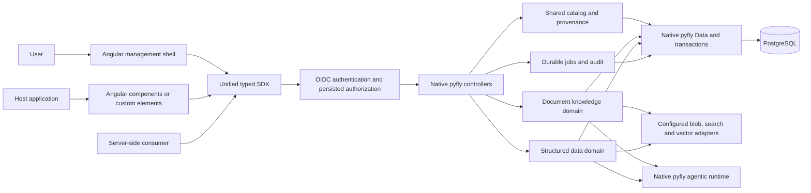
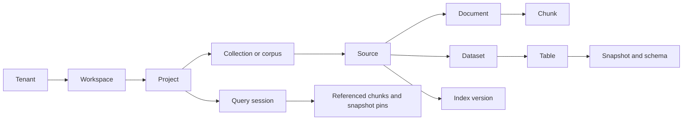

# How koinon fits together

Koinon has one application boundary and one native pyfly application context. The management application, embedded components and SDK call the same authorized API. Embedding a component does not embed a database, start a second backend or grant access to a tenant.

## Reference deployment

Deploy the API and its documented worker process against shared PostgreSQL and
explicit persistent object storage. Serve the optional management application
through the public HTTPS edge. SDK clients call the same API; they do not run
another backend or receive direct database access. This topology uses no
cloud-specific service names.

<figure>
  
  <figcaption>Deployment dependencies, not a claim of provider availability. Each process owns its own native pyfly context. <a href="../../assets/reference-architecture.svg">Open the full-size diagram</a>.</figcaption>
</figure>

| Boundary | What belongs there |
|---|---|
| Public HTTPS edge | Route the browser application, API, sign-in/callback and MCP/discovery paths to their correct destinations; preserve streaming. |
| API process | Authenticate requests, check current persisted authority and run scoped domain operations. A UI or client-selected resource ID grants no access. |
| Worker process | Consume all enabled queues and scheduled maintenance, enforce current admission and lease fences, and execute bounded model/tool work. It needs the same recorded storage and identity configuration. |
| PostgreSQL | Operational catalog, authorization, sessions, jobs, conversations and provenance. Document and structured runtime/control roles remain explicit and distinct. |
| Object storage | Original files, processed artifacts and private attachments through three configured profiles. A pod or container's writable layer is not a shared durable store. |
| Approved external services | Operator-admitted model/embedding endpoints and source connectors; use explicit credentials and egress policy. |
| Operations services | Protected encryption keys, backups and a configured telemetry collector. Telemetry must exclude prompts, tokens, credentials and source payloads by default. |

The shared dependencies are logical boundaries: use the same PostgreSQL service
with separate roles where appropriate, or separate databases when your operation
requires it. The diagram does not require Kubernetes, a particular identity
provider or a cloud. Local development may keep processes on one host; production
replicas need shared persistent services and independent lifecycle supervision.

### Process roles and release boundaries

Run the API with `python -m koinon.serve` and the complete background process
with `python -m koinon.worker`. Select the process role explicitly with
`KOINON_PROCESS_ROLE=api` or `KOINON_PROCESS_ROLE=worker`, or the corresponding
`koinon.process.role` setting. The default is `api`; unknown roles fail startup.

The API exposes HTTP and registers no automatic schedules. The worker opens no
HTTP listener, controllers or MCP session transport; it owns all enabled queues
and maintenance. Each process builds its own native pyfly context from the
installation's reviewed configuration. The older
`koinon.assistants.worker` and `koinon.knowledge.indexes.worker` entry points
delegate to this complete worker role; they are not independent partial workers.

Do not infer worker consumption from API readiness. Size connection budgets for
every process and rolling overlap, and check each enabled queue and maintenance
operation under the selected deployment settings. See
[operator configuration](../operations/configuration.md).

### Scaling and persistent authority

Use bounded API concurrency, worker concurrency and database pools. Adding
replicas does not increase database capacity. A worker claim and its lease are
not authorization: operations still check current persisted membership, resource
ancestry and recorded policy. Primary-authoritative security reads must not
observe a lagging read replica.

Share storage and the installation's encryption/session configuration across
replicas. A database backup alone cannot recover encrypted credentials without
their keys, or files held outside the database. Verify restore and process
replacement with the selected storage backend.

MCP transport initialization and capability state have their own release-specific
portability requirements; consult [MCP architecture](../architecture/mcp.md)
before distributing requests across replicas. Shared browser sessions do not
prove MCP transport state or in-memory work is portable. Readiness, provider
connectivity, job consumption and telemetry export are separate observations.

Start with [installation](../operations/installation.md), then follow the
ordered [first-start guide](../operations/first-start.md).

## Logical service graph

The document and structured knowledge packages preserve established domain behavior, measured against retained regression suites and integrated acceptance checks. The product control plane owns shared identity, membership, catalog ancestry and the product API. Both domains must borrow native Data resources and the context-owned agent factory; they must not start an independent agent runtime or container.

## Application composition

Pyfly owns application startup, dependency resolution, transactions and shutdown. Configuration classes declare beans, and controllers receive application services through constructor injection. HTTP requests, background operations and headless calls use the same managed domain services. A controller does not create a second service graph for an SDK or worker.

Keep each feature's responsibilities separate:

| Layer | Responsibility | Boundary |
| --- | --- | --- |
| DTOs | Describe accepted inputs and returned values. | No database or transport initialization. |
| Mappers | Convert recorded domain values into public representations. | No queries, authorization decisions or network calls. |
| Repositories | Perform scoped persistence operations. | Borrow named pyfly datasource resources and join the native transaction. |
| Services | Apply authorization, policies and domain workflows. | Depend on repository or domain ports rather than controller internals. |
| Controllers | Bind and validate requests, then select the HTTP or SSE response. | Delegate domain work to injected services. |
| Configuration | Bind deployment settings and declare managed dependencies. | Resource ownership stays with the application context. |

The immutable document-history feature provides an example in `backend/src/koinon/knowledge/document_history/`: DTOs, mappers, repository operations, the domain port, service, controller and bean configuration have separate modules. Its service checks current access both before and after a historical read. A saved version identifier never grants permission by itself.

Structured queries use `StructuredQueryRuntimeFactory.unit()` for operation-scoped composition. The factory borrows named sessions, enters pyfly's transaction infrastructure and keeps model bindings and streaming resources alive for the operation. Both HTTP and headless consumers use this boundary. Pure values and session-bound helpers may be created inside that operation; they do not own independent connection pools or application contexts.

Named datasource registries own database engines and session factories. Compatibility repository constructors require the application-owned registry and verify that the supplied URL matches the selected datasource. They cannot open a pool or silently fall back to the primary database. Runtime and administrative resources remain distinct when their configured bindings differ.

Cloud transports also have explicit owners. Shutdown drains admitted operations and closes owned clients and credentials through pyfly lifecycle hooks. A caller that supplies a borrowed client retains responsibility for closing it. Changing a storage configuration does not transfer or delete previously recorded files.

Original files, processed artifacts and private conversation attachments use explicitly configured local or remote object-storage adapters. The independent storage package owns remote transport across domain ports. Blob storage does not replace PostgreSQL metadata or authorization. Existing data stays bound to its recorded storage identity; changing a profile is a separately planned migration. See [file persistence](../operations/storage.md).

A source is distinct from its assets. One source may yield a document and a dataset. A document contains chunks with original section/page references. A dataset contains tables and immutable snapshots with schema and query provenance. A shared catalog identifier maps explicitly to the original domain identifier. Equal names never imply equal identities.

Knowledge operations validate persisted membership and complete resource ancestry before calling a domain service. Selecting a tenant or workspace in a URL, header, component input or SDK call does not grant a privilege. A query's referenced datasets and tables must belong to the authorized context before execution.

Operational state lives in PostgreSQL. Vector extensions are provider choices, not a substitute for operational persistence. `pgvector` and `pg_vectorsearch` are distinct providers with different extension, type, index and parameter contracts. Enabling one must never silently select the other. A configured provider is reported separately from a qualified live connection.
