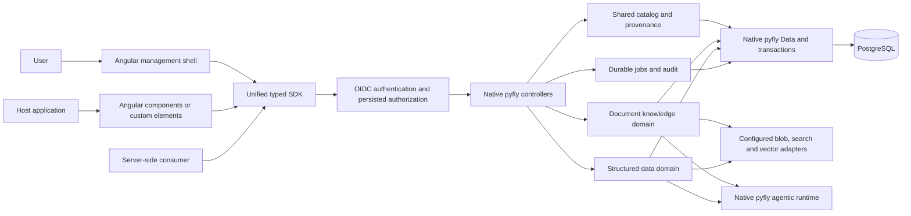
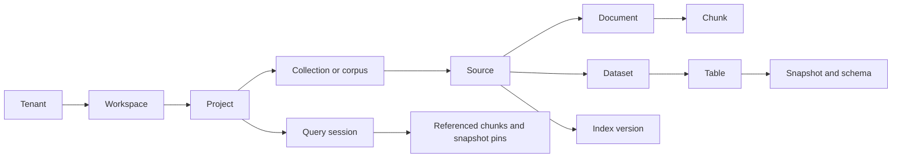

# How koinon fits together

Koinon has one application boundary and one native pyfly application context. The management application, embedded components and SDK call the same authorized API. Embedding a component does not embed a database, start a second backend or grant access to a tenant.

The document and structured knowledge packages preserve established domain behavior, measured against retained regression suites and integrated acceptance checks. The product control plane owns shared identity, membership, catalog ancestry and the product API. Both domains must borrow native Data resources and the context-owned agent factory; they must not start an independent agent runtime or container.

## Application composition

Pyfly owns application startup, dependency resolution, transactions and shutdown. Configuration classes declare beans, and controllers receive application services through constructor injection. HTTP requests, background operations and headless calls use the same managed domain services. A controller does not create a second service graph for an SDK or worker.

Keep each feature's responsibilities separate:

| Layer | Responsibility | Boundary |
| --- | --- | --- |
| DTOs | Describe accepted inputs and returned values. | No database or transport initialization. |
| Mappers | Convert recorded domain values into public representations. | No queries, authorization decisions or network calls. |
| Repositories | Perform scoped persistence operations. | Borrow named pyfly datasource resources and join the native transaction. |
| Services | Apply authorization, policies and domain workflows. | Depend on repository or domain ports rather than controller internals. |
| Controllers | Bind and validate requests, then select the HTTP or SSE response. | Delegate domain work to injected services. |
| Configuration | Bind deployment settings and declare managed dependencies. | Resource ownership stays with the application context. |

The immutable document-history feature provides an example in `backend/src/koinon/knowledge/document_history/`: DTOs, mappers, repository operations, the domain port, service, controller and bean configuration have separate modules. Its service checks current access both before and after a historical read. A saved version identifier never grants permission by itself.

Structured queries use `StructuredQueryRuntimeFactory.unit()` for operation-scoped composition. The factory borrows named sessions, enters pyfly's transaction infrastructure and keeps model bindings and streaming resources alive for the operation. Both HTTP and headless consumers use this boundary. Pure values and session-bound helpers may be created inside that operation; they do not own independent connection pools or application contexts.

Named datasource registries own database engines and session factories. Compatibility repository constructors require the application-owned registry and verify that the supplied URL matches the selected datasource. They cannot open a pool or silently fall back to the primary database. Runtime and administrative resources remain distinct when their configured bindings differ.

Cloud transports also have explicit owners. Shutdown drains admitted operations and closes owned clients and credentials through pyfly lifecycle hooks. A caller that supplies a borrowed client retains responsibility for closing it. Changing a storage configuration does not transfer or delete previously recorded files.

Original files, processed artifacts and private conversation attachments use explicitly configured local, S3, Azure Blob Storage or Google Cloud Storage adapters. The independent storage package shares Azure/GCS transport across domain ports. Blob storage does not replace PostgreSQL metadata or authorization. Existing data stays bound to its recorded storage identity; changing a profile is a separately planned migration. See [file persistence](../operations/storage.md).

A source is distinct from its assets. One source may yield a document and a dataset. A document contains chunks with original section/page references. A dataset contains tables and immutable snapshots with schema and query provenance. A shared catalog identifier maps explicitly to the original domain identifier. Equal names never imply equal identities.

Knowledge operations validate persisted membership and complete resource ancestry before calling a domain service. Selecting a tenant or workspace in a URL, header, component input or SDK call does not grant a privilege. A query's referenced datasets and tables must belong to the authorized context before execution.

Operational state lives in PostgreSQL. Vector extensions are provider choices, not a substitute for operational persistence. `pgvector` and `pg_vectorsearch` are distinct providers with different extension, type, index and parameter contracts. Enabling one must never silently select the other. A configured provider is reported separately from a qualified live connection.
