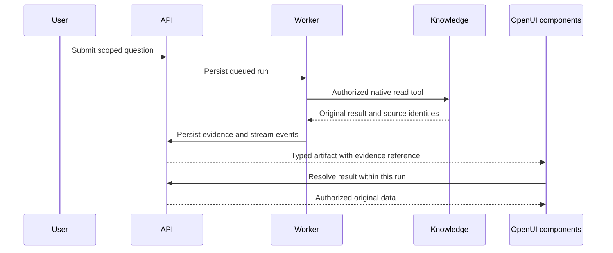

# Ask questions and inspect evidence

An agent combines a configured model, allowed read tools and a knowledge scope. The same API serves the management application, embedded components and headless consumers.

Choose an available agent and the folder or items relevant to the question. Review its setup checks before starting. An agent cannot grant access: every tool checks current persisted permissions and source ancestry. Dataset queries require query permission as well as read access.

## Durable conversations

Threads belong to their authenticated owner and organization. Messages, run state, stream events and evidence references persist in PostgreSQL. A request identifier protects repeated submission of the same message. Each thread accepts one queued or running answer at a time.

A worker leases a run, checks agent/provider revisions and invokes the native agent factory. It renews the lease during execution. A stopped worker can be recovered after lease expiry; exhausted recovery becomes an explicit failure. Cancel revokes run ownership, so a stale worker cannot append more visible text. Closing a browser tab or stream alone does not cancel generation.

Retry resets the affected partial answer and emits `message_reset`. Consumers replace that message's partial text and artifacts. Earlier completed messages remain independent. A run receives history only from matching knowledge scopes; narrowing a question must not carry broader evidence into its model context. Prior evidence is reauthorized before reuse.

The Chat sidebar separates recent unfiled conversations from expandable folders. Use **New** to start a draft, search across the current space, or choose a folder before starting. Folder actions create, rename or remove groups; removing a group preserves its conversations. Moving a conversation changes its organization, not its knowledge scope. Archived conversations remain available through **Conversation options**.

Conversation titles can be edited. When a title suggestion is available, review it before saving; a revision conflict requires reloading the current title. The sidebar chevron hides history while keeping the conversation and composer available. Mobile history opens as a focus-managed drawer.

## Private files in chat

Use the composer's **+** menu, drag files onto the composer, or paste an image when the selected agent supports images. Available formats and size limits come from the deployment capability response. The composer shows each file's upload and reading state, and permits sending only after the selected files are ready. Images require a model with verified image input support; text extraction does not imply OCR support.

Files belong to their authenticated owner and conversation. Uploading does not publish a file to the organization Library. Each message sends an explicit ordered selection of file IDs. Removing a selected file deletes its private original; leaving the conversation clears the editor selection without publishing its files. Expired or deleted originals cannot be reused for a new answer. Saved owner-visible messages retain safe file metadata and identify files that are no longer available.

Private-file runs currently expose the private-file retrieval tool. A new combined query across private files and organizational datasets requires a separate execution path; private content must not enter shared query history. Use the Library upload flow to publish knowledge intentionally, with the destination and required write permissions.

## Tool activity

Open **Audit** below an answer to inspect the tools invoked, their queued/running/final status and a short result summary, including after reopening the conversation. Longer histories are paged from the server. Select a recorded tool result to inspect its typed evidence; a query result includes the recorded SQL and whether execution completed or was blocked. This is a read of saved execution data. Tool credentials and internal reasoning are excluded. Retrying an answer resets its activity to the current attempt.

## Dynamic evidence with OpenUI

Koinon uses the native Angular OpenUI renderer with Firefly components. `KnowledgeAnswer` is the registered root; `Evidence` resolves a server result inside the trusted run context. Search results, tables, schemas, lineage and citations use their actual result type.

The interface renders each canonical result once. Legacy layout hints are normalized before rendering; a request for both a table and a chart of the same result becomes one card. Query results open as a table. Choose **Chart** to inspect the same returned rows when they contain a finite numeric series and at most 100 rows. Switching views does not run another query or change the downloaded values. Exact numeric strings remain strings rather than being coerced into a potentially inaccurate chart.

Use **Audit** below an answer to open its provenance sidebar. Sources, dataset schemas, lineage and tool execution details belong there rather than appearing as cards in the conversation. Recorded query results expose the SQL actually executed, returned-row limits and available snapshot information. Opening this evidence does not execute the SQL again. Missing revisions or incomplete evidence remain explicit; the panel does not infer a confidence score from tool success.

**Overview** summarizes the recorded outcome and evidence coverage. **Sources** lists the documents, data and retrieved passages, with their recorded identity and version information. **Execution** shows paged tool activity; select a result to inspect its SQL or other typed evidence. SQL appears before the optional returned-data preview, keeping the execution record separate from the conversation's primary result.

The execution engine, database and registered tables describe where a statement ran. Dataset and snapshot identities describe the data it read. A separately recorded origin identifies an imported file, workbook sheet or source database connection. These fields keep DuckDB execution over an imported snapshot distinct from the system that originally supplied the data. Unrecorded origin fields remain unknown; current connection settings cannot establish a historical origin.

Canonical structured intake accepts uploaded files. The immutable [table provenance API](lineage.md) records original bytes, source sections and transformations for newly recorded snapshots. It requires the exact snapshot identifier and does not fill missing historical origins from current metadata. Its declared coverage is file and section; row/cell mappings and external ingestion-database connections require separate qualification. Model-provider connections do not identify an ingestion database. See [qualification](../operations/qualification.md) for runtime acceptance status.

SQL highlighting preserves the recorded statement exactly and renders it as text. The copy action copies that same statement. Document evidence uses the corresponding source identity, passage or page and recorded fingerprint. A passage fingerprint identifies the retrieved text; a whole-file revision is shown only when it was recorded.

## Read the audit without the frontend

The same owner audit is available through the authenticated SDK. The response contains typed generation, source, private-file, native-read and SQL-attempt receipts. Reading it checks current and originating authority; it does not call a model or rerun a query.

```python
audit = await client.run_audit(tenant_id, run_id)
```

```typescript
const audit = await client.chat.audit(tenantId, runId);
```

```java
var audit = client.chat(tenantId).audit(runId);
```

Distinct queries retain separate result identities even when their returned rows happen to match. Headless consumers receive the original typed evidence; this display policy belongs to the frontend.



The model cannot supply executable HTML, JavaScript, arbitrary fetch destinations or mutation actions. Business values come from stored tool results. Source badges resolve against returned evidence; unverified source references fail validation.

## Configure an agent

An operator saves a provider address, credential when required and model identifiers. Validation checks the actual endpoint and available models. Saving configuration does not establish connectivity. Discovering a model does not verify its chat, streaming or tool support. Unverified capabilities remain explicit, even when an operator can start a trial. A change invalidates the previous validation revision.

The agent chooses one provider/model, supported tools and an optional scope. Instructions guide tone and domain behavior but cannot expand permissions or add unsupported tools. Changing configuration during a run stops that answer instead of silently switching models or scope.

Actual local connectivity and generation have been observed with a native PostgreSQL context. That is separate from answer quality, complete document/dataset grounding, frontend acceptance and live cloud-provider qualification. See [qualification](../operations/qualification.md).
