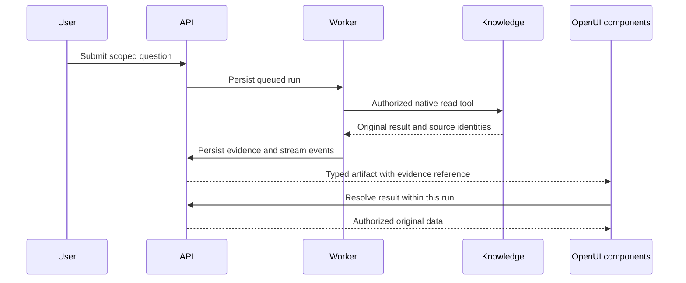

# Ask questions and inspect evidence

An agent combines a configured model, allowed read tools and a knowledge scope. The same API serves the management application, embedded components and headless consumers.

Choose a ready agent and the folder or items relevant to the question. An agent cannot grant access: every tool checks current persisted permissions and source ancestry. Dataset queries require query permission as well as read access.

## Durable conversations

Threads belong to their authenticated owner and organization. Messages, run state, stream events and evidence references persist in PostgreSQL. A request identifier protects repeated submission of the same message. Each thread accepts one queued or running answer at a time.

A worker leases a run, checks agent/provider revisions and invokes the native agent factory. It renews the lease during execution. A stopped worker can be recovered after lease expiry; exhausted recovery becomes an explicit failure. Cancel revokes run ownership, so a stale worker cannot append more visible text. Closing a browser tab or stream alone does not cancel generation.

Retry resets the affected partial answer and emits `message_reset`. Consumers replace that message's partial text and artifacts. Earlier completed messages remain independent. A run receives history only from matching knowledge scopes; narrowing a question must not carry broader evidence into its model context. Prior evidence is reauthorized before reuse.

## Dynamic evidence with OpenUI

Koinon uses the native Angular OpenUI renderer with Firefly components. `KnowledgeAnswer` is the registered root; `Evidence` resolves a server result inside the trusted run context. Search results, tables, schemas, lineage and citations use their actual result type.

The model cannot supply executable HTML, JavaScript, arbitrary fetch destinations or mutation actions. Business values come from stored tool results. Source badges resolve against returned evidence; unverified source references fail validation.

## Configure an agent

An operator saves a provider address, credential when required and model identifiers. Validation checks the actual endpoint and available models. Saving configuration does not establish connectivity. A change invalidates the previous validation revision.

The agent chooses one provider/model, supported tools and an optional scope. Instructions guide tone and domain behavior but cannot expand permissions or add unsupported tools. Changing configuration during a run stops that answer instead of silently switching models or scope.

Actual local connectivity and generation have been observed with a native PostgreSQL context. That is separate from answer quality, complete document/dataset grounding, frontend acceptance and live cloud-provider qualification. See [qualification](../operations/qualification.md).
