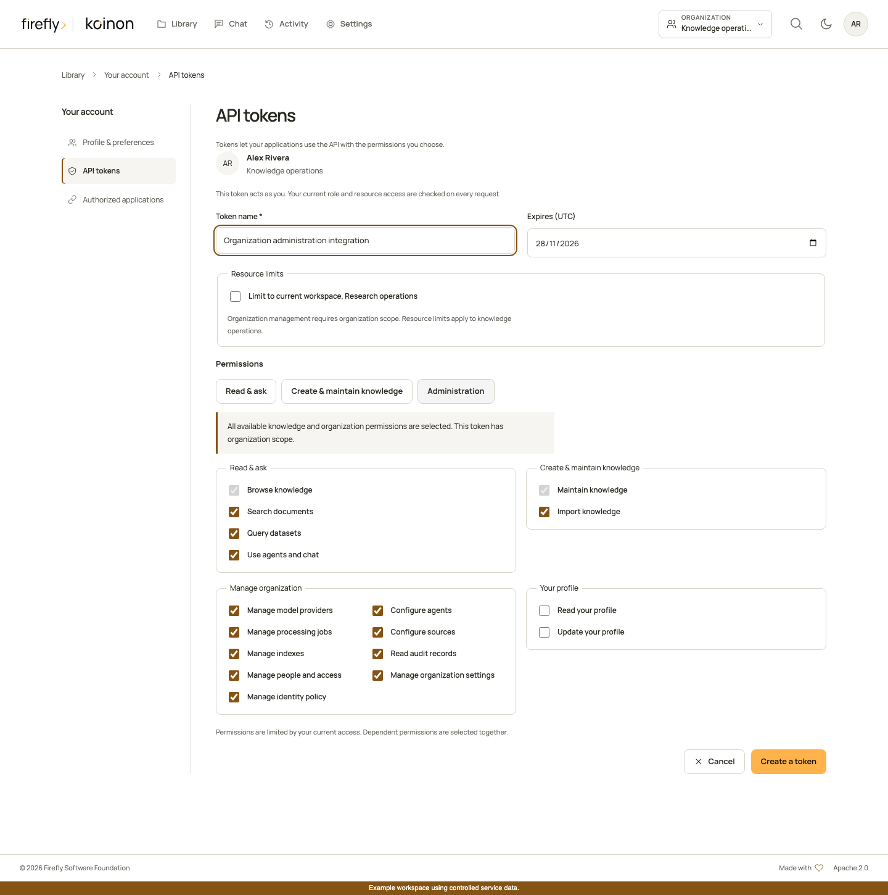

<!-- Copyright 2026 Firefly Software Foundation -->
<!-- SPDX-License-Identifier: Apache-2.0 -->
# Create and manage knowledge with API tokens

A personal API token can write as well as read. Its effective authority is the intersection of the selected scopes, the user's **current** organization and workspace permissions, and its saved resource bounds. The SDKs call the same authorized endpoints as the interface.

## Choose access for the integration

Open your profile menu, choose **API tokens**, select the organization, and create a token with a name and expiration. Choose the narrowest scopes and destination that fit the integration. Copy the secret once into your application's secret store; the list shows metadata afterward.

[](../assets/screenshots/scoped-token-setup.png)

For an organization administration integration, select organization scope and the specific management permissions. An administrator's token does not receive every permission automatically.

[](../assets/screenshots/organization-token-setup.png)

These interface screenshots use controlled review data. They do not contain a usable token or establish a connection to an external identity or model provider.

| Purpose | Scopes | Resource bounds |
| --- | --- | --- |
| Browse and inspect knowledge | `catalog:read` | Organization, selected workspaces, or selected supported assets |
| Search, SQL, or chat | `knowledge:search`, `query:execute`, `chat:use`, as needed | Same admitted knowledge scope; each adds `catalog:read` |
| Create, rename, archive, restore, or remove catalog entries | `catalog:write` | Organization or selected workspaces, subject to hierarchy and existing-resource checks |
| Upload or update source content | `ingest:write` | Admitted destination and current write permissions; adds `catalog:read` and `catalog:write` |
| Export, share, or inspect evidence | `exports:read`, `exports:write`, `shares:read`, `shares:write`, `evidence:read`, as needed | Same knowledge and conversation-owner checks as the interface |
| Configure providers and agents | `providers:write`, `agents:write` | Organization scope |
| Manage source connections, indexes, or durable jobs | `sources:configure`, `indexes:manage`, `jobs:manage`, as needed | Organization scope; job resources must also be readable |
| Read organization activity | `audit:read` | Organization scope |
| Manage members, organization settings, or corporate identity | `members:write`, `settings:write`, `identity:manage`, as needed | Organization scope |
| Read or edit the token owner's profile | `profile:read`, `profile:write` | The authenticated user only; editing adds `profile:read` |

The token form obtains available scopes from the API for the selected organization and workspace. Dependencies are included in the issued receipt. `exports:write` also adds `exports:read` and `catalog:read`; `shares:write` adds `shares:read`, `chat:use` and `catalog:read`. Management scopes cannot be combined with workspace or asset restrictions to disguise an organization-wide operation as a resource-limited grant.

Asset bounds admit selected documents, datasets or curated knowledge items and their necessary catalog ancestry. They do not grant arbitrary new upload destinations or access to sibling resources. Use a workspace-bound token for an ingestion integration that must create new knowledge.

## Match the current role

| Current role | Knowledge and management capabilities before token restrictions |
| --- | --- |
| Viewer | Browse, search, chat, reviewed exports, sharing and evidence |
| Analyst | Viewer capabilities plus read-only SQL queries |
| Editor | Analyst capabilities plus catalog and ingestion writes |
| Operator | Editor capabilities plus provider, agent, source, index, job and audit operations |
| Administrator | Operator capabilities plus member, organization-settings and corporate-identity management |

Workspace membership still limits where a capability applies. Issuance cannot exceed current permissions; authentication and service authorization recheck them afterward. Downgrading a user's role removes the corresponding authority from existing tokens. Revocation and expiry prevent further authentication. An in-flight operation may have its own commit-time authorization and revision checks; never treat a successful earlier request as a permanent grant.

Personal token creation, listing and revocation require a verified interactive identity. A personal token cannot create or manage other tokens. For a connected client that needs an authorization flow, use [authorized applications](authorized-applications.md), with explicit user consent, rather than passing around another user's personal secret.

OAuth application registration is also an identity-only administration operation. Its [typed SDK methods](register-applications.md#use-the-typed-sdks) require an ordinary verified administrator identity and organization-level `identity:manage`; personal tokens and application credentials cannot list, create, edit or rotate registrations. Current organization members can read the safe connection descriptor without receiving secrets or additional permissions.

## Write through the SDK

The following helpers deliberately perform writes only when called. They create a project and collection within an **existing authorized workspace**, rename the collection, and upload one file into that destination. Pass the client initialized in the [headless guide](headless.md); provide a workspace-scoped `ingest:write` token and an ordinary input file of at most 32 MiB. The server enforces its own limits and configured extractors.

Use `document` for unstructured content or `dataset` for structured content. Select an intake format supported by the deployment; the SDK preserves the uploaded bytes. See [storage and bulk boundaries](../operations/storage.md#bulk-work-remains-separate) before implementing multi-file imports.

### Python

```python
from pathlib import Path
from koinon_sdk import KoinonClient, ProviderInput

async def upload_knowledge(client: KoinonClient, tenant: str, workspace: str, file: Path):
    if not file.is_file() or not 0 < file.stat().st_size <= 32 * 1024 * 1024:
        raise ValueError("Choose a nonempty regular file up to 32 MiB")
    project = await client.create(tenant, kind="project", name="Operations", parent_id=workspace)
    collection = await client.create(tenant, kind="collection", name="Policies", parent_id=project.id)
    await client.update(tenant, collection.id, name="Approved policies")
    return await client.upload(tenant, filename=file.name, content=file.read_bytes(),
        parent_id=collection.id, workspace_id=workspace, project_id=project.id, mode="document")

async def rename_provider(client: KoinonClient, tenant: str, provider_id: str):
    return await client.update_provider(tenant, provider_id, ProviderInput(name="Organization model"))
```

### TypeScript

```ts
import {KoinonClient} from '@fireflyframework/koinon-sdk';

export async function uploadKnowledge(client: KoinonClient, tenant: string,
    workspace: string, file: File) {
  if (file.size === 0 || file.size > 32 * 1024 * 1024) {
    throw new Error('Choose a nonempty file up to 32 MiB');
  }
  const project = await client.catalog.create(tenant,
    {kind: 'project', name: 'Operations', parent_id: workspace});
  const collection = await client.catalog.create(tenant,
    {kind: 'collection', name: 'Policies', parent_id: project.id});
  await client.catalog.update(tenant, collection.id, {name: 'Approved policies'});
  return client.sources.uploadFile(tenant, {file, filename: file.name,
    workspace_id: workspace, project_id: project.id, parent_id: collection.id, mode: 'document'});
}

export async function renameProvider(client: KoinonClient, tenant: string, providerId: string) {
  return client.providers.update(tenant, providerId, {name: 'Organization model'});
}
```

### Java

```java
import java.io.IOException;
import java.nio.file.Files;
import java.nio.file.Path;
import org.fireflyframework.koinon.sdk.KoinonClient;
import org.fireflyframework.koinon.sdk.model.*;

public final class WriteKnowledge {
    public static UploadResponse upload(KoinonClient client, String tenant,
            String workspace, Path file) throws IOException {
        if (!Files.isRegularFile(file) || Files.size(file) == 0 || Files.size(file) > 32L * 1024 * 1024) {
            throw new IllegalArgumentException("Choose a nonempty regular file up to 32 MiB");
        }
        var project = client.catalog(tenant).create(CatalogCreate.empty()
            .withKind("project").withName("Operations").withParentId(workspace));
        var collection = client.catalog(tenant).create(CatalogCreate.empty()
            .withKind("collection").withName("Policies").withParentId(project.id()));
        client.catalog(tenant).update(collection.id(), CatalogUpdate.empty().withName("Approved policies"));
        return client.sources(tenant).upload(new SourceUpload(file, "application/octet-stream",
            workspace, project.id(), collection.id(), UploadMode.DOCUMENT));
    }

    public static ModelProvider renameProvider(KoinonClient client, String tenant, String providerId) {
        return client.providers(tenant).update(providerId, ProviderInput.empty().withName("Organization model"));
    }
}
```

The separate provider helper needs an organization-scoped `providers:write` token and a current operator or administrator role. It updates an existing provider's display name without a connectivity test or model call. Omitted credentials retain the saved value; explicit null clears it. Keep model credentials in the server's supported secret configuration.

Other administration methods use the same clients: Python `create_agent`, `update_organization_chat_settings` and `update_member`; TypeScript `agents.create`, `organizationChat.update` and `members.update`; Java `agents(tenant).create`, `organizationChat(tenant).update` and `members(tenant).update`. Consult the [generated method reference](../reference/sdk-api.md) for their exact typed request records and revision fields. Jobs use Python `cancel_job`, TypeScript `jobs.cancel` or Java `jobs(tenant).cancel`; cancellation requires access to the job resource and `jobs:manage`, or the existing ingestion-write permission for a compatible resource-scoped workflow.

## Handle outcomes explicitly

Store the upload response: it identifies the canonical source and admitted document or dataset. The source metadata records the uploader and input hash. Catalog changes record the current actor; do not substitute a client-supplied display name for authenticated attribution.

A request can fail even after an earlier read succeeded. Handle `401` by requiring a valid, unexpired credential; handle `403` by checking the current role, token scope and selected destination. Revision conflicts require fetching and reviewing current state. The clients do not retry writes automatically. After an ambiguous timeout, inspect the destination and operation state before submitting again.

These examples are separate writes, with no transaction spanning project creation and file ingestion. A later failure does not roll back earlier accepted requests. Review partial results before retrying. For controlled release evidence, native HTTP authorization, real extraction/storage acceptance, model generation and published SDK packages are qualified separately.
