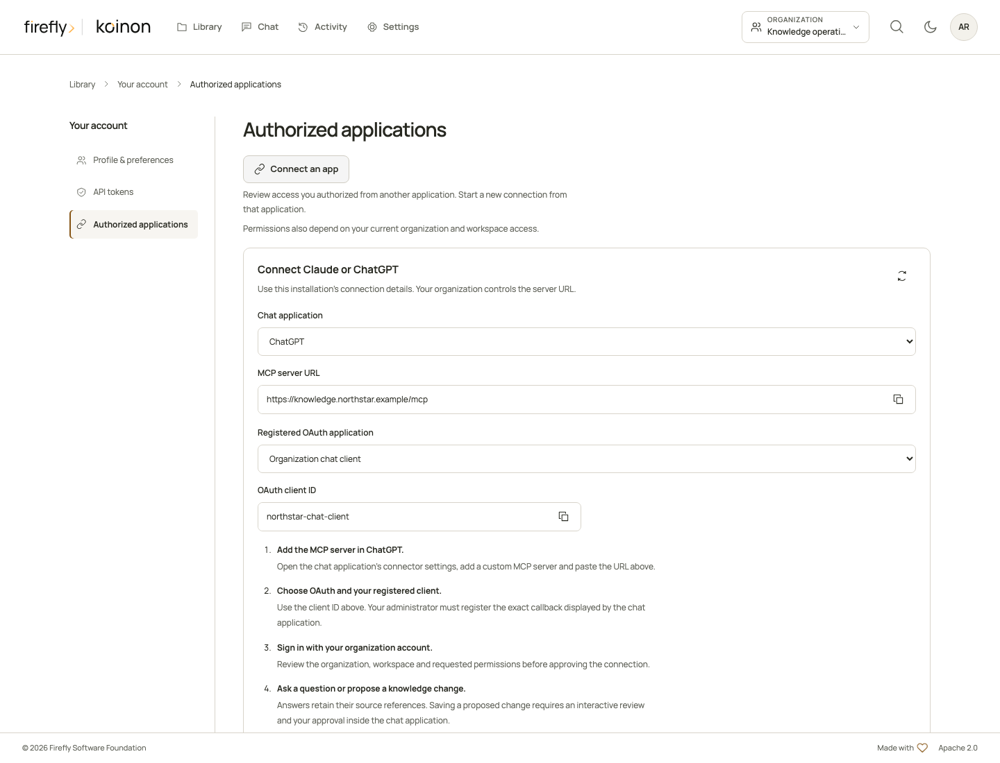
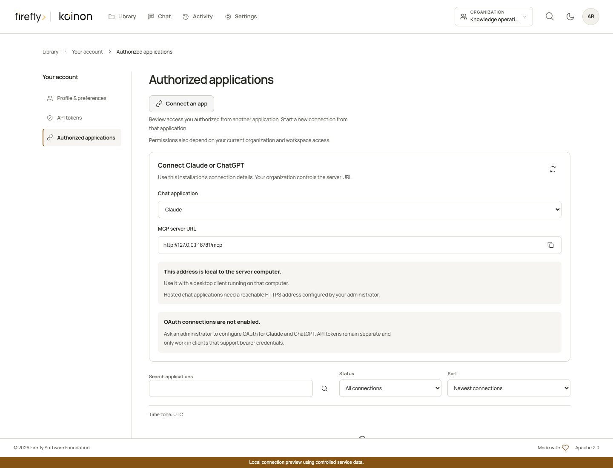

<!-- Copyright 2026 Firefly Software Foundation -->
<!-- SPDX-License-Identifier: Apache-2.0 -->
# Authorized applications

Use **Authorized applications** in your account to review applications connected through OAuth. Each connection records the application, organization, space, permissions and expiry you approved. No access token is displayed or copied from this page.

| Concept | Managed by | Purpose |
| --- | --- | --- |
| Registered application | Deployment operator | Identifies a client, its exact callback URLs and the permissions it may request |
| Authorized connection | The signed-in user | Grants that application access to one selected space, within the user's current permissions |
| API token | The signed-in user | Supplies an explicitly scoped credential to a script, SDK or client configured manually |

An application registration does not grant access to anyone's knowledge. A user's approval does not increase their organization role or give an application access to another space.

## Connect an application

Open **Authorized applications** in your account and select **Connect an app** to see this installation's MCP URL and registered OAuth client IDs. Select Claude or ChatGPT to follow the matching setup steps. The endpoint comes from your deployment configuration; it is not a fixed koinon service address. Client IDs identify an application and are safe to copy; confidential client secrets must come from the deployment operator through a protected channel.

*The actual account interface using controlled service responses and example deployment details. Real client account linking is qualified separately.*

A local installation displays its local MCP address and explains which clients can reach it. A desktop client on the server computer can use that address. Hosted chat applications need a reachable HTTPS address supplied by your deployment operator. See [MCP configuration](../operations/mcp-authentication.md) for startup settings and reverse-proxy deployment.

*The connection panel in a local interface test with controlled service data. This image does not establish a connection from a hosted chat application.*

Start the connection in a client configured for your koinon MCP endpoint. Sign in through your organization's identity provider. The consent screen shows your stored profile, account and avatar so you can check which identity is authorizing access.

Choose an organization and space, read the requested permissions, then select **Connect**. **Cancel** returns a denial to the registered client and creates no credential. Knowledge changes still require the separate exact-content authorization workflow; connecting an application never supplies that consent. Use the [in-chat review](mcp-knowledge-management.md) to inspect and approve a proposal without leaving Claude or ChatGPT.

The server consumes the short-lived authorization code, creates the private application credential and records the connection in one transaction. A failed issuance leaves no partial connection or consumed code. The client receives a credential bound to that application, the configured MCP resource and the recorded authorization.

## Review and disconnect

Open your avatar menu and choose **Authorized applications**. The account page keeps **Profile & preferences**, **API tokens** and **Authorized applications** together in its own navigation. In the standalone management app, `/account/applications` also opens this page directly. Embedded components leave routing to their host product.

Search by application, filter by lifecycle status and sort or page through the results. Select **Review permissions** to expand a connection's permissions and activity below its row. Connection and expiry times use your profile's time zone, shown above the list. Last activity is updated at most once every five minutes; an empty value means no use has been recorded.

**Active** describes the authorization's lifecycle. Every operation still checks current membership, roles, resource restrictions and the application's registration. Losing workspace access prevents the next governed operation even when the authorization has not expired.

Select **Revoke access** and confirm the connection you want to remove. Select **Keep access** to cancel and return to that connection. Revocation disables its credentials immediately. Removing a connector only in the external client does not notify koinon; revoke it here as well. Revoked and expired connections remain available as history.

Connecting the same application to the same space again creates a new authorization and atomically revokes its previous active connection. The new grant contains exactly the newly approved permissions. Permissions are never silently combined, and connections to other spaces or applications are unaffected. If creating the replacement fails, the previous connection remains intact.

## Expiry and API tokens

This release does not issue OAuth refresh tokens. When a connection expires, reconnect from the client and approve its requested access again. No permission is renewed or widened in the background.

Keep manually created credentials under **API tokens**. A desktop bridge configured with a personal token follows that token's restrictions and expiry; it is not represented as an OAuth-authorized application. Application credentials cannot be copied into the general API, used as ordinary personal tokens or managed through the personal-token endpoints.

The Python, TypeScript and Java SDKs expose typed list, detail and revoke methods for authorized applications. These are personal account operations and require a verified interactive user identity. A personal token or application credential cannot manage authorizations, and there is no SDK shortcut that approves browser consent.

Operators configure registration, resource URLs and encryption under [MCP authentication](../operations/mcp-authentication.md). Protocol and interface tests use owned fixtures; actual hosted-client linking, identity-provider login and deployment acceptance remain separate qualification steps.

Copyright 2026 Firefly Software Foundation. Licensed under Apache-2.0. Made with <3.
