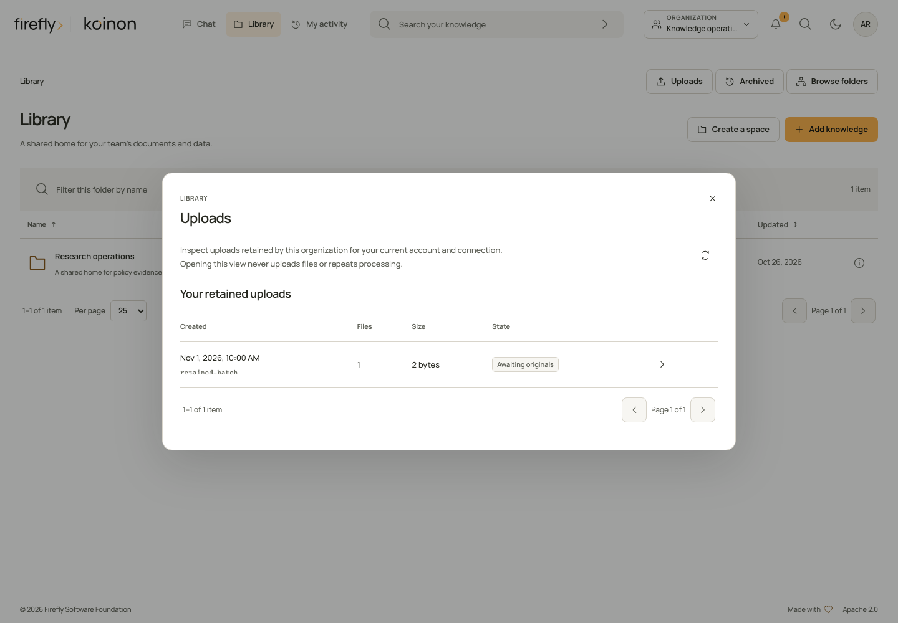
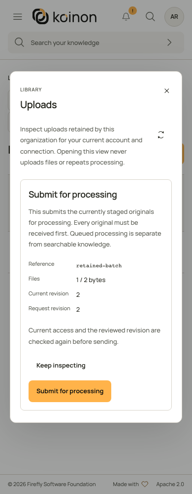
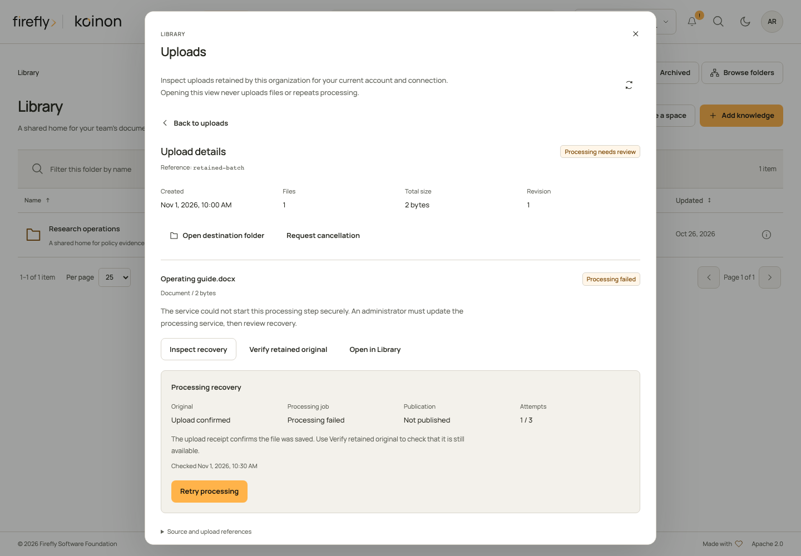
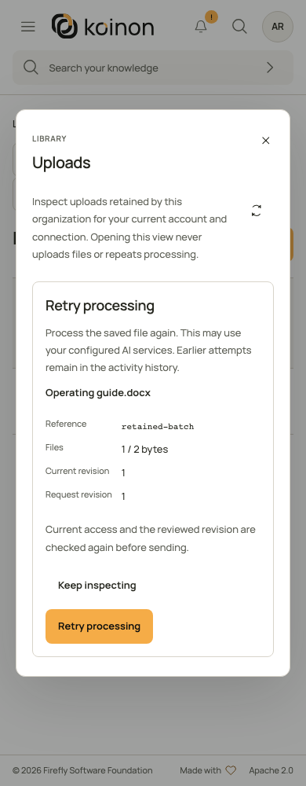

<!-- Copyright 2026 Firefly Software Foundation -->
<!-- SPDX-License-Identifier: Apache-2.0 -->

# Durable document and dataset intake

Use a durable file batch when a multi-file import needs a saved manifest, bounded uploads, per-file outcomes and restart reconciliation. A sequential loop around the single-file upload API remains a caller-owned loop. File batches use the existing native job queue and canonical document/Structured pipelines; they do not make all files one atomic transaction. Query batches are a separate capability and are not accepted as file modes.

The deployment must configure [durable private staging and its supported topology](../operations/durable-bulk.md), the appropriate native databases, readers and an authorized embedding connection. The capability response advertises `document` and `dataset` with `extract_only_v1`: extraction and admitted embeddings, without implicit authored naming or enrichment. Requesting a mode does not configure a provider. Bulk configuration and staging paths are deployment authority, not personal-token settings.

## Reopen a retained upload in Library

Open **Library**, then **Uploads** beside the folder actions. This list reads retained batches for your current account, connection and current access. Page through the results and choose **Inspect upload** to read the batch and all of its current items. No original bytes are uploaded, no processing is submitted and no storage receipt is checked by opening the list or details.



This desktop capture uses controlled example data. In your installation, the list comes from the current authorized batch records.

A batch admitted through a personal API token remains bound to that credential. Signing into the browser as the same user does not transfer that batch into the browser session. Organization administrators do not gain another person's private batch through this view. If access or the original credential is unavailable, use the supported authority and recovery procedures rather than changing the stored owner.

After renewing your session or reloading the page, open **Uploads** again and select the retained batch. The page checks its current destination, item inventory and revision before offering actions. The previous browser file objects and old authorization context are not restored. **Open destination folder** and **Open in Library** resolve the current authorized knowledge resources.

| What the current details show | Deliberate action | What it establishes |
| --- | --- | --- |
| An original is not verified and the batch is still staging | Review **Check retained original**, then confirm that check | The server attempts to verify an original it already retained. This can perform storage reads and record a receipt; it does not send another file or start processing. A missing original or active writer remains unresolved. |
| A received original or an item with a processing job needs an explicit storage check | Choose **Verify retained original** | The server checks the retained original and returns its size/hash-bound receipt. This is an explicit storage operation, not a passive list refresh. |
| Every current original is received | Review **Submit for processing**, then confirm | The batch can be admitted to the native worker queue using the reviewed revision. It is not a claim that the knowledge is searchable. |
| Processing needs review | Choose **Inspect recovery**, read the current observation, then review its offered action | The server distinguishes a safe retry, prepared publication and an already completed import. Unknown outcomes offer no mutation. |
| Supported pending work should stop | Review **Request cancellation**, then confirm | Pending cancellation is requested. Already published knowledge and committed effects can remain. |

Original receipt, processing completion and search availability are different states. Inspect the resulting Library item and its availability before using it in an answer. The per-item **Source and upload references** include the source, knowledge item, checksum, job and returned immutable version/extraction identities where available. An identifier being reserved does not mean that its processing has completed.

{ width="390" }

This controlled example shows the separate review before submission. It does not indicate that the batch has already been submitted.

### If an action result is uncertain

The panel saves the exact reviewed action key and revision in bounded session storage before sending a mutation. It retains only request identifiers, subject/organization, operation, revision and key. It does not save filenames, document content, file bytes, endpoints or credentials. This tab journal holds at most eight requests and 16 KiB; it is not a durable operator change record. Keep important batch references in your change record separately.

Refreshing, reopening the panel and signing in never repeat a mutation. A saved request becomes visible only after the server authorizes that exact batch under your current account and credential. **Review saved request** shows the original request and its consequences; confirmation explicitly sends the same revision and original key. If that request was not previously accepted, it may start the reviewed operation. No file upload is exposed by this recovery view.

A newly observed desired state can resolve the panel's uncertainty without claiming which request caused it. A changed revision requires fresh inspection. Do not manufacture a new key, reset counters, rewrite an owner or delete a retained batch to bypass a conflict. If no retained original can be verified, preserve the reference and investigate the original upload before choosing a supported next step.

Closing the panel stops its checks and does not cancel submitted work. Current permissions are checked again before each action. A session failure hides the retained details and requires sign-in; a different account or credential cannot restore another connection's saved request.

## Recover processing without uploading the original again

A received original is not the same as searchable knowledge. If a file shows **Processing needs review**, open its upload details and read the explanation beneath the filename. For example, `INGEST_EXECUTION_CONTEXT_REQUIRED` means the service could not start the processing step with the required execution authority. An administrator must update the processing service before reviewing recovery. Uploading a second copy does not repair that service configuration.



This capture uses controlled example data. The original receipt and the failed processing job are shown separately.

1. Open **Library**, choose **Uploads**, and inspect the existing batch under the account and credential that admitted it. Keep its batch, item and source identities.
2. Choose **Inspect recovery** on the affected file. This reads current processing metadata and native outcome; it does not upload bytes or automatically start another attempt. Current `catalog:write` and `ingest:write`, the original owner/credential, destination access and token bounds are required.
3. Read **Original**, **Processing job**, **Publication**, the attempt count and the observation time separately. **Upload confirmed** describes a previously verified durable receipt. This inspection does not fetch the Blob or object. Use **Verify retained original** for a separate current storage check. A failed job can coexist with a completed native commit; a missing HTTP response cannot establish that nothing happened.
4. Review the action offered by the server. An unknown result, active worker, changed connection, conflicting receipt or exhausted attempt limit can leave no safe action. Follow the explanation; do not substitute a retry based on a native identifier or a missing receipt.
5. Confirm the selected operation once. Current authority, revision and native state are rechecked. Refresh the upload afterward and inspect the resulting Library item's availability before relying on it in chat or search.

| Offered action | What you authorize | What it does not authorize |
| --- | --- | --- |
| **Retry processing** | Process the same saved original again using the configured processing and AI services. Earlier attempts remain in activity history. | Uploading another original, resetting counters or bypassing a changed source connection. |
| **Finish publication** | Completion of the already prepared result under the current lease and destination. | Reinterpreting a changed result as permission to parse or call models again. |
| **Record completed import** | Recording the verified native commit that already completed. | Reimporting the source or repeating embeddings. |

A current descriptor with `operation: null` offers no mutation. `native_state: unknown` or `not_checked` is not failure and is not evidence of absence. An administrator can expand **Source and upload references** to read the safe processing reference; arbitrary provider exception text is not displayed.

An accepted recovery response acknowledges the requested action. It does not assert that queued processing has completed or that every source is already indexed. The attempt limit is reported as `max_attempts` by the current descriptor; a client cannot raise it in the recovery request.

{ width="390" }

This controlled example shows approval before the request is sent. It is not evidence that a production import has completed.

### Headless inspection and explicit confirmation

Read `GET /api/v1/tenants/{tenant_id}/sources/batches/{batch_id}/items/{item_id}/recovery` to obtain `FileRecoveryView`. It reports the current batch revision, offered operation, native state, recorded job state, original-receipt state, attempt bounds, safe reason and nullable check time. It never returns storage URLs, credentials or internal native identifiers.

The separate `POST` at the item's `/recover` path accepts `BulkRecoveryAction`: the exact `expected_revision` and offered `operation`, plus an explicit `Idempotency-Key` header. The following helpers deliberately separate inspection from confirmation. Authenticate the client as explained in the [SDK guides](headless.md); save the reviewed action and its stable key in your integration's durable operation record before calling the confirmation function.

=== "Python"

    ```python
    from koinon_sdk import (
        BulkRecoveryAction, FileBatchView, FileRecoveryView, KoinonClient,
    )

    async def inspect_recovery(
        client: KoinonClient, tenant: str, batch: str, item: str,
    ) -> FileRecoveryView:
        return await client.file_batch_processing_recovery(tenant, batch, item)

    async def confirm_reviewed_recovery(
        client: KoinonClient, tenant: str, batch: str, item: str,
        reviewed: BulkRecoveryAction, stable_key: str,
    ) -> FileBatchView:
        return await client.recover_file_batch_processing(
            tenant, batch, item, reviewed, stable_key,
        )
    ```

    After displaying the descriptor and receiving approval, construct `BulkRecoveryAction(expected_revision=descriptor.batch_revision, operation=descriptor.operation)` only when `operation` is present. The helper sends once. It does not retry a timeout or infer success from the prior descriptor.

=== "TypeScript"

    ```typescript
    import type {
      BulkRecoveryAction, FileBatchView, FileRecoveryView, KoinonClient,
    } from '@fireflyframework/koinon-sdk';

    export async function inspectRecovery(
      client: KoinonClient, tenant: string, batch: string, item: string,
      signal?: AbortSignal,
    ): Promise<FileRecoveryView> {
      return client.fileBatches.processingRecovery(
        tenant, batch, item, { signal },
      );
    }

    export async function confirmReviewedRecovery(
      client: KoinonClient, tenant: string, batch: string, item: string,
      reviewed: BulkRecoveryAction, stableKey: string, signal?: AbortSignal,
    ): Promise<FileBatchView> {
      return client.fileBatches.recoverProcessing(
        tenant, batch, item, reviewed, stableKey, { signal },
      );
    }
    ```

    Cancellation stops the client request, not a committed server action. Keep the exact reviewed body and key if its result is unknown.

=== "Java 21+"

    ```java
    import org.fireflyframework.koinon.sdk.KoinonClient;
    import org.fireflyframework.koinon.sdk.model.BulkRecoveryAction;
    import org.fireflyframework.koinon.sdk.model.FileBatchView;
    import org.fireflyframework.koinon.sdk.model.FileRecoveryView;

    public final class ProcessingRecovery {
      public static FileRecoveryView inspect(
          KoinonClient client, String tenant, String batch, String item) {
        return client.fileBatches(tenant).processingRecovery(batch, item);
      }

      public static FileBatchView confirmReviewed(
          KoinonClient client, String tenant, String batch, String item,
          BulkRecoveryAction reviewed, String stableKey) {
        return client.fileBatches(tenant)
            .recoverProcessing(batch, item, reviewed, stableKey);
      }
    }
    ```

    `processingRecoveryAsync` and `recoverProcessingAsync` expose the same typed contract with `CompletableFuture`. After an approved non-null operation, `new BulkRecoveryAction(descriptor.batchRevision(), descriptor.operation())` retains the server-selected operation and revision.

If confirmation times out, first inspect the existing batch under fresh authority. Only an explicit reconciliation may resend the **same** request body, original revision and original key. A prior accepted request can return its stored receipt even when the current revision advanced or no action is now offered; that replay does not queue a second attempt. Never replace the key or operation automatically. `BULK_REVISION_CONFLICT` or `BULK_RECOVERY_STATE_CHANGED` requires fresh inspection and a new review; it does not authorize a different operation under an old approval.

These recovery controls are exposed through Library, the REST API and the three SDKs. They do not add an MCP recovery tool. An external agent's existing knowledge review must not silently repeat failed processing.

## Admit, upload, review and submit

1. Select an existing authorized workspace, its project and a collection or corpus in that project. Current `catalog:write` and `ingest:write` permissions are required. A PAT must also retain those scopes and applicable workspace/resource bounds; it cannot exceed the original subject's current role.
2. Persist an exact manifest and caller-owned admission key before creating a batch. Each item has a unique client ID, plain filename, mode, byte count and SHA-256. Admission reserves canonical identities before processing. Bounds are at most 100 files, 128 MiB per file and 512 MiB per batch, subject to smaller deployment limits and retained quotas.
3. Read the item page to match each client ID to its server item ID. Upload its exact original with a separate stable key. This is raw `application/octet-stream`, not multipart, JSON or base64. A changed length or digest conflicts. Receipt reads verify retained originals; they do not return private object keys or storage credentials.
4. After every original is staged, review the batch and submit with its current `revision` and a persisted submission key. HTTP202 means accepted, not indexed. An independently configured native bulk worker claims items; the general chat/job worker does not process this job kind.
5. Read batch and item pages for outcomes. Documents expose exact source-version/extraction IDs after success; datasets expose the reserved file-version and complete table IDs. Preserve historical IDs for audit and exact snapshot reads. A successful dataset has a receipt for every required table; a partial extraction or missing embedding does not become partial dataset success.

All mutation helpers require an explicit idempotency key. They send once and do not automatically retry failures, timeouts or unknown outcomes. Reusing the same key with a different manifest/action conflicts. Keys are bounded opaque identifiers, not secrets or payload containers.

The following functions only admit a manifest when invoked. Persist `key`, the exact bytes and the returned batch ID in your integration's durable job record. They do not upload, submit or poll automatically.

### Python

```python
import hashlib
from koinon_sdk import (
    BulkDestination, FileBatchCreate, FileBatchView, FileManifestItem, KoinonClient,
)

async def admit_dataset(
    client: KoinonClient, tenant: str, destination: BulkDestination,
    filename: str, content: bytes, key: str,
) -> FileBatchView:
    manifest = FileBatchCreate(destination=destination, items=[FileManifestItem(
        client_item_id="source-1", filename=filename, mode="dataset",
        size_bytes=len(content), sha256=hashlib.sha256(content).hexdigest(),
    )])
    return await client.create_file_batch(tenant, manifest, key)
```

Use `file_batch_items`, `upload_file_batch_item`, `file_batch_item_receipt` and `file_batch` to stage and inspect. `submit_file_batch`, `cancel_file_batch`, `reconcile_file_batch_item` and `reconcile_file_batch_original` take `BulkAction(expected_revision=current.revision)` plus the caller's stable key. `file_batches` and `file_batch_items` accept bounded `page` and `page_size`. Cancelling a Python await does not cancel a server batch; use the explicit cancellation operation and then inspect its result.

### TypeScript

```typescript
import {
  KoinonClient, type BulkDestination, type FileBatchView,
} from '@fireflyframework/koinon-sdk';

export async function admitDataset(
  client: KoinonClient, tenant: string, destination: BulkDestination,
  filename: string, content: Blob, key: string,
): Promise<FileBatchView> {
  const digest = await crypto.subtle.digest('SHA-256', await content.arrayBuffer());
  const sha256 = Array.from(new Uint8Array(digest),
    byte => byte.toString(16).padStart(2, '0')).join('');
  return client.fileBatches.create(tenant, {destination, items: [{
    client_item_id: 'source-1', filename, mode: 'dataset',
    size_bytes: content.size, sha256,
  }]}, key);
}
```

`fileBatches` exposes `capabilities`, `create`, `list`, `get`, `items`, `upload`, `receipt`, `submit`, `cancel`, `reconcile`, `recoverOriginal`, `processingRecovery` and `recoverProcessing`. Pass an immutable `Blob` to `upload`; the helper preserves its raw bytes and sets the content type. Read methods and writes accept the usual `RequestOptions.signal`. An abort stops the client request; it does not prove a server mutation was cancelled. Keep the batch/item IDs and inspect the retained receipt before further action.

### Java 21+

```java
import java.security.MessageDigest;
import java.util.HexFormat;
import java.util.List;
import org.fireflyframework.koinon.sdk.KoinonClient;
import org.fireflyframework.koinon.sdk.model.*;

public final class BulkExample {
  public static FileBatchView admitDataset(
      KoinonClient client, String tenant, BulkDestination destination,
      String filename, byte[] content, String key) throws Exception {
    String sha256 = HexFormat.of().formatHex(MessageDigest.getInstance("SHA-256").digest(content));
    var item = new FileManifestItem("source-1", filename, AddKnowledgeMode.DATASET,
        content.length, sha256);
    return client.fileBatches(tenant).create(FileBatchCreate.empty()
        .withDestination(destination).withItems(List.of(item)), key);
  }
}
```

`client.fileBatches(tenant)` exposes the same thirteen operations with synchronous and `Async` variants. `BulkFileUpload` defensively copies its bounded byte array and `upload` sends raw bytes. `FileBatchScope` carries the required workspace for capabilities; `FileBatchFilter` carries pagination. `BulkAction` uses an integer revision. Cancelling a future is client cancellation, not proof of server rollback. Keep explicit batch cancellation separate.

## Upload a large original without loading it all into memory

First admit the manifest and read the returned item page. The following helpers upload one existing item; they do not create another manifest or submit the batch. Supply the original size and digest already admitted for that item, and keep the selected file unchanged until the call completes. The server verifies the received bytes independently before returning a staging receipt.

=== "Python"

    ```python
    from pathlib import Path

    from koinon_sdk import KoinonClient
    from koinon_sdk.bulk import FileBatchItemView, StagedFileReceipt

    async def stage_original(
        client: KoinonClient,
        tenant_id: str,
        batch_id: str,
        item: FileBatchItemView,
        path: Path,
        upload_key: str,
    ) -> StagedFileReceipt:
        return await client.upload_file_batch_path(
            tenant_id, batch_id, item.id, path, upload_key,
            expected_size_bytes=item.size_bytes,
            expected_sha256=item.sha256,
        )
    ```

    The helper prepares a private temporary copy, checks its size and SHA-256 against the manifest, then sends 64 KiB blocks. Preparation runs outside the event loop. Changing the selected source after preparation cannot change the transmitted bytes. The helper closes its temporary copy on success, failure or cancellation, and waits for any admitted preparation to finish before cleanup. The byte-array helper remains available for callers that already hold a small original in memory. Neither helper retries an uncertain write.

=== "TypeScript"

    ```typescript
    import type {
      FileBatchItemView, KoinonClient, StagedFileReceipt,
    } from '@fireflyframework/koinon-sdk';

    export async function stageOriginal(
      client: KoinonClient,
      tenantId: string,
      batchId: string,
      item: FileBatchItemView,
      file: File,
      uploadKey: string,
      signal?: AbortSignal,
    ): Promise<StagedFileReceipt> {
      if (file.size !== item.size_bytes) {
        throw new Error('Choose the original file admitted in this batch');
      }
      return client.fileBatches.upload(
        tenantId, batchId, item.id, file, uploadKey, { signal },
      );
    }
    ```

    `File` extends `Blob`. The SDK passes it directly to Fetch without converting the complete original to JSON, Base64 or an extra array buffer. A returned staging receipt confirms the server's digest verification. Preserve that receipt before submitting the batch.

=== "Java 21+"

    ```java
    import java.nio.file.Path;
    import org.fireflyframework.koinon.sdk.KoinonClient;
    import org.fireflyframework.koinon.sdk.model.BulkFilePath;
    import org.fireflyframework.koinon.sdk.model.FileBatchItemView;
    import org.fireflyframework.koinon.sdk.model.StagedFileReceipt;

    public final class StageOriginal {
      public static StagedFileReceipt upload(
          KoinonClient client, String tenantId, String batchId,
          FileBatchItemView item, Path path, String uploadKey) {
        var original = new BulkFilePath(path, item.sizeBytes(), item.sha256());
        return client.fileBatches(tenantId)
            .uploadPath(batchId, item.id(), original, uploadKey);
      }
    }
    ```

    `BulkFilePath` prepares a private temporary copy and verifies its size and SHA-256 before dispatch. The HTTP publisher reads that verified copy; it never reopens the caller's original path. The SDK closes its input and removes the temporary copy when the HTTP future completes or is cancelled. `uploadPathAsync` returns a `CompletableFuture<StagedFileReceipt>` with the same checks. `BulkFileUpload` remains available for an existing byte array; its defensive copies are unnecessary when using the path helper.

The path helpers need temporary client disk space for one bounded original. Local Java preparation finishes before `uploadPathAsync` returns its HTTP future. All three languages respect the same maximum of 128 MiB per original, subject to the installation's smaller advertised limit. Cancelling an upload releases the client operation; it does not establish whether the server retained a staging receipt. Inspect that existing item before taking further action.

## Unknown outcomes and cancellation

Batch and item reads are read-only and recheck current authority before returning private metadata. Permission or token revocation can make an old batch unavailable. Knowing its ID does not grant access.

A completed native commit can be acknowledged from its immutable receipt without replaying the original or embeddings. A complete prepared dataset can publish its already-recorded table set under a current lease without parsing or model calls. An admitted or incomplete native effect remains `reconciling`; absence of a successful HTTP response is not permission to run it again.

`recoverOriginal` / `reconcile_file_batch_original` is a distinct explicit action for an interrupted staged upload. A committed database generation first fences the old writer. Verification then checks only its immutable registered object and current storage identity; the final owner-token/lease/revision check publishes the receipt. Recovery never replays original bytes, resets quotas or grants another writer permission. A stale SDK write can finish only at its own accounted-for attempt key.

The [bounded Library file profile](../reference/library-file-ingestion.md) distinguishes queued 128 MiB originals, synchronous 32 MiB uploads, 256 MiB expansion, parser resources and the 16 GiB lifetime admission ledger. Uploaded originals spool to files and are pinned to exact provider versions; document text/table extraction does not imply image interpretation.

Cancellation prevents further claims and publication under a cancelled lease. A winning native commit remains successful and its originals and receipt remain retained. Mixed completed/cancelled files produce a partial batch outcome; cancellation is not a reset, deletion, refund or guarantee that no native preparation occurred. Reconcile an unknown result explicitly and preserve its evidence. Do not reset counters, delete failure records or replay old queued work during recovery.

A revision conflict requires reloading and reviewing the batch. Resource archive, changed native workspace binding or changed admitted embedding connection fails closed. A new import after review is a distinct admission; it does not overwrite an uncertain prior outcome.
