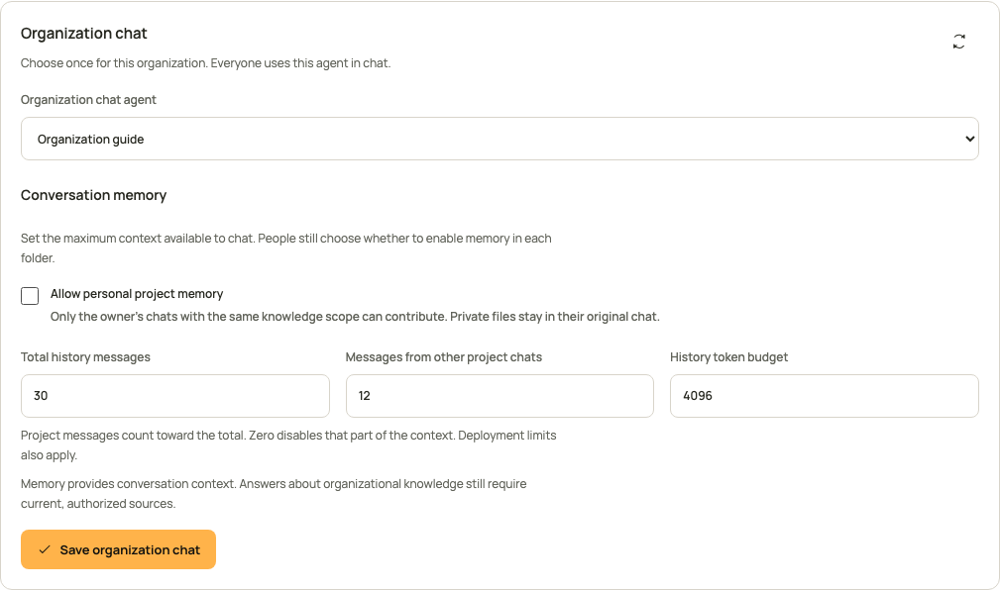

<!-- Copyright 2026 Firefly Software Foundation -->
<!-- SPDX-License-Identifier: Apache-2.0 -->
# Manage conversation memory

Conversation memory helps koinon understand a follow-up without asking you to repeat the discussion. A folder can also use context from your other chats in that folder when you explicitly enable it. This is personal context: placing two people's chats under the same organizational project does not make their conversations available to each other.

Memory and published knowledge have different purposes. A remembered question can explain what you mean; it cannot establish that an old answer is still correct. Answers about organizational knowledge still need current, authorized sources. A proposed addition to the knowledge repository requires your explicit approval before publication.

## Enable memory for one chat project

1. Open **Chat** and find the chat project in the conversation sidebar. Use **New chat project** if the conversations do not yet have a home.
2. Open the chat project's actions and choose **Chat project settings**.
3. Select **Use memory from my chats in this project**.
4. Choose **Save changes**. Closing the panel or choosing **Cancel** keeps the saved preference.
5. Move the conversations you want to group into that folder. Starting a chat from the folder also associates the new conversation with it.

The switch starts disabled. It applies to your chats directly inside that folder, with the same knowledge scope. A nested folder has its own setting. Chats from another person, organization or knowledge scope do not contribute. Private attachments remain in their original conversation; a folder is not a way to share an attachment between chats.


*The screenshot shows the running interface with controlled example data.*

## Set organization limits

An organization administrator opens **Settings**, selects **Agents**, and reviews **Conversation memory** in the organization chat configuration. The administrator can disable personal project memory or set its context limits. Allowing it at organization level does not activate it in anyone's folders.

| Setting | Meaning |
| --- | --- |
| Allow personal project memory | Allows folder owners to opt in to context from their other chats. |
| Total history messages | Maximum prior messages considered for a question, including project context. |
| Messages from other project chats | Maximum messages contributed by other chats, within the total history limit. |
| History token budget | Maximum token budget for remembered context. The current question has its own input budget. |

Project messages cannot exceed the total history allowance. Zero disables the corresponding part of remembered context. Deployment limits also apply, so an administrator cannot increase a policy beyond the installation's hard caps. Save uses the current configuration revision. If another administrator changed it, reload and review their settings before trying again.



*This configuration example uses controlled data. Its unchecked organization switch prevents project memory even when a folder owner has saved an enabled preference.*

## Understand what is remembered

koinon selects bounded, completed turns and records the exact messages that entered the model's context. It uses the native pyfly conversation memory budget rather than loading an unlimited transcript. Incomplete, failed, deleted or ineligible conversations do not become background context.

An earlier answer is eligible as answer text only when its recorded evidence and memory dependencies can be verified and currently authorized. Older records without that proof do not acquire invented provenance. A relevant earlier question can still supply context without copying an unverified answer into the model's history.

Permissions are checked again when context is used and when an answer is released. Losing a source grant, revoking an originating credential, or changing the selected context during generation must not release an answer using the revoked material. The system does not silently substitute another conversation after selecting context.

## Inspect the memory behind an answer

Choose **Audit** below an answer and read **Conversation memory** in **Overview**. The record distinguishes context from this conversation from context contributed by your other project chats. Each included turn identifies its conversation, time, and whether its question alone or both its question and answer were included. **Open conversation** is available for an eligible saved conversation.

**Memory record and limits** contains the policy revision, effective limits, dependency count and immutable record fingerprint. Message identities and hashes belong to the generation that actually used them. Renaming a folder does not rewrite those recorded labels or hashes.

Availability is current status. A conversation may have been archived, moved or deleted since generation; the audit explains that it can no longer provide reusable context. That status is separate from the recorded source versions in **Sources**. A stored answer remains readable only while its current owner, knowledge permissions and originating authorization still permit access. An older answer without a memory record is marked as unrecorded.

## Share or publish an answer that used memory

An answer can combine current sources with context remembered from your other conversations. Review that context before sharing the answer or turning it into repository knowledge. The share preview and knowledge intent expose `remembered_context_present` when this additional decision is needed.

The sharing panel displays a separate, unchecked consent option. Approving it shares only the selected answer, subject to the recipient's current source permissions. It does not share the originating chats or their private attachments. The server rechecks the remembered sources and originating authorization when the share is created and whenever someone reads it.

SDK callers must obtain the same explicit decision and send `include_remembered_context=true` on share creation or knowledge confirmation. The default is false. Never copy `remembered_context_present` into the consent field automatically: it describes what the server found, not what the person approved. A stale review, changed content or revoked permission requires another review.

When knowledge is curated from a conversation, its source evidence retains `basis: remembered_context` for dependencies inherited from prior answers. Directly retrieved evidence uses `basis: direct`. Those labels keep remembered evidence distinguishable from retrieval performed for the selected answer. Historical evidence without a basis field retains its original representation and hash.

Owner-only exports also recheck the complete authorization chain before creation and download. Their preview does not grant another person access. Read the [export and sharing guide](exports-sharing.md) for the separate review and confirmation steps.

## Move, archive or delete a conversation

Use the conversation's action menu in the sidebar. **Move to folder** changes its grouping without changing knowledge access. **Archive conversation** removes it from the active history; archived conversations remain available through the history filter. **Delete conversation** asks for confirmation, removes it from normal history and excludes it from future memory. A queued or running answer must be stopped or finish before deletion.

Deleting a conversation does not delete a source document or publish its private files. Retained audit storage follows the installation's retention policy. Turning off folder memory stops future cross-chat reuse; it does not retroactively change the context recorded for a completed answer.

## Use the same operations through an SDK

These helpers take an already authenticated client from the [Python](headless-python.md), [TypeScript](headless-typescript.md) or [Java 21](headless-java.md) setup guide. Call them only after the owner chooses to enable folder memory. They read the latest revision before writing and leave the folder's name, parent and knowledge scope unchanged. A revision conflict requires a fresh decision rather than an automatic retry.

=== "Python"

    ```python
    from koinon_sdk import ChatFolder, FolderPatch, KoinonClient

    async def enable_folder_memory(
        client: KoinonClient, tenant: str, folder_id: str,
    ) -> ChatFolder:
        current = await client.folder(tenant, folder_id)
        return await client.update_folder(
            tenant, folder_id,
            FolderPatch(expected_revision=current.revision, memory_enabled=True),
        )
    ```

=== "TypeScript"

    ```typescript
    import { KoinonClient, type ChatFolder } from '@fireflyframework/koinon-sdk';

    export async function enableFolderMemory(
      client: KoinonClient, tenant: string, folderId: string,
    ): Promise<ChatFolder> {
      const current = await client.chat.folders.get(tenant, folderId);
      return client.chat.folders.update(tenant, folderId, {
        expected_revision: current.revision, memory_enabled: true,
      });
    }
    ```

=== "Java 21"

    ```java
    import org.fireflyframework.koinon.sdk.KoinonClient;
    import org.fireflyframework.koinon.sdk.model.ChatFolder;
    import org.fireflyframework.koinon.sdk.model.FolderPatch;

    public final class PersonalMemory {
        private PersonalMemory() {}

        public static ChatFolder enable(
                KoinonClient client, String tenant, String folderId) {
            var current = client.chatFolders(tenant).get(folderId);
            return client.chatFolders(tenant).update(folderId,
                FolderPatch.empty().withExpectedRevision(current.revision())
                    .withMemoryEnabled(true));
        }
    }
    ```

Use `false` to disable the saved preference. Omitting `memory_enabled` preserves it; explicit null is rejected. Organization chat settings expose a typed `memory` policy through `organization_chat_settings` in Python, `organizationChat.get` in TypeScript and `organizationChat(tenant).get` in Java. An administrator updates that policy with the existing revision and `agents:write` authority. A personal token still needs the owner's role and resource bounds; it cannot create access by enabling memory.

The typed answer audit exposes an optional `memory` receipt through Python `run_audit`, TypeScript `chat.audit`, and Java `chat(tenant).audit`. Internal credentials and authorization snapshots are not part of that public receipt. See the [chat API reference](../reference/api/chat.md) for request fields, pagination and errors, and the language-specific conversation chapters for durable runs and SSE handling.
