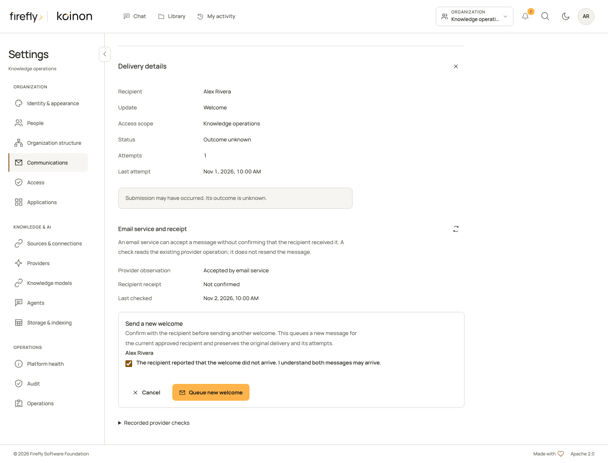
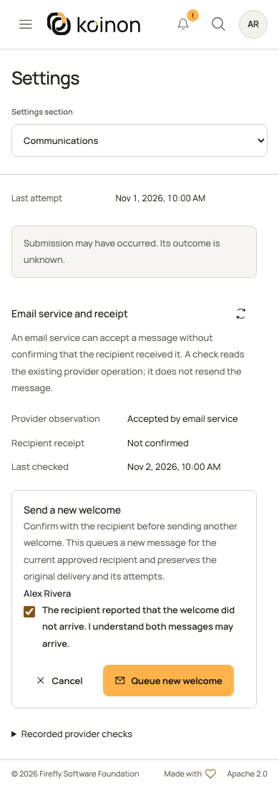

<!-- Copyright 2026 Firefly Software Foundation -->
<!-- SPDX-License-Identifier: Apache-2.0 -->
# Inspect email delivery and recover a welcome

Use this workflow when a person cannot find an email that koinon prepared. First inspect the existing delivery. Request another welcome only after the recipient reports that the first one did not arrive and you have reviewed the possibility of both messages arriving.

A provider operation lookup, recipient-server delivery evidence and a person confirming receipt are different observations. The operation lookup described here does not inspect the recipient's mailbox and does not change the original submission into **Delivered**.

## Before you begin

You need current organization-wide administrator membership and `members:write` for that organization. A workspace administrator, a workspace-bound API token or an external client cannot expand its authority through this workflow. The server checks the current actor, token and organization on every request.

For a new welcome, the original record must be an eligible initial welcome and the current approved administrator contact must still qualify. The visual workflow uses the signed-in recipient already associated with that contact. It offers no editable email address, contact selector or identity override. A deployment operator handles eligible pre-login recovery through the [native operator commands](../reference/operator-delivery-contacts.md#inspect-an-existing-delivery-or-recover-a-welcome).

Apply the ordinary database migrations, including `koinon_0041_email_recovery`, before using these endpoints. Keep the complete communications worker running: accepting a recovery request queues an event; it does not send the message inside the administrator's HTTP request.

## Open the original delivery

1. Open your avatar menu and **Settings**. If you have access to several organizations, select the intended organization first.
2. Open **Communications**, then **Delivery history**.
3. Filter the event type and dates, find the existing delivery and choose **Details**.
4. Read its submission status, attempts and explanation before requesting another action.

The **Email service and receipt** section loads current action eligibility and previously recorded checks. Opening or refreshing these details does not call the external provider, send email or retry an unknown request.

## Check the email service

Choose **Check email service**, read the review and confirm that check. This explicitly looks up the retained operation using the configured provider. It cannot prove inbox placement and does not create a new welcome.

| Observation | What it establishes | What remains separate |
| --- | --- | --- |
| **Check in progress** or **Provider operation pending** | A recorded check or provider operation is unfinished. | The final operation outcome and recipient receipt. |
| **Accepted by email service** | The provider accepted the existing operation. | Recipient-server handling, quarantine, final folder and actual receipt. |
| **Rejected by email service** | The provider rejected the operation. | Whether a different, explicitly authorized message should be prepared. |
| **Provider outcome unknown** or **Provider status unavailable** | No usable operation result has been established. | The original outcome remains unresolved; another check is not permission to resend. |

Expand **Recorded provider checks** to inspect the retained observations and timestamps. The interface shows at most the 25 most recent checks and states when older checks exist. **Recipient receipt** remains **Not confirmed** because this API does not observe the person's mailbox. For recipient-side investigation, use the existing delivery reference, sender, localized subject, send time and provider identifiers described in [message investigation](../operations/communications.md#investigate-a-message-that-did-not-arrive).

If the provider or its credentials changed, the original operation may need a deployment operator's verification before it can be inspected. Changing the active provider does not authorize interpreting an old provider operation through a new account.

## Request a new welcome



This controlled example uses fictional recipients and recorded provider observations. It shows the current review controls; it does not establish external email delivery.

**Send a new welcome** appears only when the server offers it for this original delivery and the current approved target. It is a separate action from **Check email service** and invitation retry.

1. Confirm with the recipient that the original welcome has not arrived.
2. Choose **Send a new welcome** and review the displayed recipient.
3. Acknowledge that the original and new messages may both arrive.
4. Choose **Queue new welcome** once.
5. Keep the new delivery reference. Choose **View new welcome** to inspect its independent state.

The new event links to the original. The original `unknown` status, attempt count, frozen content and history are preserved. A new welcome does not reset bootstrap enrollment, renew an expired contact, grant a role or change notification schedules. A queue acknowledgment does not establish provider acceptance or mailbox receipt.

<details>
<summary>Review on a small screen</summary>



</details>

## Handle an unconfirmed request

A network interruption can hide whether an inspection or welcome recovery was accepted. koinon retains the exact bounded request and idempotency key in that browser tab. It stores identifiers, revisions and the reviewed operation, not recipient addresses, email bodies, credentials or attachments.

Refreshing, signing in or opening the delivery never replays this request. After the server authorizes the delivery again, **Review saved request** lets you inspect it and explicitly submit the same request with its original key. If the service accepted that request earlier, it returns its recorded observation or the same linked welcome. If it did not, the reviewed action may run. A changed body must not be sent under the old key.

A different account cannot see another person's saved request. A changed credential still has to obtain current server authorization before a request becomes visible. If current access is denied, the saved request does not grant it. Keep this browser tab and the operation reference while investigating an unknown outcome.

## Use the typed SDKs

The same four endpoints are available through Python, TypeScript and Java 21 or later. Use the API root ending in `/api/v1`, a current authorized administrator token and the original delivery ID. Keep tokens outside logs and source control; see [authentication](headless-python.md#authenticate-and-read-one-authorized-scope).

| Purpose | HTTP operation | TypeScript factory member |
| --- | --- | --- |
| Read current eligibility | `GET /tenants/{tenant_id}/communications/deliveries/{delivery_id}/recovery` | `administration.recovery` |
| Read recorded observations | `GET /tenants/{tenant_id}/communications/deliveries/{delivery_id}/observations` | `administration.observations` |
| Explicitly inspect the existing operation | `POST /tenants/{tenant_id}/communications/deliveries/{delivery_id}/observations` | `administration.inspectDelivery` |
| Explicitly queue a linked welcome | `POST /tenants/{tenant_id}/communications/deliveries/{delivery_id}/welcome-recovery` | `administration.recoverWelcome` |

Both POST operations require `Idempotency-Key`. Generate one operation key after human review, retain it with the exact request before sending, and reuse it only to reconcile that same uncertain request. Do not put a retry loop around these calls. A new key represents a new action.

The following helpers first read the current descriptor. They do not run until the caller invokes them. The welcome helper requires explicit caller consent and takes the retained operation key as an argument; it never generates a replacement key after an error.

=== "Python"

    ```python
    from koinon_sdk import KoinonClient
    from koinon_sdk.communications_recovery import (
        DeliveryInspectionInput,
        DeliveryOperationObservation,
        WelcomeRecoveryAcknowledgement,
        WelcomeRecoveryInput,
    )

    async def inspect_delivery(
        client: KoinonClient, tenant_id: str, delivery_id: str, operation_key: str
    ) -> DeliveryOperationObservation:
        options = await client.communication_delivery_recovery(tenant_id, delivery_id)
        await client.communication_delivery_observations(tenant_id, delivery_id)
        if not options.can_inspect:
            raise ValueError("Review current inspection eligibility before continuing")
        request = DeliveryInspectionInput(expected_generation=options.generation)
        return await client.inspect_communication_delivery(
            tenant_id, delivery_id, request, operation_key
        )

    async def recover_reviewed_welcome(
        client: KoinonClient, tenant_id: str, delivery_id: str,
        operation_key: str, *, duplicate_consent: bool,
    ) -> WelcomeRecoveryAcknowledgement:
        if not duplicate_consent:
            raise ValueError("Explicit recovery and possible-duplicate consent are required")
        options = await client.communication_delivery_recovery(tenant_id, delivery_id)
        if not options.can_recover_welcome or not options.contact_id or not options.contact_revision:
            raise ValueError("No current approved welcome recovery is available")
        request = WelcomeRecoveryInput(
            expected_generation=options.generation,
            contact_id=options.contact_id,
            expected_contact_revision=options.contact_revision,
            reason="recipient_reported_not_received",
            acknowledge_possible_duplicate=True,
        )
        return await client.recover_welcome_delivery(
            tenant_id, delivery_id, request, operation_key
        )
    ```

    Construct `KoinonClient` with the authenticated asynchronous lifecycle explained in the [Python getting-started guide](headless-python.md). The methods return validated response models. Preserve the `request` and `operation_key` if transport failure leaves the POST outcome unknown; rebuilding a request from a newer descriptor is a different operation.

=== "TypeScript"

    ```typescript
    import { FetchTransport } from '@fireflyframework/koinon-sdk';
    import { createCommunicationsApi } from '@fireflyframework/koinon-sdk/communications';

    export function communicationClient(apiRoot: string, accessToken: () => Promise<string>) {
      const transport = new FetchTransport({ baseUrl: apiRoot, accessToken });
      return createCommunicationsApi(transport);
    }

    type Communications = ReturnType<typeof communicationClient>;

    export async function inspectDelivery(
      api: Communications, tenantId: string, deliveryId: string, operationKey: string,
    ) {
      const options = await api.administration.recovery(tenantId, deliveryId);
      await api.administration.observations(tenantId, deliveryId);
      if (!options.can_inspect) throw new Error('Review current inspection eligibility');
      const request = { expected_generation: options.generation };
      return api.administration.inspectDelivery(tenantId, deliveryId, request, operationKey);
    }

    export async function recoverReviewedWelcome(
      api: Communications, tenantId: string, deliveryId: string,
      operationKey: string, duplicateConsent: boolean,
    ) {
      if (!duplicateConsent) throw new Error('Explicit recovery and duplicate consent are required');
      const options = await api.administration.recovery(tenantId, deliveryId);
      if (!options.can_recover_welcome || !options.contact_id || !options.contact_revision) {
        throw new Error('No current approved welcome recovery is available');
      }
      const request = {
        expected_generation: options.generation,
        contact_id: options.contact_id,
        expected_contact_revision: options.contact_revision,
        reason: 'recipient_reported_not_received' as const,
        acknowledge_possible_duplicate: true as const,
      };
      return api.administration.recoverWelcome(tenantId, deliveryId, request, operationKey);
    }
    ```

    Import the optional communications factory from its own subpath and give it the same authenticated transport as the rest of your application. The helpers return fully typed promises and accept ordinary request options, including `AbortSignal`. See [TypeScript authentication and cancellation](headless-typescript.md).

=== "Java 21+"

    ```java
    import org.fireflyframework.koinon.sdk.api.CommunicationsApi;
    import org.fireflyframework.koinon.sdk.model.DeliveryInspectionInput;
    import org.fireflyframework.koinon.sdk.model.DeliveryOperationObservation;
    import org.fireflyframework.koinon.sdk.model.WelcomeRecoveryAcknowledgement;
    import org.fireflyframework.koinon.sdk.model.WelcomeRecoveryInput;
    import org.fireflyframework.koinon.sdk.model.WelcomeRecoveryInputReason;

    public final class WelcomeRecoveryExample {
        private WelcomeRecoveryExample() {}

        public static DeliveryOperationObservation inspect(
                CommunicationsApi api, String deliveryId, String operationKey) {
            var options = api.recovery(deliveryId);
            api.observations(deliveryId);
            if (!Boolean.TRUE.equals(options.canInspect())) {
                throw new IllegalStateException("Review current inspection eligibility");
            }
            return api.inspectDelivery(
                deliveryId, new DeliveryInspectionInput(options.generation()), operationKey);
        }

        public static WelcomeRecoveryAcknowledgement recoverReviewed(
                CommunicationsApi api, String deliveryId, String operationKey,
                boolean duplicateConsent) {
            if (!duplicateConsent) {
                throw new IllegalArgumentException("Explicit recovery and duplicate consent are required");
            }
            var options = api.recovery(deliveryId);
            if (!Boolean.TRUE.equals(options.canRecoverWelcome())
                    || options.contactId() == null || options.contactRevision() == null) {
                throw new IllegalStateException("No current approved welcome recovery is available");
            }
            var input = new WelcomeRecoveryInput(
                options.generation(), options.contactId(), options.contactRevision(),
                WelcomeRecoveryInputReason.RECIPIENT_REPORTED_NOT_RECEIVED, true);
            return api.recoverWelcome(deliveryId, input, operationKey);
        }
    }
    ```

    Obtain `CommunicationsApi` from `client.communications(tenantId)` after constructing the authenticated client as shown in [Java authentication](headless-java.md). Each operation also has an asynchronous counterpart and overloads accepting `RequestOptions`. Neither synchronous nor asynchronous methods automatically retry a send.

If current generation or contact revision changed, refresh and start a new human review. For a genuinely unknown earlier POST, retain and explicitly reconcile its original body and key instead. The server checks replay authorization before deciding whether it can return a recorded result. Provider-binding changes can still make an inspection unavailable; an old key is not a credential.

These recovery operations do not add a mail-sending MCP tool. They are administrator UI and typed API/SDK workflows with their own explicit review and current authority.
