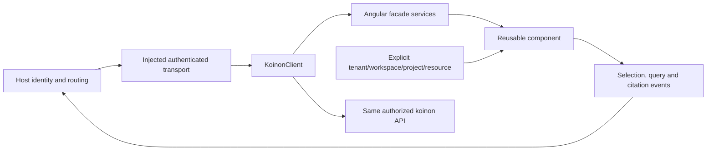

# Use koinon in another product

Choose the integration boundary that your host needs. The management application is a complete deployment. The Angular library supplies reusable management and exploration components. Angular custom elements provide a browser boundary for hosts using other UI frameworks. The framework-neutral TypeScript SDK supports a custom UI or server integration.

| Boundary | Host supplies | koinon supplies |
| --- | --- | --- |
| Management application | Deployment configuration and identity provider | Navigation, application state and complete management views |
| Angular library | SDK client, authenticated transport and explicit context | Components, facade services, typed inputs and interaction events |
| Custom elements | Scoped client binding and tenant/workspace/project/resource inputs | Encapsulated component UI and selection/query/citation events |
| TypeScript SDK | API location and authentication transport | Typed API methods, errors, upload contracts and cancellation |

An embedded component must not take over the host router, create a global authentication session, change the host theme or persist an unrestricted token. Components receive explicit context and report events. Visual styles stay inside the component boundary; design tokens allow intentional theming. The host decides where a selected document, citation or query result opens.

The SDK accepts a `KoinonTransport`. The default fetch transport supports API-relative paths, typed JSON, FormData, cancellation and problem details. Hosts can inject their own transport to reuse existing request tracing, authentication and renewal logic. A component never receives a client secret.

Use a same-origin BFF session for browser cookie authentication. Reads use the native session; writes also provide the current decoded XSRF cookie value. API clients use a short-lived bearer token and the bearer API prefix. The server keeps these authorities separate and rechecks persisted membership on every protected operation. Embedding across origins requires an explicit deployment design for CORS and browser cookies; enabling arbitrary origins is not a substitute for that design.

Angular packages use peer dependencies and partial compilation. Build and package the library, then install the resulting package into an independent consumer. A successful management-app build alone does not establish library-consumer compatibility. Qualification also checks a non-Angular host, event payloads, context changes during in-flight requests, CSS isolation, keyboard access, and component teardown.
