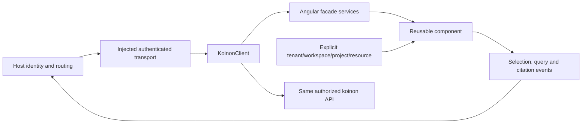

# Use koinon in another product

Choose the integration boundary that your host needs. The management application is a complete deployment. The Angular library supplies reusable management and exploration components. Angular custom elements provide a browser boundary for hosts using other UI frameworks. The framework-neutral TypeScript SDK supports a custom UI or server integration.

| Boundary | Host supplies | koinon supplies |
| --- | --- | --- |
| Management application | Deployment configuration and identity provider | Navigation, application state and complete management views |
| Angular library | SDK client, authenticated transport and explicit context | Components, facade services, typed inputs and interaction events |
| Custom elements | Scoped client binding and tenant/workspace/project/resource inputs | Encapsulated component UI and selection/query/citation events |
| TypeScript SDK | API location and authentication transport | Typed API methods, errors, upload contracts and cancellation |



An embedded component must not take over the host router, create a global authentication session, change the host theme or persist an unrestricted token. Components receive explicit context and report events. Visual styles stay inside the component boundary; design tokens allow intentional theming. The host decides where a selected document, citation or query result opens.

## Open a focused chat

Set `view="chat"` and `[showNavigation]="false"` on `ffk-workbench` when the host owns the product navigation. Enable the optional `KOINON_CHAT_LOADER` provider. The same inputs are properties on the `firefly-koinon` custom element. `viewChange` reports navigation requests to the host; the component does not change its URL.

`navigationCollapsed` controls the conversation sidebar. Listen to `navigationCollapsedChange` to keep the host's preference in sync. The boundary chevron keeps history available when collapsed. Files use the injected client and the current tenant, subject and conversation; selecting a file does not publish it to the organization Library. The backend reports available formats and processing prerequisites, and each message explicitly selects its attachment IDs.

The command palette uses the injected client and current catalog scope. Its keyboard shortcut, **Command/Ctrl+K**, operates only while focus is inside the workbench. Resource searches use bounded server pages and discard responses after the subject, client or selected context changes. The palette does not register a page-wide shortcut in the host.

## Render a code block

Import `KoinonCodeBlock` from `@fireflyframework/koinon-angular` into your Angular component, then pass the original code and an explicit `language`:

```html
<ffk-code-block
  [code]="exampleCode"
  language="python"
  label="Python example"
/>
```

Omitting `language` preserves the SQL default, the **Recorded SQL** region label and the **Copy SQL** button label. Set `label` for another context. The atom displays the full text immediately and loads its tokenizer on demand. Direct consumers of the existing `sqlTokens` function keep its synchronous behavior.

Supported languages use syntax colors; unknown languages and highlighting failures preserve plain text. Angular text bindings render every token, so code cannot inject HTML. The copy button copies the original code, and long lines scroll within the block. See [code in chat messages](agents.md#code-in-chat-messages) for fence handling and attachment references.

## Open reviewed shared messages

Enable `KOINON_SHARED_CONVERSATION_LOADER` with a lazy import of `KoinonSharedConversation` from the Chat entry point. Pass the reviewed reference through `sharedConversationId`, select its organization through `tenantId`, and clear the reference when `sharedConversationDismissed` fires. The same properties and event are available on the custom element. The host retains control of its route and login redirect.

The management application accepts `#share=<reference>&tenant=<organization>`, removes those fields from the address, and retains only the reference for up to an hour across sign-in. A reference grants no access: opening the saved messages checks current recipient, owner, source and originating-token authority. The reader shows the reviewed text and verified source manifest; it does not resolve the owner's private chat artifacts.

## Brand assets and fonts

Serve the supplied brand assets at a trusted HTTP(S) base and pass that location through the component's `brandBase` input. The default is `/assets/brand`. Include the canonical logos and both `fonts/manrope-latin-wght-normal.woff2` and `fonts/inter-latin-wght-normal.woff2` when users can choose the interface font. Copying only the SVGs leaves the selected typeface unavailable.

The component loads Manrope at weights 200–800 or Inter at weights 100–900 with a private family name and applies it inside its own boundary. Instances share a per-document asset cache and release their font reference on teardown. The host does not need a global font stylesheet, and its body typography stays unchanged. Cross-origin assets need the appropriate font CORS response and deployment CSP permission. Verify the font response and loaded font face in a clean host; a computed font-family declaration alone does not establish that the bytes loaded.

The SDK accepts a `KoinonTransport`. The default fetch transport supports API-relative paths, typed JSON, FormData, cancellation and problem details. Hosts can inject their own transport to reuse existing request tracing, authentication and renewal logic. A component never receives a client secret.

Use a same-origin BFF session for browser cookie authentication. Reads use the native session; writes also provide the current decoded XSRF cookie value. API clients use a short-lived bearer token and the bearer API prefix. The server keeps these authorities separate and rechecks persisted membership on every protected operation. Embedding across origins requires an explicit deployment design for CORS and browser cookies; enabling arbitrary origins is not a substitute for that design.

Angular packages use peer dependencies and partial compilation. Build and package the library, then install the resulting package into an independent consumer. A successful management-app build alone does not establish library-consumer compatibility. Qualification also checks a non-Angular host, event payloads, context changes during in-flight requests, CSS isolation, keyboard access, and component teardown.
