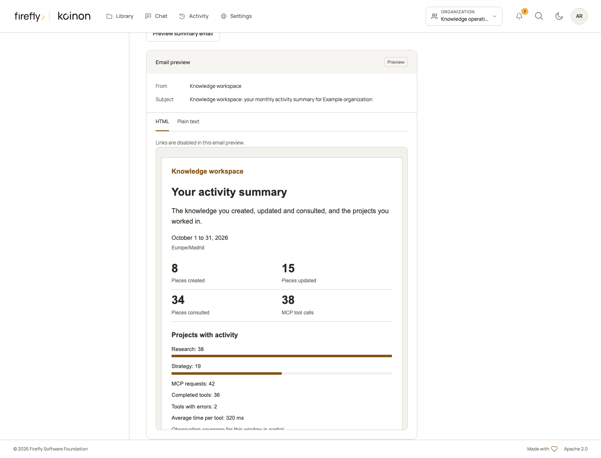
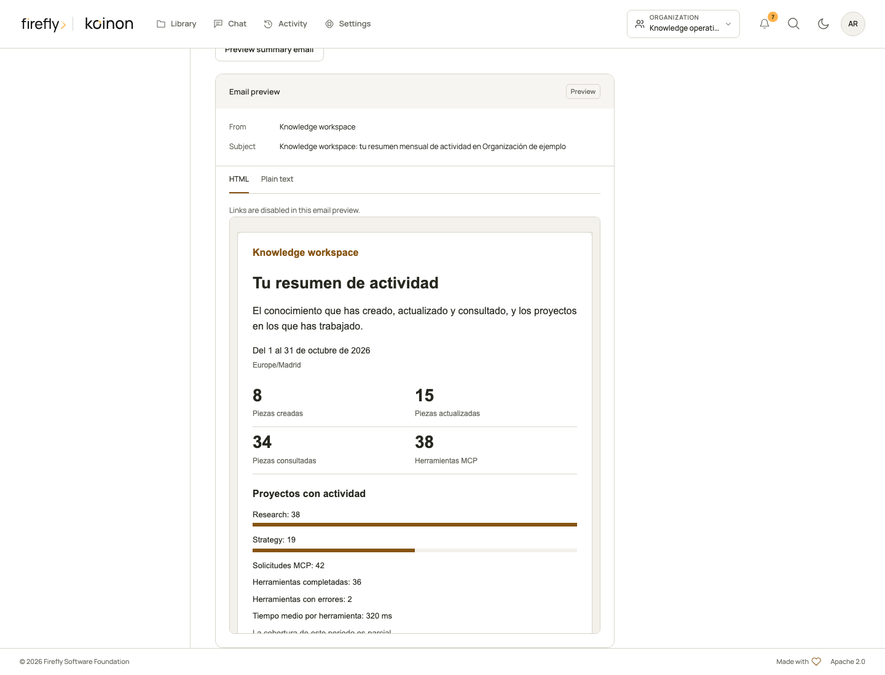

<!-- Copyright 2026 Firefly Software Foundation SPDX-License-Identifier: Apache-2.0 -->
# Communications without the management interface

Use the same recipient-bound invitations, personal inbox and scheduled knowledge summaries from your own application. This chapter follows the [headless essentials](headless.md) and the language-specific [Python](headless-python.md), [TypeScript](headless-typescript.md) or [Java 21](headless-java.md) installation tutorial. The SDKs call the native API; they do not send email directly or create a second identity directory.

## 1. Choose the actor and permissions

Configure an API root ending in `/api/v1`. Your host supplies a current API-audience access token or a personal API token through a callback for **each request**. Never use a model-provider key, an ID token or an MCP resource token. Keep credentials out of URLs, invitation messages, screenshots and logs.

| Operation | Authority |
|---|---|
| Read your inbox, unread count, preferences and calendar preview | `notifications:read`; no organization membership required |
| Mark your notification read or update your preferences | `notifications:write`, which includes read |
| Preview your actual knowledge-summary email | `notifications:read` and `activity:read`, with current access to the selected organization |
| Search eligible directory recipients, preview/create/revoke/resend invitations, inspect policy and delivery history | Current organization/workspace administration and `members:write`; scoped admin PATs remain within their current ceilings |
| Accept or decline an email invitation | The intended recipient's interactive sign-in and CSRF-protected browser session; a PAT cannot replace this |

For a browser host, use its established same-origin session through `/bff/api/v1` and a callback supplying the current decoded `XSRF-TOKEN` cookie as `X-XSRF-TOKEN` on writes. Include same-origin credentials and omit bearer authority on that browser transport. For a server host, obtain the bearer through the approved identity flow. A token provider refreshes credentials; the SDK does not acquire consent or refresh credentials for you. Handle `401` by renewing authentication, and `403` by reviewing current scope or membership. Do not retry writes with a new idempotency key just because a connection ended without a response.

## 2. Read the inbox before making a change

Inbox pages contain your own notifications, their organization/workspace provenance and a typed target. Page with `page` and `page_size`; use `read="unread"` and `kind="security"` on the HTTP, Python and Java APIs. The TypeScript factory exposes `event_kind` and translates it to the native `kind` query parameter.

`read_at: null` means unread. Mark only a notification that the person has actually opened. Access and security notices are separate from optional summaries. Token or application notices contain safe labels, scope and expiry information, never credentials. The current authority still controls every linked resource; a historical notification does not confer access.

## 3. Propose a schedule, preview it, then save explicitly

Fetch preferences first and retain their `revision`. A draft carries `expected_revision`, the current channel rules, `digest` and `schedule`. `digest` accepts `off`, `daily`, `weekly` or `monthly`, subject to the organization's allowed cadences. Choosing an email cadence should explicitly enable the digest email rule; retaining an old `email: false` rule keeps that opt-out in force. Inbox-only summaries can keep email disabled.

The profile's IANA time zone governs scheduling. `weekday` uses Monday `0` through Sunday `6`; `day_of_month` uses `1`–`31`. A monthly day `31` clips to the final day of shorter months. The calendar preview returns `next_run_at` in UTC and `next_run_local` with the local offset. A DST gap advances to the first valid minute; an ambiguous time uses the earlier occurrence once. Previewing does not save preferences or dispatch work.

`notification_locale: null` inherits organization language, then installation language, then English. Supported English and Spanish tags include `en-US` and `es-ES`. The output's `effective_locale` and `locale_origin` explain the result. Organization administrator schedules can independently enable daily, weekly and monthly summaries; personal `admin_summaries: null` inherits those schedules and `false` opts out. Neither turns off mandatory security notices.

## Python: a complete read and preview program

This program reads state and renders a proposed monthly summary. Its entry point does not save preferences, create invitations or send email. The separate write helpers below require a later explicit decision in your host.

```python
import asyncio
import os
from datetime import UTC, datetime, timedelta

from koinon_sdk import KoinonClient
from koinon_sdk.activity import ActivityWindow
from koinon_sdk.communications import (
    ActivityEmailPreviewInput,
    DigestSchedule,
    EmailInvitationInput,
    NotificationPreferenceRuleInput,
    NotificationPreferencesInput,
)


def monthly_draft(current):
    rules = [
        NotificationPreferenceRuleInput(kind=r.kind, inbox=r.inbox, email=r.email)
        for r in current.rules if r.kind != "digest"
    ]
    rules.append(NotificationPreferenceRuleInput(kind="digest", inbox=True, email=True))
    return NotificationPreferencesInput(
        expected_revision=current.revision,
        rules=rules,
        digest="monthly",
        schedule=DigestSchedule(local_time="09:00", weekday=0, day_of_month=31),
        notification_locale=None,
        admin_summaries=current.admin_summaries,
    )


async def save_reviewed_preferences(client, draft):
    return await client.update_notification_preferences(draft)


async def create_reviewed_invitation(client, tenant, recipient_ref, workspace, action_key):
    value = EmailInvitationInput(
        recipient_ref=recipient_ref, role="viewer", workspace_id=workspace,
        expires_in_hours=24, message="Please review access to our shared knowledge workspace.",
    )
    return await client.create_email_invitation(tenant, value, action_key)


async def main():
    async with KoinonClient(
        os.environ["KOINON_API_URL"],
        token_provider=lambda: os.environ["KOINON_TOKEN"],
    ) as client:
        inbox = await client.notifications(read="unread", page=1, page_size=20)
        unread = await client.notification_unread_count()
        print("Unread:", unread.unread, "Page:", inbox.page, "of", inbox.pages)
        current = await client.notification_preferences()
        if "monthly" not in current.allowed_digests:
            print("Monthly summaries are not enabled by this organization's policy.")
            return
        draft = monthly_draft(current)
        calendar = await client.preview_notification_schedule(draft)
        print("Next run:", calendar.next_run_local, "Zone:", calendar.time_zone)
        end = datetime.now(UTC) - timedelta(seconds=2)
        preview = await client.preview_activity_email(ActivityEmailPreviewInput(
            tenant_id=os.environ["KOINON_TENANT_ID"], preferences=draft,
            window=ActivityWindow(start_at=end-timedelta(days=7), end_at=end,
                                  time_zone=current.time_zone),
        ))
        print("Preview:", preview.subject, "Language:", preview.effective_locale)
        print("No preferences saved and no email sent.")


if __name__ == "__main__":
    asyncio.run(main())
```

The preview window is the preceding seven elapsed days, grouped in the profile time zone; it does not claim seven complete local calendar days. Keep it in the past and at most 366 elapsed days. Unknown observations remain `null` with coverage/status information; do not substitute zero. The preview includes only current, permission-filtered activity, knowledge counts and projects. It excludes questions, answers and private chat contents. Actual email HTML/text comes from `rendered_html`/`rendered_text`; do not reconstruct a different template from guessed fields.

## TypeScript: import the optional communications entry point

The factory is published at `@fireflyframework/koinon-sdk/communications`. It is intentionally separate from the root runtime constructor. Reuse your application's authenticated `KoinonTransport`; do not read private fields from a `KoinonClient`. The following complete module also keeps all writes as separate exported helpers.

```typescript
import { FetchTransport } from "@fireflyframework/koinon-sdk";
import type {
  EmailInvitationInput, NotificationPreferences, NotificationPreferencesInput,
} from "@fireflyframework/koinon-sdk";
import { createCommunicationsApi } from "@fireflyframework/koinon-sdk/communications";

const transport = new FetchTransport({
  baseUrl: process.env["KOINON_API_URL"]!,
  accessToken: () => process.env["KOINON_TOKEN"] ?? null,
  credentials: "omit",
});
const communications = createCommunicationsApi(transport);

function monthlyDraft(current: NotificationPreferences): NotificationPreferencesInput {
  return {
    expected_revision: current.revision,
    rules: [
      ...current.rules.filter(rule => rule.kind !== "digest")
        .map(({kind, inbox, email}) => ({kind, inbox, email})),
      {kind: "digest", inbox: true, email: true},
    ],
    digest: "monthly",
    schedule: {local_time: "09:00", weekday: 0, day_of_month: 31},
    admin_summaries: current.admin_summaries,
    notification_locale: null,
  };
}

export async function saveReviewedPreferences(draft: NotificationPreferencesInput) {
  return communications.notifications.updatePreferences(draft);
}

export async function createReviewedInvitation(
  tenant: string, input: EmailInvitationInput, actionKey: string,
) {
  return communications.emailInvitations.create(tenant, input, {
    headers: {"Idempotency-Key": actionKey},
  });
}

async function main() {
  const controller = new AbortController();
  const options = {signal: controller.signal};
  const inbox = await communications.notifications.list(
    {read: "unread", page: 1, page_size: 20}, options,
  );
  console.log("Inbox page:", inbox.page, "of", inbox.pages);
  const current = await communications.notifications.preferences(options);
  if (!current.allowed_digests.includes("monthly")) return;
  const draft = monthlyDraft(current);
  const calendar = await communications.notifications.previewPreferences(draft, options);
  console.log("Next run:", calendar.next_run_local, "Zone:", calendar.time_zone);
  const end = new Date(Date.now() - 2000);
  const preview = await communications.notifications.previewEmail({
    tenant_id: process.env["KOINON_TENANT_ID"]!, preferences: draft,
    window: {start_at: new Date(end.getTime() - 7 * 86400000).toISOString(),
             end_at: end.toISOString(), time_zone: current.time_zone},
  }, options);
  console.log("Preview:", preview.subject, "Language:", preview.effective_locale);
  console.log("No preferences saved and no email sent.");
}

await main();
```

Use `controller.abort()` when the owner changes, the host closes the view or the request is no longer wanted. Discard old responses after an actor or tenant switch. Embedded Angular hosts must bind the matching client **and** transport together, as explained in [embedding](embedding.md); a new client with an old transport must never retain the previous person's inbox or unread count.

## Java 21: the same workflow with typed records

Use the SDK's established JDK HTTP client and bearer supplier. Generated model enums below are their actual Java names. `JsonField`-backed fields distinguish omission from explicit null: `clearNotificationLocale()` chooses inheritance, while omitting that field leaves it unspecified in the request.

```java
import java.net.URI;
import java.time.Instant;
import java.time.temporal.ChronoUnit;
import java.util.ArrayList;
import org.fireflyframework.koinon.sdk.KoinonClient;
import org.fireflyframework.koinon.sdk.model.*;

public final class CommunicationsExample {
  static NotificationPreferencesInput monthlyDraft(NotificationPreferences current) {
    var rules = new ArrayList<NotificationPreferenceRuleInput>();
    for (var rule : current.rules()) {
      if (rule.kind() != DeliveryRecordKind.DIGEST) {
        rules.add(NotificationPreferenceRuleInput.empty().withKind(rule.kind())
          .withInbox(rule.inbox()).withEmail(rule.email()));
      }
    }
    rules.add(NotificationPreferenceRuleInput.empty().withKind(DeliveryRecordKind.DIGEST)
      .withInbox(true).withEmail(true));
    var draft = NotificationPreferencesInput.empty().withExpectedRevision(current.revision())
      .withRules(rules).withDigest(CommunicationPolicyAllowedDigests.MONTHLY)
      .withSchedule(new DigestSchedule("09:00", 0, 31)).clearNotificationLocale();
    return current.adminSummaries() == null ? draft.clearAdminSummaries()
      : draft.withAdminSummaries(current.adminSummaries());
  }

  static NotificationPreferences saveReviewedPreferences(
      KoinonClient client, NotificationPreferencesInput draft) {
    return client.notifications().updatePreferences(draft);
  }

  static EmailInvitation createReviewedInvitation(
      KoinonClient client, String tenant, String recipientRef,
      String workspace, String actionKey) {
    var input = EmailInvitationInput.empty().withRecipientRef(recipientRef)
      .withRole(MembershipRole.VIEWER).withWorkspaceId(workspace)
      .withExpiresInHours(24).withMessage("Please review access to shared knowledge.");
    return client.communications(tenant).createInvitation(input, actionKey);
  }

  public static void main(String[] args) {
    try (var client = KoinonClient.builder(URI.create(System.getenv("KOINON_API_URL")))
        .bearerToken(() -> System.getenv("KOINON_TOKEN")).build()) {
      var inbox = client.notifications().list(NotificationFilter.empty()
        .withRead("unread").withPage(1).withPageSize(20));
      System.out.println("Inbox page: " + inbox.page() + " of " + inbox.pages());
      var current = client.notifications().preferences();
      if (!current.allowedDigests().contains(CommunicationPolicyAllowedDigests.MONTHLY)) return;
      var draft = monthlyDraft(current);
      var calendar = client.notifications().previewSchedule(draft);
      System.out.println("Next run: " + calendar.nextRunLocal());
      var end = Instant.now().minusSeconds(2);
      var window = new ActivityWindow(end.minus(7, ChronoUnit.DAYS), end, current.timeZone());
      var preview = client.notifications().previewEmail(new ActivityEmailPreviewInput(
        System.getenv("KOINON_TENANT_ID"), draft, window));
      System.out.println("Preview: " + preview.subject());
      System.out.println("No preferences saved and no email sent.");
    }
  }
}
```

Synchronous methods also have `CompletableFuture` counterparts such as `preferencesAsync()` and `previewEmailAsync(input)`. Your host owns cancellation and lifecycle. On a revision conflict, re-read the current preferences, show the changed policy and ask for a fresh decision; do not overwrite the revision automatically.

## Inspect the real preview

These compiled management-host captures use the same rendered-template response as the SDK endpoint, with fictional people and counts. They show English and Spanish output under the generic product brand. They are controlled UI examples; no email was sent and they are not evidence of a live provider or observed customer activity. The preview disables links; the complete template, including its immutable attribution, remains available in the scrollable preview and plain-text tab.





## 4. Select an existing directory recipient

An invitation does not provision a new Keycloak, Entra or Google Workspace account. The operator configures a supported directory connection and eligible sender first. Read capabilities before enabling email actions. `disabled`, `not_configured` and `degraded` are meaningful states; in-app notifications remain usable when email is unavailable. A dummy or absent email provider is not a successful delivery.

| Step | Python | TypeScript factory | Java tenant API |
|---|---|---|---|
| Read readiness | `client.communications_capabilities(tenant)` | `api.administration.capabilities(tenant)` | `client.communications(tenant).capabilities()` |
| Page safe provider choices | `client.communication_providers(tenant, workspace_id=workspace, page=1, page_size=20)` | `api.recipients.providers(tenant, {workspace_id: workspace, page: 1, page_size: 20})` | `recipientProviders(RecipientProviderFilter.empty().withWorkspaceId(workspace))` |
| Search recipients | `client.communication_recipients(tenant, provider_id=provider, workspace_id=workspace, q=query, limit=10)` | `api.recipients.list(tenant, {provider_id: provider, workspace_id: workspace, q: query, limit: 10})` | `recipients(RecipientFilter.empty().withProviderId(provider).withWorkspaceId(workspace).withQ(query).withLimit(10))` |
| Preview the selected grant | `client.preview_email_invitation(tenant, input)` | `api.emailInvitations.preview(tenant, input)` | `previewInvitation(input)` |

Provider choices are paginated and expose no directory credentials. When multiple connections are eligible, require an explicit provider selection. Recipient search uses a bounded opaque `next_cursor`; pass it as `after` to continue. Display `delivery_address_status` and the eligibility reason. The browser cannot mark an address verified. An existing organization member may still need access to an additional workspace; the final server preview decides eligibility in that exact context.

After the person chooses a result, use its server-issued `recipient_ref` in `EmailInvitationInput`. It is short-lived and scoped to provider, tenant, directory revision and actor. It is never a client-asserted email or immutable user ID. The server revalidates it at preview/create. Show the exact recipient, organization, shared knowledge workspace, immutable role and expiry before calling a write helper. These workspace grants do not share private chat folders or personal memory.

## 5. Create once, inspect and revoke deliberately

After explicit review, call the creation helper with an action-specific idempotency key and retain it with the resulting invitation ID. An interrupted response can be retried with the **same** input/key; do not generate another key to force a second invitation. The output has a noncredential invitation UUID and delivery state. It has no bearer token. Changing the role or workspace means revoking the old grant and reviewing a new invitation.

| Action | Python | TypeScript factory | Java tenant API |
|---|---|---|---|
| Page invitation history | `client.email_invitations(tenant, status="pending", page=1, page_size=20)` | `api.emailInvitations.list(tenant, {status: "pending", page: 1, page_size: 20})` | `invitations(EmailInvitationFilter.empty().withStatus("pending"))` |
| Revoke an exact UUID | `client.revoke_email_invitation(tenant, invitation_id)` | `api.emailInvitations.revoke(tenant, invitationId)` | `revokeInvitation(invitationId)` |
| Resend when allowed | `client.resend_email_invitation(tenant, invitation_id)` | `api.emailInvitations.resend(tenant, invitationId)` | `resendInvitation(invitationId)` |

Revoke returns `None` in Python, `undefined` in TypeScript and `Void` in Java on HTTP204. Resend eligibility is authoritative: inspect `allowed_actions`, `action_reasons` and `delivery.next_resend_at`. Revoked/expired inviter credentials, lost authority, changed connection, cooldown, send limit or an unknown provider outcome can prevent resend. Do not bypass these states by creating another bearer link.

The default email CTA opens `/auth/invitations/email/{uuid}` on the operator-configured `koinon.public_url`. The host header never selects that public origin. The UUID only identifies the invitation. Interactive sign-in must freshly match the intended immutable directory identity before acceptance. The native screen works without Angular. A host implementing its own screen can read the review through `email_invitation`, `api.emailInvitations.review` or `client.emailInvitations().review`, but acceptance/decline still require the recipient's ordinary CSRF-protected interactive session. Accepted-invitation replay cannot restore a subsequently removed membership. Explicit legacy bearer-link invitations remain a separate flow.

## 6. Inspect delivery without promising arrival

Page organization delivery history with current administration authority. In Python use `communication_deliveries(tenant, kind="invitation", status="unknown", page=1, page_size=20)`; in TypeScript use `api.administration.deliveries(tenant, {event_kind: "invitation", status: "unknown"})`; in Java use `client.communications(tenant).deliveries(CommunicationDeliveryFilter.empty().withKind("invitation").withStatus("unknown"))`. Date filters are aware ISO8601 `created_from`/`created_to`, not display-formatted dates. Respect the returned page counts.

`queued` and `sending` describe worker state. `sent` means the provider accepted the message, not that the recipient received or opened it. `unknown` retains an uncertain provider outcome; it is not success or failure and must not be blindly resent. Only expose retry when `can_retry` permits it. Use the delivery detail and safe explanation; do not display provider exceptions or credentials.

Every preview, HTML/text email and notification preserves **Powered by koinon** and **© year Firefly Software Foundation**, even with custom branding. Originating organization/workspace provenance remains visible where authorized. Render the actual returned HTML only inside a scriptless, navigation-free sandbox; treat plain text as text. The [communications guide](../operations/communications.md) covers the incumbent interface, and [communications configuration](../reference/communications-configuration.md) covers the real sender, public URL, queue and installation settings.

Copyright 2026 Firefly Software Foundation. Licensed under Apache-2.0.
