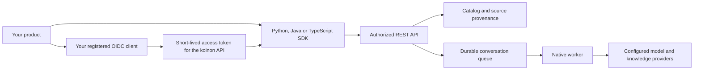

# Add knowledge capabilities to your product

The API and durable worker run independently of the interface. Forge or another product can use koinon through the Python, Java or TypeScript SDK, build its own interface, or add only an [embedded explorer](embedding.md). All three SDKs run without Angular or the backend package.



Pass a scoped personal API token or an OIDC access token issued for the configured API audience. Personal tokens are created by a user with an expiry and explicit organization, permission and resource bounds. An OIDC integration registers its own identity client and supplies token renewal through a callback. Both use the same authorized API; current membership and resource ancestry are checked on every request.

For scope selection, role boundaries and creation/upload examples in all three languages, see [API permissions and knowledge writes](api-permissions.md).

Never copy browser cookies to a server or send a model credential to the SDK. A personal token cannot create or manage other tokens; those operations require an interactive verified identity.

## TypeScript

The [complete TypeScript example](headless-typescript.md) includes environment configuration, paging, bounded file uploads, organization-default chat, streaming and audit access.

Install the built `@fireflyframework/koinon-sdk` package. A release must qualify the packed package before publication; the development monorepo also builds it from `sdk/typescript`.

```ts
import {FetchTransport, KoinonClient} from '@fireflyframework/koinon-sdk';

const knowledge = new KoinonClient({transport: new FetchTransport({
  baseUrl: 'https://knowledge.example.org/api/v1',
  accessToken: () => identity.getAccessToken(),
  credentials: 'omit',
})});

const context = await knowledge.context();
const organization = context.tenants.find(tenant => tenant.id === configuredTenant);
if (!organization) throw new Error('Knowledge access is not configured');
const documents = await knowledge.catalog.list(organization.id, {kind: 'document'});
```

Identifiers come from authorized responses and host configuration. A workspace selector or component input supplies context; it does not grant access. Keep one client per host authentication policy and explicitly pass the intended organization, workspace and source scope.

## Python

The [complete Python example](headless-python.md) includes client cleanup and lazy, scoped operations without starting a backend application context.

Install the built `firefly-koinon-sdk` wheel. The package has only HTTPX and Pydantic runtime dependencies.

```python
from koinon_sdk import KoinonClient

async with KoinonClient(
    "https://knowledge.example.org/api/v1",
    token_provider=identity.get_access_token,
) as knowledge:
    context = await knowledge.context()
    documents = await knowledge.catalog(configured_tenant, kind="document")
```

The caller owns the event loop, client lifecycle and token renewal. Register the client through your application's dependency injection if useful; the SDK does not start another application context.

## Java

The [complete Java example](headless-java.md) includes Java 21 records, lazy paging and a demand-aware SSE subscriber with explicit connection ownership.

The Java 21 SDK uses the JDK HTTP client and Jackson. Its Maven coordinates are `org.fireflyframework:koinon-sdk:26.11.2`. This SDK is built from `sdk/java`; a local package qualification does not publish it to Maven Central.

```java
import java.net.URI;
import org.fireflyframework.koinon.sdk.KoinonClient;

try (var knowledge = KoinonClient.builder(
        URI.create("https://knowledge.example.org/api/v1"))
    .bearerToken(identity::getAccessToken)
    .build()) {
    var context = knowledge.platform().context();
    var documents = knowledge.documents(configuredTenant);
}
```

Resource groups provide concrete typed methods and asynchronous `CompletableFuture<T>` variants. SSE returns `EventStream<StreamEvent>`, a demand-aware `Flow.Publisher` that closes its HTTP connection on cancellation. Request records, wire enums and `JsonField<T>` preserve omitted values, explicit null and false. Timestamp metadata uses `Instant`; exact numeric cells remain strings or `BigDecimal` as declared by the contract.

## Contract and helpers

The generated [API and SDK reference](../reference/sdk-api.md) maps every canonical operation to all three clients. Use its checked operation manifest and shared schemas for the current counts and signatures, including requests, responses, pages and binary descriptors. Retained routes outside that contract require separate migration qualification.

SDK source, local packages, registry publication and configured-service acceptance are separate. Use a trusted built artifact or build the SDK from the repository; these examples do not establish that its development version is available on PyPI, npm or Maven Central. Never install a similarly named package by guessing its publisher.

## Import several files

Canonical Library upload currently admits one bounded file per request. The language examples expose a sequential client batch of at most 16 files, each at most 32 MiB. They retain each successful receipt and stop on a failure. They do not supply an atomic transaction, durable batch queue, per-item recovery or automatic write retries. An ambiguous timeout requires checking the existing ingestion state before deciding whether to submit again. This is distinct from the separately idempotent dataset file-append operation.

Select `document` for unstructured intake or `dataset` for structured intake. Actual supported formats, extractors, object storage and model prerequisites depend on the configured deployment. XLSX does not require pretending that a workbook is CSV. See [Library intake](library.md) and [storage and bulk boundaries](../operations/storage.md#bulk-work-remains-separate).

Each SDK includes server-page iteration and exact-number helpers. Page iteration is lazy, preserves opaque cursors and does not slice local arrays. Decimals and integers outside JavaScript's safe range travel as exact strings. Convert a value only when its column or field is known to be numeric; preserve identifiers, date-only values and unknown text.

Content replacement and reingestion require the current revision. The SDK sends `If-Match` and leaves conflicts visible. Omitted provider credentials preserve the saved value; explicit null clears it. Authenticated file responses preserve content type, filename and ETag, including not-modified responses. The clients never retry writes automatically.

## Streaming and cancellation

Submit a conversation run with a caller-generated `client_request_id`. Reuse that identifier only for the same message and scope. The server returns the existing submission for an identical request and rejects conflicting reuse.

Consume `knowledge.chat.events` in TypeScript or the Python client's `events` context manager. Save the last fully processed event ID and provide `Last-Event-ID` on a new stream. Handle `message_reset` by replacing the affected partial message, and handle terminal completion, failure and cancellation explicitly. Closing a stream releases the connection; use the cancel endpoint to stop the server run. The SDKs never silently reconnect or retry writes.

OpenUI artifacts contain only registered component names and evidence references. Resolve their data through the result endpoint for the same organization, run and conversation owner. Do not execute arbitrary HTML, JavaScript or URLs from a model response.

## Deploy only what you need

Start the API with `python -m koinon.serve` through the native framework launcher and the independent worker with `python -m koinon.assistants.worker`, using runtime credentials and the same protected configuration. The ASGI entry point remains `koinon.main:app` for embedding. Run migrations separately with deployment authority. The worker needs configured knowledge and model providers; it has no dependency on the management application. See [production deployment](../operations/production.md) for identity, storage, sessions and secret management.

Qualification is recorded separately for SDK packaging, native API authorization, local provider generation, embedded UI and production deployment. Passing a mock HTTP test does not establish provider readiness.

Organization administrators can read and update typed [knowledge behavior settings](../operations/organization-knowledge.md) through all three SDKs. Organization policy revisions and optional applied snapshots remain distinct from workspace model assignments and token permissions.
