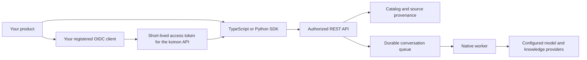

# Add knowledge capabilities to your product

The API and durable worker run independently of the interface. Forge or another product can use koinon through the TypeScript or Python SDK, build its own interface, or add only an [embedded explorer](embedding.md). Neither SDK depends on Angular or the backend package.



Register a dedicated identity client and the configured API audience. Reuse the host's token renewal through a callback; never copy browser cookies to a server or send a model credential to the SDK. An authenticated identity also needs a persisted koinon membership. The server enforces that membership and each resource's ancestry.

## TypeScript

Install the built `@fireflyframework/koinon-sdk` package. A release must qualify the packed package before publication; the development monorepo also builds it from `sdk/typescript`.

```ts
import {FetchTransport, KoinonClient} from '@fireflyframework/koinon-sdk';

const knowledge = new KoinonClient({transport: new FetchTransport({
  baseUrl: 'https://knowledge.example.org/api/v1',
  accessToken: () => identity.getAccessToken(),
  credentials: 'omit',
})});

const context = await knowledge.context();
const organization = context.tenants.find(tenant => tenant.id === configuredTenant);
if (!organization) throw new Error('Knowledge access is not configured');
const documents = await knowledge.catalog.list(organization.id, {kind: 'document'});
```

Identifiers come from authorized responses and host configuration. A workspace selector or component input supplies context; it does not grant access. Keep one client per host authentication policy and explicitly pass the intended organization, workspace and source scope.

## Python

Install the built `firefly-koinon-sdk` wheel. The package has only HTTPX and Pydantic runtime dependencies.

```python
from koinon_sdk import KoinonClient

async with KoinonClient(
    "https://knowledge.example.org/api/v1",
    token_provider=identity.get_access_token,
) as knowledge:
    context = await knowledge.context()
    documents = await knowledge.catalog(configured_tenant, kind="document")
```

The caller owns the event loop, client lifecycle and token renewal. Register the client through your application's dependency injection if useful; the SDK does not start another application context.

## Streaming and cancellation

Submit a conversation run with a caller-generated `client_request_id`. Reuse that identifier only for the same message and scope. The server returns the existing submission for an identical request and rejects conflicting reuse.

Consume `knowledge.chat.events` in TypeScript or the Python client's `events` context manager. Save the last fully processed event ID and provide `Last-Event-ID` on a new stream. Handle `message_reset` by replacing the affected partial message, and handle terminal completion, failure and cancellation explicitly. Closing a stream releases the connection; use the cancel endpoint to stop the server run. Neither SDK silently reconnects or retries writes.

OpenUI artifacts contain only registered component names and evidence references. Resolve their data through the result endpoint for the same organization, run and conversation owner. Do not execute arbitrary HTML, JavaScript or URLs from a model response.

## Deploy only what you need

Run the API with `koinon.main:app` and the independent worker with `python -m koinon.assistants.worker`, using runtime credentials and the same protected configuration. Run migrations separately with deployment authority. The worker needs configured knowledge and model providers; it has no dependency on the management application. See [production deployment](../operations/production.md) for identity, storage, sessions and secret management.

Qualification is recorded separately for SDK packaging, native API authorization, local provider generation, embedded UI and production deployment. Passing a mock HTTP test does not establish provider readiness.
