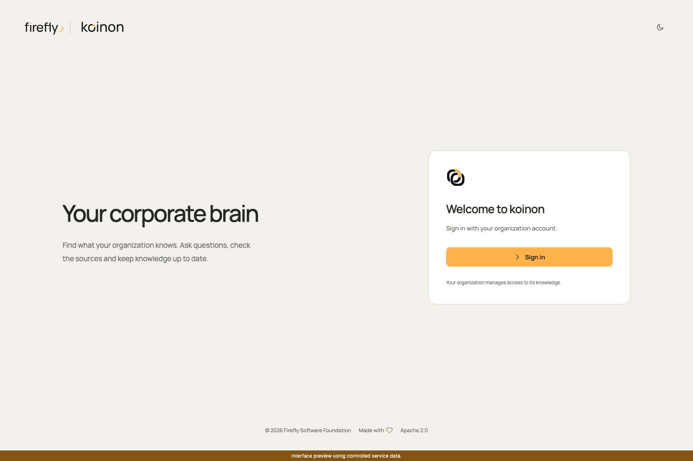
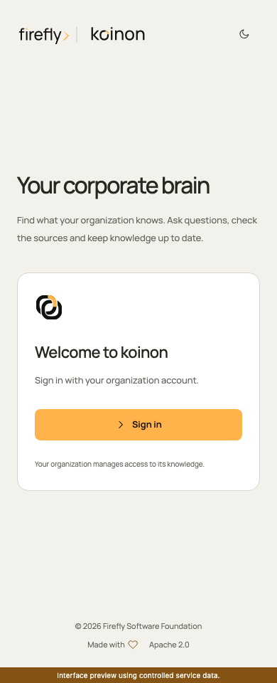
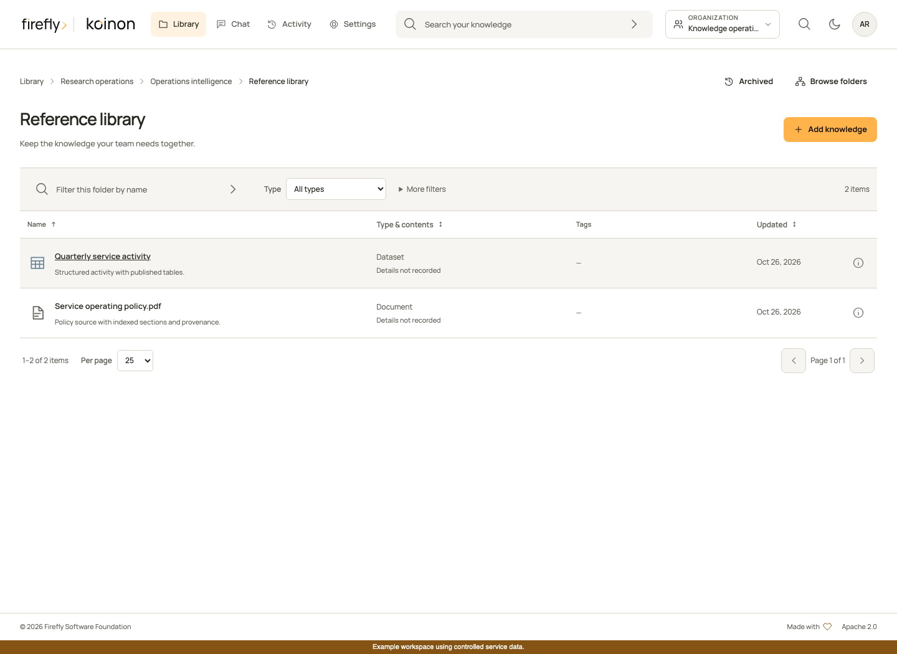
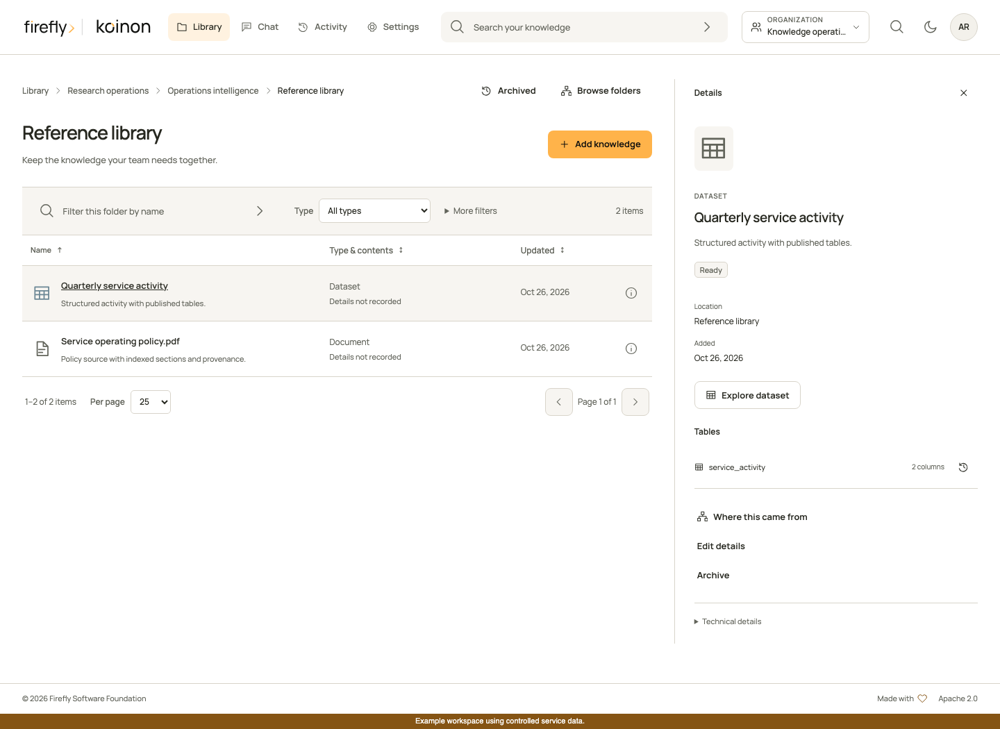
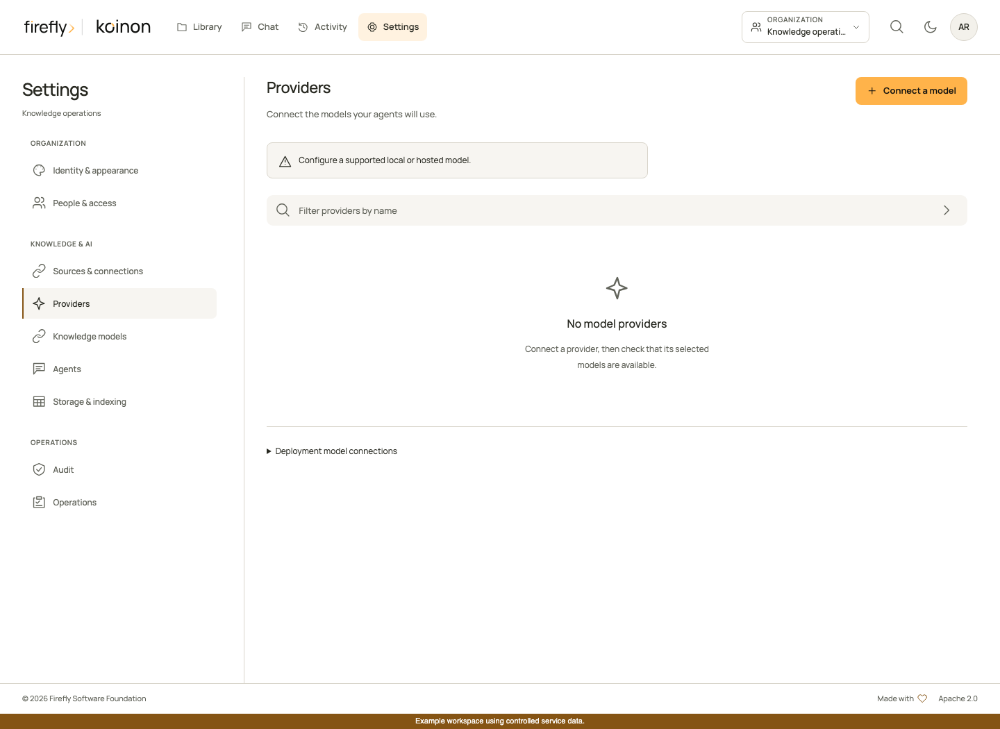
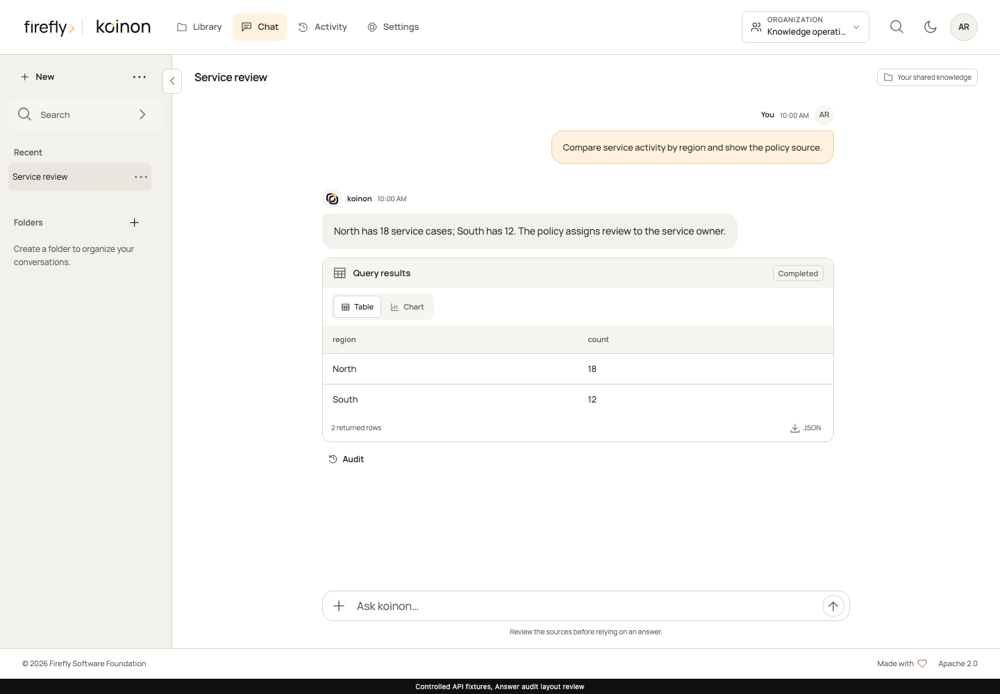
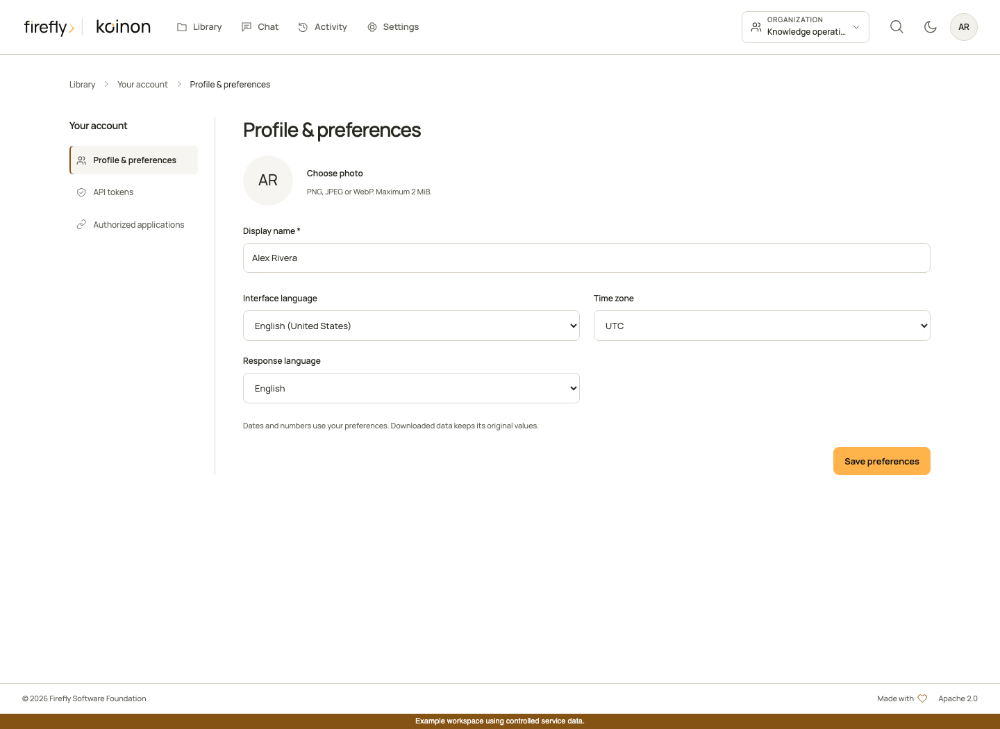
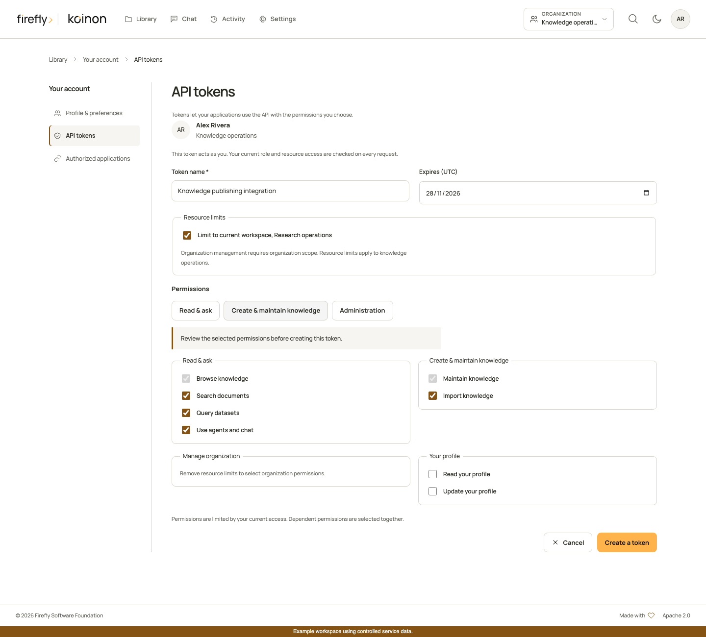

# A guided tour of koinon

Use this walkthrough to configure an organization, add knowledge and check the evidence behind an answer. An administrator manages organization policy and access; an operator connects services and monitors processing; a reader works with the knowledge shared with them.

The screenshots show the built interface with **controlled example data**. Names, documents, rows and model activity are demonstrations of the interface, not evidence of a production connection or a completed import. Available actions depend on your permissions and the capabilities reported by your deployment. Select a screenshot to open it at full size.

## 1. Open the right organization and folder

Sign in through your organization's identity provider. The organization selector in the top navigation determines which organization's library, conversations and settings you are viewing. Choosing an organization does not grant access to it.

koinon presents the product as your corporate brain: a place to find organizational knowledge, ask questions and inspect its sources. The sign-in page uses the installation's configured identity and opens the knowledge available to your account.

Open **Library**, select a workspace and follow its projects and folders. The breadcrumb shows your current location. Use the column headers to sort, the folder filter to narrow names, **More filters** for metadata and **Per page** to change the result size. The page controls request the next server page; they do not download the whole repository.

Folders hold related knowledge. Documents provide passages for reading and search; datasets provide tables for structured queries. The same folder can contain both. See [Library](library.md) for the hierarchy, permissions and supported operations.

## 2. Check a resource before using it

Open a document or dataset to inspect its details. The panel identifies the resource, its metadata and available actions. A dataset can expose its schema, published table snapshots and lineage. Recorded actor names, timestamps and metadata appear when the source records them; **not recorded** means the platform does not have that historical fact.

Use [Versions and lineage](lineage.md) to follow the original file, source version, extraction and the specific part or table snapshot used by an answer. Replacing a file must not silently relabel an older answer's evidence.

## 3. Add files to a deliberate destination

Choose **Add knowledge**, select **Upload files** and review the destination folder. Use **Change** if it is not the intended location.

Choose how the files will be used:

- **Documents to read and search** uses the document ingestion capabilities enabled by the operator.
- **Data to explore with queries** uses structured dataset ingestion. CSV is one supported case; the actual accepted formats, including spreadsheet support, depend on the connected ingestion service.

Drag files into the drop area or select them from your computer. Review the file list and upload it. A successful upload and a ready knowledge resource are separate states: follow **Activity** while extraction, indexing or dataset publication finishes. Failed files need review; the interface must not imply that an incomplete file is searchable.

Multiple file selection is not a guarantee of an atomic server batch. Current canonical upload limits and the distinction between client batches and durable bulk jobs are described in [File persistence and storage](../operations/storage.md).

## 4. Configure the services your organization uses

An organization administrator or appropriately authorized operator opens **Settings**. The sections separate organization access, knowledge/AI configuration and operational controls.

Configure in dependency order:

1. **Access:** establish the intended roles and workspace bounds. Use the separate **People** and **Organization structure** sections for positions and reporting relationships. Follow the [administration guide](administration.md) for invitations and directory-managed access.
2. **Providers:** connect an approved model provider and validate its observed capabilities. A discovered model name does not prove that streaming, tools or image input work.
3. **Knowledge models:** assign the document and dataset model roles exposed by the server, including embeddings where required. Existing indexed knowledge must retain a compatible embedding space.
4. **Agents:** configure the organization's default chat agent and its authorized knowledge tools. End users do not need to choose an agent in each conversation.
5. **Knowledge behavior:** configure the retrieval or analysis policy supported by the deployment. Read [Organization knowledge behavior](../operations/organization-knowledge.md) before enabling RLM; its qualification requirements and limitations are explicit.
6. **Sources & connections, Storage & indexing, Operations:** finish source-specific setup, verify readiness and inspect failed work. Deployment credentials, storage backends and worker capacity belong in the [operations documentation](../operations/README.md).

Settings changes require their own permission. Being an administrator in one workspace does not automatically authorize organization-wide changes.

## 5. Apply your organization's visual identity

Open **Settings** and select **Identity & appearance** in the **Organization** group. The **Identity** tab edits the product and assistant names, light/dark logos, assistant symbol and browser icon. Drag an image onto the relevant asset or choose a file. The checkerboard helps inspect transparency.

Open **Colors** to generate both themes from a brand color, then refine individual tokens. The readability checks show the actual contrast for text, secondary text, links and button text. Invalid colors cannot be saved.

The live preview switches between **Chat**, **Navigation** and **Sign-in**. Sign-in deliberately previews the installation identity: an organization's private settings are not exposed before authentication. Changes remain local until **Save changes** succeeds. See [Identity and appearance](../operations/identity-appearance.md) for deployment defaults, image constraints, restoring inheritance and typed SDK methods.

## 6. Ask a question, then inspect its evidence

Open **Chat**. Use **New** to start a conversation; folders organize related conversations. The current knowledge scope determines what the conversation can consult. The **+** menu adds supported private attachments; drag and drop is also available. Wait for attachment processing to finish before sending.

A private chat attachment is not automatically published to the organization library. Knowledge changes and newly derived conclusions require the explicit review and authorization flow described in [Agents and chat](agents.md).

After an answer, open **Audit**. Check the cited source and its recorded revision, then review the tools and execution context. For structured queries, inspect the executed SQL and the source/database/table snapshot context. For documents, inspect the passage and recorded document-part identity. A source being available now does not by itself establish that its full historical lineage was recorded.

The detailed [chat guide](agents.md) explains SSE, conversation memory, file capabilities and RLM tool receipts. [Exports and sharing](exports-sharing.md) explains reviewing selected messages, retaining their evidence and sharing under the recipient's current permissions.

## 7. Set your own profile and integration access

Open the account menu in the top navigation and choose **Your account**. Set your display name, avatar, interface locale, time zone and preferred response language. Locale controls presentation; it does not rewrite stored source values.

Choose **API tokens** for a user-owned integration token with explicit expiry, scopes and resource bounds. Choose **Authorized applications** to review application access and revoke a connection. These are distinct mechanisms: see [Profiles and API tokens](../operations/profiles-and-tokens.md), [Authorized applications](authorized-applications.md) and [MCP authentication](../operations/mcp-authentication.md).

Tokens can upload and maintain knowledge, as well as read it. Choose **Create & maintain knowledge** for an ingestion integration, then review its destination and permissions. **Administration** explicitly selects available organization permissions and removes resource limits. Current roles still apply on every request. See [API permissions and writes](api-permissions.md) for the role matrix and tested examples in all three SDK languages.

## 8. Build a headless or embedded integration

For a product that supplies its own interface, start with the [headless overview](headless.md), then the complete [Python](headless-python.md), [TypeScript](headless-typescript.md) or [Java](headless-java.md) guide. The [API and SDK reference](../reference/sdk-api.md) maps supported operations and DTOs.

For an existing frontend, use [Embedded components](embedding.md). A host supplies an authenticated client and explicit context. Identity and styles stay inside each workbench's component boundary; the host retains control of its own page and authentication.
