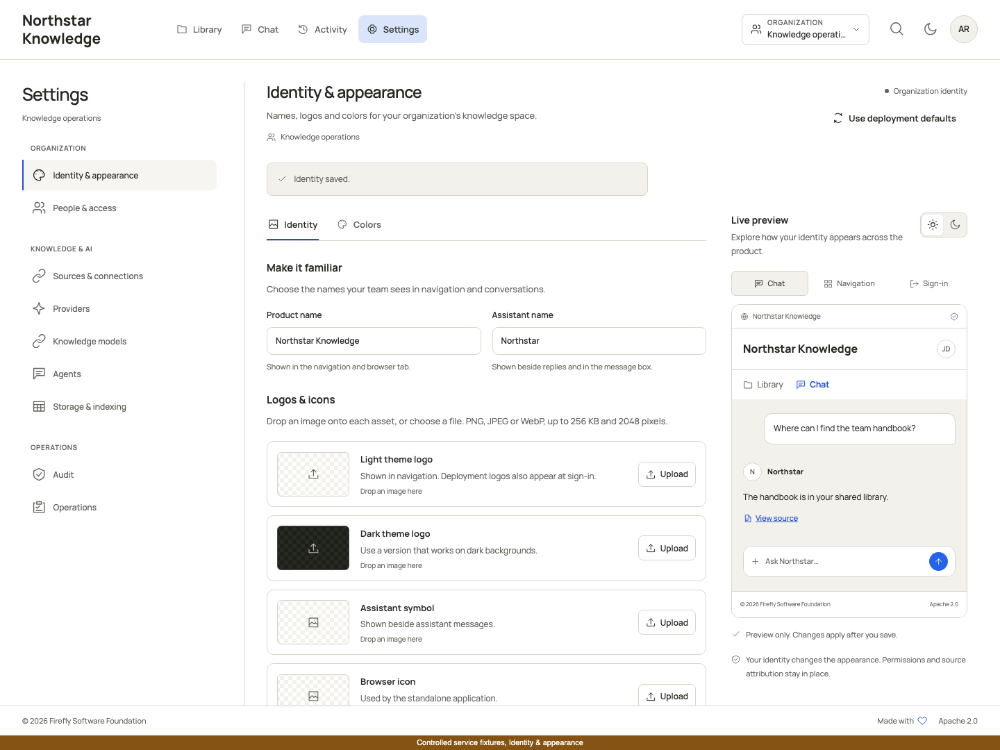
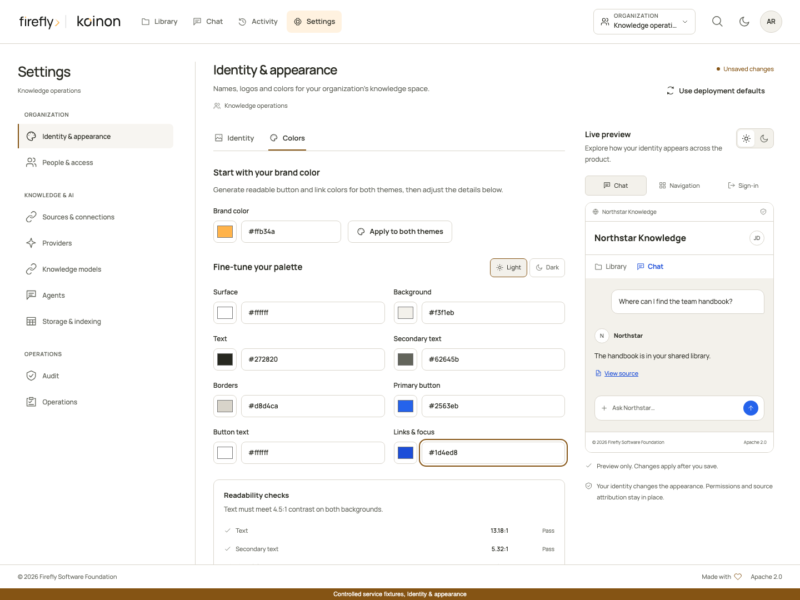
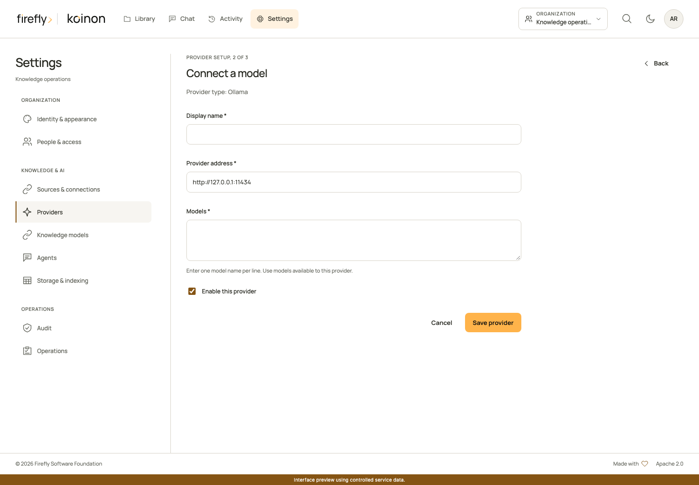
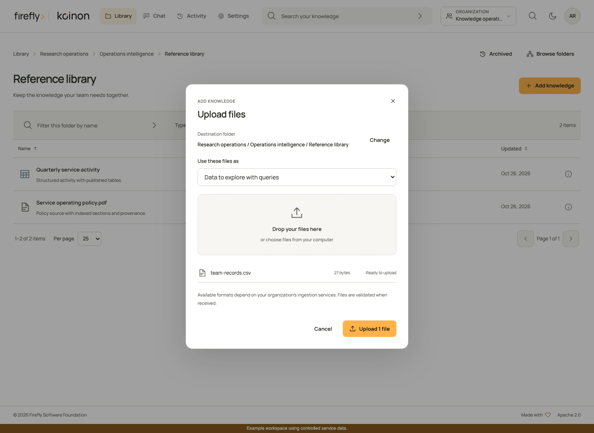
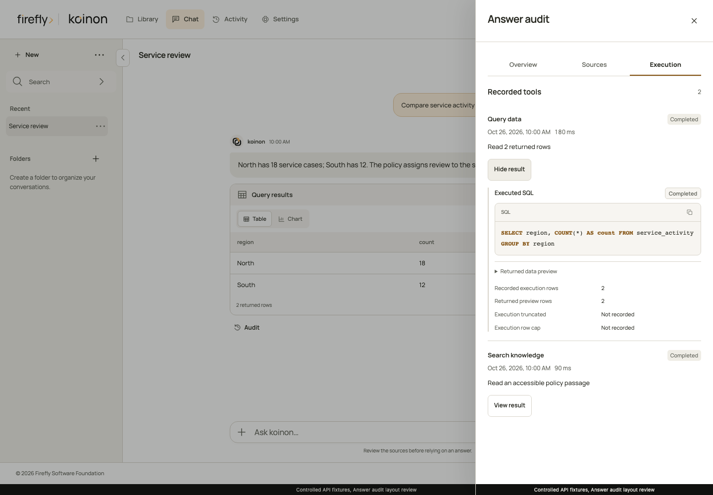

<!-- Copyright 2026 Firefly Software Foundation SPDX-License-Identifier: Apache-2.0 -->
# Configure your corporate brain

Follow this path for a new installation or organization. It connects deployment prerequisites, visual configuration and a small acceptance exercise. The linked screenshots use controlled example data; they illustrate the screens and do not establish that your provider or deployment is ready.

Sign in to the intended installation. With one authorized organization, no organization selection is needed and no selector is shown. If your account has several authorized organizations, choose the intended one using the organization selector. Then open your avatar menu and select **Settings**. On a phone, use **Settings section** to choose a page. On a larger screen, use the settings navigation. The management administration area requires organization administrator access; a workspace role or a successful sign-in alone does not grant it.

Before starting, agree who owns each part of the installation:

| Owner | Prepare | How to check it |
| --- | --- | --- |
| Deployment operator | Migrated PostgreSQL stores, identity, protected secrets, final object storage, bulk staging and worker processes | Complete [first start](../operations/first-start.md); inspect readiness and a retained test operation. |
| Organization administrator | Access, provider/model choices, knowledge behavior and the central chat agent | Read back each saved revision in the selected organization. |
| Acceptance tester | Fictional documents and a small table with independently known answers | Record expected values before import; test as both administrator and reader. |

Keep a short record of the release, selected organization, source identities and outcomes. No real customer or employee data is needed to establish this first working path.

## 1. Prepare the installation

Configure the public/base URL, trusted proxy behavior, identity provider, PostgreSQL datasources, object storage, encryption material and worker resources through the protected deployment configuration. Apply the three migration histories with separate migration authority before starting the updated application. Runtime credentials must not have migration authority.

For a new production installation, use [First start in production](../operations/first-start.md) for the migration, sign-in and verified-subject bootstrap order. For loopback development, use [local deployment](../operations/local-deployment.md), then rehearse [backup and restore](../operations/backup-restore.md). Decide where original documents, dataset artifacts and private chat files persist; configuring only a knowledge index is insufficient. [File persistence and storage](../operations/storage.md) covers local, S3, Azure Blob Storage and Google Cloud Storage profiles and the current bulk-operation boundaries.

Configure [bulk staging](../operations/durable-bulk.md) independently when using queued Library uploads. A document bucket is not a staging configuration. Start the worker process and explicitly enable the file-batch consumer on the worker replicas that will process these uploads. The [worker guide](../operations/workers.md) distinguishes the ordinary worker entry point, bulk opt-ins and shared concurrency limits. API readiness does not establish that a queue is being consumed.

## 2. Establish people and access

After signing in to the running installation, obtain the verified canonical subject from `GET /auth/me` and create the first organization administrator through the [audited bootstrap procedure](../operations/first-start.md#4-establish-the-first-administrators). An identity-provider login alone does not grant product membership. Open **Access** to invite people or assign the smallest useful organization/workspace role. Configure supported corporate group mappings separately from manual grants.

Directory synchronization and email are optional installation features, not sign-in prerequisites. Recipient-bound email invitations need their own verified directory and delivery configuration. A manual membership or the separate private legacy invitation link remains a different operation. See [communications and invitations](../operations/communications.md) before promising an email to a new user.

Use **People** and **Organization structure** for positions, departments, teams and managers. These values do not grant permissions. Choose directory visibility explicitly, and let each person manage their own avatar and preferences. The [people guide](people-and-organization.md) covers the complete flow and SDK operations.

## 3. Apply the product identity

Open **Identity & appearance** in the **Organization** settings group. Review product and assistant names, light/dark assets, browser icon and palettes. Check both themes and the preview before saving. Installation branding controls the signed-out experience; private organization overrides apply after authentication.

[](../assets/screenshots/identity-editor.png)

[](../assets/screenshots/identity-colors.png)

Follow [identity and appearance](../operations/identity-appearance.md) for image constraints, inheritance, revision conflicts and embedded-host branding. Check mobile navigation and account screens as well as the desktop preview.

## 4. Connect and validate model providers

Open **Providers**, connect an approved endpoint, select the actual protocol and provide credentials when required. Save, then run the offered checks. A model being listed establishes discovery, not successful streaming, tool calling or vision.

[](../assets/screenshots/provider-connection.png)

Start with the model needed for your first bounded scenario. Check its supported settings instead of assuming that all models on the endpoint share capabilities. A changed connection or model configuration invalidates previous validation observations.

The operator must approve the provider origin and supply any required encryption material before credentials can be saved. A browser administrator cannot broaden the host allowlist. Verify the actual endpoint, selected protocol and model identifier together; credentials for a different resource or an incompatible protocol cannot be repaired by changing agent instructions. Use a small explicit check before a larger import or generation.

## 5. Assign processing models and choose RAG or RLM

Open **Knowledge models**. Configure the document and structured roles needed by your selected workflow. Embeddings require an explicit compatible model, dimensions and space. Organization defaults and workspace overrides have different authority and behavior; a disabled override blocks fallback.

At the top of **Knowledge models**, the **Knowledge behavior** panel contains the current policy, capabilities and bounds. It is not a separate navigation page. Choose **RAG** for the document retrieval path or **RLM** only after its recorded-view, secure execution and model prerequisites are met. Review both the document and structured policy before saving. Reload and review a revision conflict rather than overwriting another administrator's changes.

Continue to the model assignments below that panel. Choose **Organization default** for a shared baseline, or an authorized workspace for an explicit override. A disabled override blocks inheritance rather than falling back silently. Assign generative roles needed by the workflow and an explicit compatible embedding model and space. The [role catalog](../concepts/knowledge-runtime.md#how-embeddings-and-indexes-fit-together) explains document answers, ingestion, SQL generation and structured schema embeddings.

**Use the current chat agent** is useful only where the role descriptor permits it and an active chat run exists. Headless ingestion or a direct query outside Chat needs its own usable assignment. Do not use a chat-only model selection as evidence that background processing is configured.

[Agents, embeddings and knowledge engines](../concepts/knowledge-runtime.md) explains the choice. [Organization knowledge behavior](../operations/organization-knowledge.md) gives the exact settings, RLM restrictions and typed examples. Keep unsupported capabilities disabled; a mode selector does not qualify a provider.

### Review one assignment from start to finish

Select the role you intend to change before selecting a model. For example, `documents.embedding` controls document vectors; changing `documents.answer` does not configure those embeddings. Keep **Assignment scope** at **Organization default** for the shared baseline, then choose **Model selection**, **Model provider** and **Model** in the assignment editor.

The corresponding API input uses `domain`, `role`, `workspace_id`, `mode`, `provider_id` and `model_id`. An organization default has no workspace ID. `mode: provider` selects the explicit connection; `mode: current_agent` is limited to supported generative roles and does not accept a provider/model override. The [API reference](../reference/api/knowledge-services.md) and [language walkthroughs](headless.md) explain the typed operations.

For an embedding role, supply `dimensions`, `storage_dimensions` and the approved existing `space_id`. These are compatibility facts, not tuning guesses. Document vector and storage dimensions must match. The current structured assignment uses storage dimensions of 1536 and requires the selected dimensions to fit that space. Read the current setup and role descriptors before saving; this form does not create an arbitrary compatible space by accepting a name.

After saving, reload the assignment and perform its intended operation. A revision conflict reports `KNOWLEDGE_CONNECTION_CONFLICT`: read the current `revision`, review the change and submit its `expected_revision` only after that review. `KNOWLEDGE_EMBEDDING_REINDEX_REQUIRED` means the proposed binding is incompatible with retained indexed knowledge. Plan the supported reindexing procedure rather than deleting and recreating the assignment. Both errors leave the failed change unaccepted.

## 6. Configure the organization's chat agent

In **Agents**, choose a provider/model, allowed knowledge tools and instructions. Validate the agent, then set the organization default. Standard chat resolves that central setting for the current caller. No agent can broaden the caller's memberships or token resource bounds.

Check a reader account as well as an administrator. Verify that the reader can ask about an allowed source and cannot access a source outside its workspace. [Agents and chat](agents.md) covers conversation folders, private files, memory, SSE and audit.

Creating an agent does not select it for everyone. In **Organization chat**, choose the organization-wide default and save. Review the memory controls there separately: allowing personal project memory only permits owners to opt in for their own chat projects. It does not share conversations between users or publish private files. Read [conversation memory](conversation-memory.md) before increasing its bounds.

## 7. Import representative knowledge and inspect an answer

Use an existing authorized space, Library project and destination folder. Installation-provided system spaces and folders cannot be deleted, archived or moved; ordinary subfolders remain manageable within that hierarchy. A Library folder and a private chat project serve different purposes. See [initial knowledge provisioning](../operations/installation-knowledge.md) for the retained defaults.

Upload a small fictional document and a representative dataset in the actual format you will use, such as XLSX. Choose **document** for passage retrieval or **dataset** for table queries. Confirm the destination and the effective limits in the upload review. Inspect processing, extracted sections, schema and immutable source history before asking a question. A submitted batch is accepted work, not proof that the files are searchable.

[](../assets/screenshots/upload-review.png)

Ask a question with an independently known answer. Open **Audit** and verify the cited document part or dataset snapshot, executed SQL where relevant, tool outcomes and recorded policy. Replace the test source through an authorized revision-checked operation and confirm that the older answer still resolves its original evidence.

[](../assets/screenshots/answer-audit.png)

For RLM, verify actual content-use records and final citations, not just a successful analysis action. For private files, verify owner/conversation isolation and expiry. Obtain explicit approval before publishing a proposed conclusion as organizational knowledge.

### Complete the first acceptance exercise

Use the same small sources throughout these checks so that an unexpected result is easy to investigate. Prepare the inputs before opening Chat:

1. Save `service-ownership.txt` with the following fictional text, then upload it in **document** mode to your document folder:

    ```text
    Service review owner: Alex Rivera.
    Service review frequency: monthly.
    ```

2. Create `orders.xlsx` with a sheet named **Orders** and these cells. Upload it in **dataset** mode to your table folder, then inspect the registered schema rather than guessing its generated table name:

    | order_id | amount | currency |
    | --- | ---: | --- |
    | 1 | 1250 | EUR |
    | 2 | 2750 | EUR |

3. Save `finance-policy.txt` with the sentence `The Orders dataset records amounts in EUR.` and upload it in **document** mode. This gives a second document source for a combined question about the dataset's value and its stated currency.

Choose the same authorized knowledge space for the question. Ask **Who owns the service review?**, then **What is the total amount in Orders and which currency does the policy specify?** The table provides the numeric answer; the policy provides the currency statement. Review their separate evidence rather than accepting a citation to only one of them. The current registered schema determines the SQL column and table names; the example filenames are not SQL identifiers.

| Exercise | Expected result | Inspect |
| --- | --- | --- |
| Import a document containing an explicit ownership fact | Processing completes and the document becomes available | Original version, extracted part and availability state in Library. |
| Ask who owns that process | The answer includes the exact authorized passage and a resolvable citation | **Audit**, selected source revision and output receipt. |
| Import an XLSX dataset with two numeric rows, such as 1,250 and 2,750 | Registered tables and their schemas are complete | Dataset version, table identity, row values and processing outcome. |
| Ask for the total of that source column | A governed aggregate returns 4,000 with its actual lineage | Executed SQL, snapshot and returned values in **Audit**; query execution permission is required. |
| Ask for a fact absent from the sources | A bounded insufficient-evidence response | No general-training answer or invented citation. |
| Repeat with a reader restricted to another space | The excluded source is not returned or used | Current memberships and the answer's actual source list. |
| Replace a source through the supported versioned operation | A new answer uses the replacement; the earlier answer retains its recorded evidence | Exact old/new version and extraction identities. |
| Reconnect to a completed chat stream | The same released response is replayed | No duplicate generation or unvalidated model draft. |

The current server-enforced answer format uses exact source excerpts and verified typed values. It does not publish arbitrary model-written factual synthesis. Office image/media bytes without a verified extraction do not become answer facts. Review [knowledge-only responses](../reference/knowledge-only-responses.md) and [format coverage](intake-formats.md) when choosing representative test files.

If a check fails, stop that exercise at the last confirmed state. An unknown submission needs inspection and reconciliation; it is not permission to upload again. Use [Platform health](../operations/platform-health.md) for passive observations and [Operations](../operations/workers.md) for consumer and capacity configuration. Keep the failed outcome with the test record rather than treating a saved setting as a substitute for completion.

## 8. Connect an application and prepare release acceptance

Use a scoped personal token for an SDK integration or a configured OAuth application for delegated access. Test reads and the authorized maintenance operations the application actually needs. Follow the complete [Python](headless-python.md), [TypeScript](headless-typescript.md) or [Java 21+](headless-java.md) guide. The [API reference](../reference/sdk-api.md) maps every canonical operation across languages.

For external assistants, follow [Claude](connect-claude.md), [ChatGPT](connect-chatgpt.md) and [authorized applications](authorized-applications.md). The deployment determines the MCP URL and OAuth callback registration. A hosted client needs network access to that deployment; local configuration alone is not a hosted-client acceptance test.

Before shipping, validate the built artifacts, retained-data migration, permissions, file persistence, worker behavior, real model answers, responsive interface and published documentation for the exact release. Record the remaining provider/client limitations in [qualification](../operations/qualification.md). Passing a source test or viewing a screenshot is one part of that evidence, not the whole deployment result.

Copyright 2026 Firefly Software Foundation. Licensed under Apache-2.0. Made with <3.
