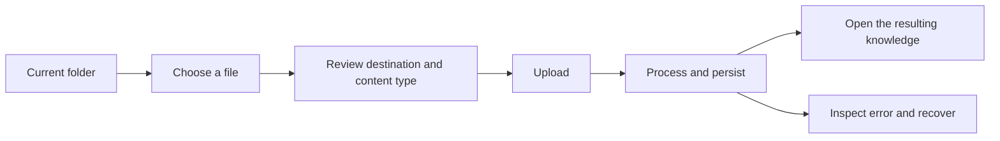

# Work with the knowledge library

The library is the main place to find organizational knowledge. A space contains team folders; folders contain documents and datasets. Technical records such as chunks, tables, snapshots and index versions belong in an item's details rather than the main navigation.

## Spaces, projects and folders

A **space** is a knowledge boundary. Its documents and datasets keep that space's identity in both native knowledge engines, and every operation checks the caller's current access. A folder name or a tag does not grant access. Create separate spaces when teams or clients need different permissions; do not rely on sibling folders for confidentiality.

Inside a space, Library projects and nested folders organize content. They inherit the space's permissions. A Library project is different from a chat project, which groups conversations and can enable the owner's shared conversation memory. Moving a Library folder does not move a conversation or publish conversation memory.

The installation can provide system spaces and system folders. **System space** or **System folder** identifies these retained defaults. Their names and descriptions can be maintained with the appropriate permission, but their system identity cannot be removed. They cannot be deleted, archived or moved, even through an administrator's API token. Creating a subfolder beneath a system folder does not make the new folder a system folder.

Choose the current destination, then create the next project or folder. Nested collection and corpus folders can contain further folders, documents and datasets. Nesting is bounded so the complete path can always be checked; a rejected depth limit requires a shallower destination. Ordinary empty folders can be deleted. Archive retains ordinary content and hides it until restored.

<figure>
  
  <figcaption>Compiled interface with controlled example data. Create a folder and Add knowledge remain separate actions.</figcaption>
</figure>

### Move a folder safely

Select an ordinary organizational folder and its destination inside the same Library project and space. A move retains the folder and asset IDs, native source bindings, historical versions and previously recorded response evidence. The audit event records the old and new parent. New reads use the current path and current permissions.

The request includes the parent and update timestamp you last observed. If another person changed the folder, reload it and review the destination rather than repeating the old request. Moves reject cycles, archived destinations, excessive nesting and pending processing. Tokens restricted to individual assets cannot move a whole folder; the caller needs current write access to the knowledge space.

A move between spaces or Library projects returns `KNOWLEDGE_TRANSFER_REQUIRED`. This operation deliberately does not rewrite native scopes, indexes or source provenance. Cross-boundary transfer needs its own reviewed migration; it is not implemented by changing a parent identifier.

At the Library home, the server-paginated list contains spaces only. Open a space to see its projects, then open a project or folder to browse its children. Names in different levels are not peer spaces. Global knowledge search remains a separate action; the home list does not filter a previously downloaded recursive catalog on the client.

## Find and open

Choose the organization and space you have access to. Browse folders with the list, breadcrumb or knowledge tree. Search narrows the current context; clear the search to return to the folder. Opening an item and inspecting its details are separate actions, so a details drawer does not interrupt browsing.

A document keeps its source and extracted evidence. A dataset exposes its table and column definitions, immutable snapshots and governed query results. Names are for people; canonical identifiers and source bindings remain on the server.

## Read and filter a folder

The list shows each item's name, type and available content details, metadata tags and last update. Folders show the content visible to you. Documents can show recorded pages and file size; datasets can show registered tables and recorded row or column counts. Missing statistics remain unknown. An original upload's size is not the total size of a dataset with several files.

Choose **Name**, **Type & contents** or **Updated** to change the server's ordering. The type column groups resource types; it does not sort by an inferred quantity. On a small screen, use the sort selector. **More filters** includes format, status, tags and **Recently added**. Apply the selection to filter the whole folder, including pages you have not opened. Active filter chips show what is applied and let you remove individual conditions.

Format and language labels come from recorded metadata or a supported file suffix. Custom tags keep their display spelling. These labels do not call a model or create new knowledge. Choosing a tag uses its recorded value as the server filter. Folder names alone do not establish a file format.

The page controls keep their labels and values together. Change the page size to return to the first page. Moving to another folder clears the previous folder's filters. Mobile rows retain the name, useful content details and tags without requiring the full desktop grid.

## Add knowledge

Start from the destination folder and choose **Add knowledge**. Review the destination, file and processing mode before uploading. The result shows the observed processing state. Uploading bytes, processing a source and making knowledge searchable are distinct states. A failed provider or unsupported format must produce an actionable error; a request reaching the server is not a successful import.



Editors can add and maintain knowledge in their authorized scope. Viewers can read and ask questions. Analysts can also query datasets. A missing permission should explain the action that requires access without exposing information from another organization or space.

### Process ordinary uploads through the worker

When queued original storage is configured, **Add knowledge** registers a bounded file batch, verifies each selected original's SHA-256 in sequence, transfers the originals as raw bodies, and submits the batch to the file-intake worker. The API process receives and stages the bytes; it does not parse those queued documents or tables. A configured queue failure does not switch to synchronous parsing.

The panel checks the server's current limits before sending files. The native upper bounds are 128 MiB per original and 512 MiB across the batch; an operator can configure lower bounds. The aggregate limit does not permit a single 512 MiB file. If queued storage is explicitly unavailable, only files within the observed synchronous limit, at most 32 MiB, can use the existing synchronous path. Unknown readiness blocks transfer rather than guessing a limit.

**Queued**, **Extraction complete** and cancellation outcomes come from the retained batch. A persisted worker-start record alone does not establish that a worker is still processing it: **Processing** requires the current native observation. Without that proof, the panel shows **Worker state not verified**. Current readable, queryable and searchable availability is shown separately from the original batch's outcome. Finishing extraction does not establish vector coverage or activate a search index.

If a transfer or submission acknowledgment is lost, choose **Check status**. The panel reads the retained batch and originals without sending them again. **Reconcile retained original** asks the native recovery operation to verify an already retained original; it does not reupload it or blindly repeat parsing. Inspect unfinished or reconciliation-required outcomes before starting different work. A partial synchronous response can also leave native effects, so its uncertain remainder is not automatically retried.

**Request cancellation** uses the current native batch revision. It stops pending work; already published effects can remain. Closing the panel stops its bounded automatic checks and leaves submitted work running. Keep the panel open while resolving an uncertain upload: its request keys remain bound to the current authenticated client and scope, and are cleared when that identity or scope changes. The batch itself remains on the server and is available through the file-batch API after a page reload.

Queued storage configuration does not prove worker availability. Operators must run the [complete worker role](../operations/workers.md) and explicitly enable `koinon.knowledge.bulk.worker_enabled` in its configuration. The query-batch scheduler has its own `query_worker_enabled` setting. For an environment-based local launch, scope the flag to the worker command:

```sh
PYFLY_KOINON_KNOWLEDGE_BULK_WORKER_ENABLED=true python -m koinon.worker
```

Do not apply that worker-only environment override to the API process, which rejects enabled background-worker flags. The file-batch capability response identifies the required external worker and configured storage, not a live worker heartbeat. Resource limits, parser supervision and original retention still apply; this interface does not qualify an arbitrary file or establish a universal memory minimum.

## Understand availability

A successful upload records the result of that request. It does not establish that a source is searchable. Library rows and details observe the current native source, extraction or table snapshot separately from catalog metadata.

- **Text available** means that the current document has a recorded extraction and matching text chunks. It does not promise complete extraction of every page or image.
- **Searchable** additionally requires matching vectors in the active embedding set and its qualified native search index. A queued or running index job can show **Queued** or **Indexing** while text remains readable.
- **Available to query** means that the current dataset or table has an active, recorded snapshot. Provider health and a future query's success remain separate checks.
- **Queued** and **Processing** require a durable job record. A synchronous upload does not acquire an invented queue stage. **Not checked** remains visible when native evidence is absent, unsupported or changes during the observation.

An unsuccessful replacement can leave a serving version available. Details show the observed serving revision separately from the latest recorded replacement or reingestion attempt. **Observed version remains available** does not authorize retrying a failed operation or establish which effects a failed request committed. Check the retained attempt and current revision before recovery.

Availability reads check current organization, space and asset permissions before and after native observations. They are bounded to the visible items and show an observation time. They are not an execution reservation: a later request checks authority and native state again. Missing native state or revision drift stays unknown instead of falling back to a ready catalog status.

Administrators can open **Activity** to inspect current knowledge jobs and server-recorded content attempts. The processing list is paginated. Earlier synchronous stages without durable records remain unavailable. Bulk jobs do not offer the generic job cancellation button; cancellation requires the bulk operation's own current batch and revision contract.

### Observe availability from an SDK

Use the same authenticated transport and current tenant as the rest of your client. The TypeScript factory is a secondary entry point so ordinary SDK clients do not load processing UI code:

```typescript
import type { KoinonTransport } from '@fireflyframework/koinon-sdk';
import { createAvailabilityApi } from '@fireflyframework/koinon-sdk/availability';

async function inspect(transport: KoinonTransport, tenantId: string, assetId: string) {
  const availability = createAvailabilityApi(transport);
  const observation = await availability.observe(tenantId, { asset_ids: [assetId] });
  const asset = observation.items[assetId];
  return { observedAt: observation.observed_at, asset };
}
```

The equivalent Python operations are `knowledge_availability` and `knowledge_processing`; Java exposes `catalog(tenantId).availability` and `catalog(tenantId).processing`. The [generated SDK reference](../reference/sdk-api.md) records their typed inputs and outputs. Availability accepts at most 100 unique asset IDs. Administrator processing pages accept at most 50 records and require current jobs-management authority over the complete requested scope; asset-restricted credentials cannot read whole-workspace history.

## Maintain and inspect

Keep titles and descriptions recognizable to the team. Inspect original source details, processing state, lineage and references before replacing or retiring knowledge. Dataset query results should identify the snapshot used; source evidence should retain section or page references when supplied by the source format.

Choose the history icon beside a dataset table to open [History & lineage](lineage.md). Versions are paginated, and each detail read keeps the selected historical snapshot separate from the current pointer. A missing original record stays visible rather than being inferred from the latest file.

Document details expose extracted chunks with their citation identities and any supplied page or section. Processing offsets describe the emitted chunk stream, including overlap; they are not positions in the original file. Use page or section references when locating evidence in an original document.

The content API checks the current revision before replacing or reingesting knowledge. A document update requires acknowledgment that previous chunk identities will be invalidated. Existing citation rows remain recorded, and the response reports the actual effects. Dataset table updates preserve historical snapshots. If the revision changed, reload the current state and review it before retrying.

Archive keeps the content and its processing state while hiding the item and its descendants from the library. Restore brings them back. A processing job that finishes while an item is archived updates its saved state without making the item visible again.

### Append a dataset file through the API

`POST /api/v1/tenants/{tenant_id}/datasets/{dataset_id}/files` requires a stable `Idempotency-Key` and accepts exactly one multipart `file` for an existing dataset. It keeps the dataset identity and appends the file's parsed sheets or sections as new tables, up to 128 tables within the configured upload byte limit. It records a file version, immutable input coordinates and snapshots. Existing table identities and historical snapshots remain retained. The result returns the canonical dataset, file-version and new table identifiers.

The SDK helpers are `append_dataset_file` in Python, `dataset.appendFile` in TypeScript and `datasets(tenant).appendFile` in Java. The caller needs current catalog and ingestion write permissions for the complete ancestry. Datasets with multiple canonical aliases are rejected pending explicit alias reconciliation.

Append takes an exclusive publication claim. Dataset queries and schema reads return `DATASET_NOT_READY` while intake is pending or failed. Native processing commits sections independently: if a later section or canonical publication fails, earlier native effects may remain. Existing files and snapshots are preserved, but the dataset stays unavailable until its retained file version is reconciled. The same key and exact file return the retained completed receipt after current permissions are checked, without repeating native work. The receipt describes the original completed operation; it is not a fresh dataset-readiness check. A changed payload conflicts, and unfinished keys require reconciliation. There is no automatic retry or public reconciliation helper.

This development endpoint has canonical, native-adapter and HTTP regression coverage. Canonical append locking, cancellation, replay and revocation passed eleven PostgreSQL checks with a controlled native port. Full native/provider append acceptance and recovery remain separate qualification steps. It does not provide asynchronous or bulk intake.

Physical deletion is a separate API operation. It rejects nonempty resources and active workspace memberships. Source retention and storage cleanup use their own domain operations.

## Use on a small screen

Navigation and the knowledge tree open as dismissible drawers. Keep the current folder visible when closing them. Open the detail inspector only when needed. Wide dataset results can scroll inside their own region while the page and primary controls remain usable.

Keyboard users should be able to reach search, expand the tree, open a row, inspect details and dismiss dialogs with focus returned to the originating control. Reduced-motion settings disable decorative heartbeat and movement while preserving progress and status information.
