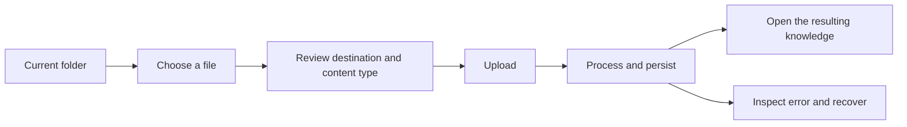

# Work with the knowledge library

The library is the main place to find organizational knowledge. A space contains team folders; folders contain documents and datasets. Technical records such as chunks, tables, snapshots and index versions belong in an item's details rather than the main navigation.

The interface is under active integrated qualification. Use the [qualification record](../operations/qualification.md) to distinguish validated behavior from work still in progress.

## Find and open

Choose the organization and space you have access to. Browse folders with the list, breadcrumb or knowledge tree. Search narrows the current context; clear the search to return to the folder. Opening an item and inspecting its details are separate actions, so a details drawer does not interrupt browsing.

A document keeps its source and extracted evidence. A dataset exposes its table and column definitions, immutable snapshots and governed query results. Names are for people; canonical identifiers and source bindings remain on the server.

## Add knowledge

Start from the destination folder and choose **Add knowledge**. Review the destination, file and processing mode before uploading. The result shows the observed processing state. Uploading bytes, processing a source and making knowledge searchable are distinct states. A failed provider or unsupported format must produce an actionable error; a request reaching the server is not a successful import.

Editors can add and maintain knowledge in their authorized scope. Viewers can read and ask questions. Analysts can also query datasets. A missing permission should explain the action that requires access without exposing information from another organization or space.

## Maintain and inspect

Keep titles and descriptions recognizable to the team. Inspect original source details, processing state, lineage and references before replacing or retiring knowledge. Dataset query results should identify the snapshot used; source evidence should retain section or page references when supplied by the source format.

Archive keeps the content and its processing state while hiding the item and its descendants from the library. Restore brings them back. A processing job that finishes while an item is archived updates its saved state without making the item visible again.

Physical deletion is a separate API operation. It rejects nonempty resources and active workspace memberships. Source retention and storage cleanup use their own domain operations.

## Use on a small screen

Navigation and the knowledge tree open as dismissible drawers. Keep the current folder visible when closing them. Open the detail inspector only when needed. Wide dataset results can scroll inside their own region while the page and primary controls remain usable.

Keyboard users should be able to reach search, expand the tree, open a row, inspect details and dismiss dialogs with focus returned to the originating control. Reduced-motion settings disable decorative heartbeat and movement while preserving progress and status information.
