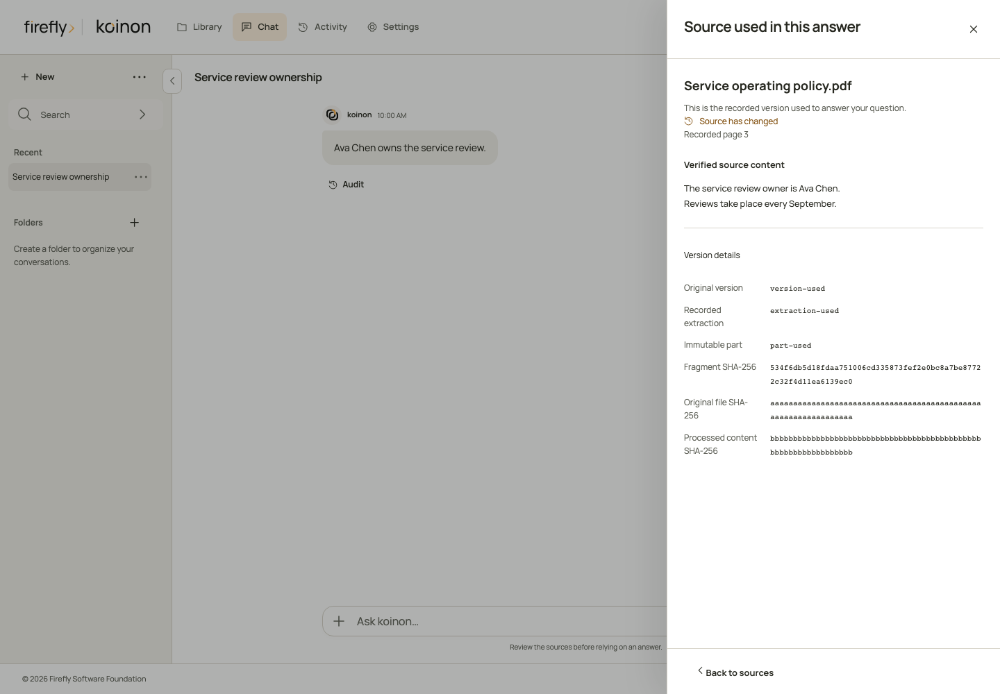
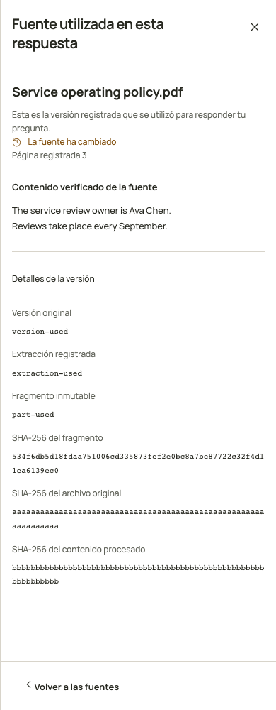

<!-- Copyright 2026 Firefly Software Foundation SPDX-License-Identifier: Apache-2.0 -->
# Inspect versions and source lineage

A saved answer must identify the inputs it used. The current version of a table can change later; that does not change the answer’s recorded snapshot. Source provenance describes those recorded inputs, while the execution audit describes the tools and SQL that produced the answer.

## Open a table’s history

In **Library**, select a dataset and choose the history icon beside a table. **History & lineage** lists its versions with server pagination. Choose a version to inspect its original file, source section and ordered processing steps. The **Current** badge identifies the pointer returned with the history; it does not replace a historical selection.

The original file hash, processed data hash and schema hash have different meanings:

| Recorded identity | What it identifies |
|---|---|
| Original bytes SHA256 | The exact file bytes admitted before parsing |
| Processed data SHA256 | The materialized Parquet bytes for this snapshot |
| Schema SHA256 | The recorded schema representation |
| Snapshot identifier | The immutable table snapshot |
| Processing run | The ingestion operation and its observed steps |

An ordered step can retain its input/output hashes, implementation hash and safe constructor metadata. Model connection assignments, provider and agent revisions are captured when selected. Instructions and model settings are represented by fingerprints, not raw prompts or credentials. An unsupported settings encoding remains unknown. Constructor metadata does not prove the identity of a provider’s internal model weights or disclose private reasoning.

## Read coverage correctly

The table provenance contract currently declares `file_section` coverage. It identifies an original file and the reader’s section; it does not establish a mapping for every row, cell or SQL result value. A predecessor snapshot records replacement history and is not automatically a transformation input.

An older snapshot can return `not_recorded`. Its original source cannot be reconstructed from today’s file pointer, model configuration or connection settings. The interface keeps that absence visible. An execution database such as DuckDB is also distinct from the original uploaded file or any external source database.

## Inspect source coordinates

Source coordinates are a separate record from the file and section history. They identify how a reader mapped an immutable snapshot’s rows and columns to its input. The manifest records the input hash, mapping hash, selected sheet or JSON path, parser decisions and reader dependencies. It contains positions and types, not cell values.

All API coordinates are **zero-based**. For a spreadsheet, row `4` and column `3` identify cell `D5`. Header coordinates are separate from data coordinates. For CSV, a source row identifies a parsed record; a quoted multiline field does not turn that record into several rows. JSON paths contain distinct string or integer segments, so a key containing `/` is preserved as a key.

```text
GET  /api/v1/tenants/{tenant_id}/datasets/{dataset_id}/tables/{table_id}/coordinates?snapshot_id={snapshot_id}
POST /api/v1/tenants/{tenant_id}/datasets/{dataset_id}/tables/{table_id}/coordinates/cells
GET  /api/v1/tenants/{tenant_id}/datasets/{dataset_id}/tables/{table_id}/coordinates/rows?snapshot_id={snapshot_id}&page=1&page_size=25
GET  /api/v1/tenants/{tenant_id}/datasets/{dataset_id}/tables/{table_id}/coordinates/columns?snapshot_id={snapshot_id}&page=1&page_size=25
```

The cell endpoint accepts a read-only selection:

```json
{
  "snapshot_id": "00000000-0000-4000-8000-000000000001",
  "cells": [{"row": 0, "column": 0}, {"row": 1, "column": 0}]
}
```

Supply an actual snapshot identifier from table history. A selection contains 1–1000 distinct positions and preserves the requested order. Row ranges and column bindings use server pagination, with at most 100 entries per page. All four endpoints require current `catalog:read` access to the canonical dataset and table, including token resource bounds. The POST endpoint reads metadata and does not change the repository.

Coverage is `complete`, `partial` with an explicit reason, or `not_recorded`. A partial mapping can leave individual source positions unknown. An unrecorded mapping does not borrow positions from the current file. These coordinates describe snapshot inputs; they do not establish how an aggregate, join or expression produced each SQL result value. Runtime and client qualification are tracked separately in [qualification](../operations/qualification.md).

The SDKs expose the same reads with typed manifests and selections. These examples inspect the first processed cell:

```python
from koinon_sdk import CoordinateCellPosition, CoordinateCellRequest

coordinates = await client.table_coordinates(
    tenant_id, dataset_id, table_id, snapshot_id=used_snapshot_id
)
selection = await client.table_coordinate_cells(
    tenant_id, dataset_id, table_id,
    CoordinateCellRequest(
        snapshot_id=used_snapshot_id,
        cells=(CoordinateCellPosition(row=0, column=0),),
    ),
)
```

```typescript
const coordinates = await client.dataset.tableCoordinates(
  tenantId, datasetId, tableId, usedSnapshotId,
);
const selection = await client.dataset.tableCoordinateCells(tenantId, datasetId, tableId, {
  snapshot_id: usedSnapshotId,
  cells: [{ row: 0, column: 0 }],
});
```

```java
import java.util.List;
import org.fireflyframework.koinon.sdk.model.TableCoordinateFilter;
import org.fireflyframework.koinon.sdk.model.CoordinateCellRequest;
import org.fireflyframework.koinon.sdk.model.CoordinateCellPosition;

var coordinates = client.datasets(tenantId).tableCoordinates(
    datasetId, tableId, new TableCoordinateFilter(usedSnapshotId));
var selection = client.datasets(tenantId).tableCoordinateCells(
    datasetId, tableId,
    new CoordinateCellRequest(usedSnapshotId, List.of(new CoordinateCellPosition(0L, 0L))));
```

## Use the headless API

Both reads require current catalog access to the canonical dataset and table, including the caller’s token and resource bounds. Reading provenance does not rerun ingestion, SQL or a model.

```text
GET /api/v1/tenants/{tenant_id}/datasets/{dataset_id}/tables/{table_id}/snapshots?page=1&page_size=25
GET /api/v1/tenants/{tenant_id}/datasets/{dataset_id}/tables/{table_id}/provenance?snapshot_id={snapshot_id}
```

Use canonical dataset/table identifiers from the catalog and schema. Native identifiers in execution receipts are separate identities. Always supply the exact snapshot being inspected.

```python
history = await client.table_snapshots(tenant_id, dataset_id, table_id, page=1, page_size=25)
origin = await client.table_provenance(
    tenant_id, dataset_id, table_id, snapshot_id=used_snapshot_id
)
```

```typescript
const history = await client.dataset.tableSnapshots(tenantId, datasetId, tableId, {
  query: { page: 1, page_size: 25 },
});
const origin = await client.dataset.tableProvenance(
  tenantId, datasetId, tableId, usedSnapshotId,
);
```

```java
import org.fireflyframework.koinon.sdk.model.TableSnapshotFilter;
import org.fireflyframework.koinon.sdk.model.TableProvenanceFilter;

var history = client.datasets(tenantId).tableSnapshots(
    datasetId, tableId, new TableSnapshotFilter(1, 25));
var origin = client.datasets(tenantId).tableProvenance(
    datasetId, tableId, new TableProvenanceFilter(usedSnapshotId));
```

The three SDKs return typed `TableSnapshotPage` and `TableProvenance` values. The history includes observed totals, page bounds and the current pointer. Detail reads identify a recorded origin or an explicitly unrecorded one. See [qualification](../operations/qualification.md) for the distinction between source tests, installed clients and integrated runtime acceptance.

## Authorize knowledge changes

Saving a conversation is separate from publishing organizational knowledge. A conclusion derived during a chat must be reviewed before it becomes repository knowledge. Review the destination, exact content or changes, and source versions; then explicitly authorize the operation. A changed preview, destination or source requires another review. Permissions establish what a user may change, but do not authorize a proposed change by themselves.

Only a committed domain receipt can confirm a repository write. A preview, pending request or timeout is not confirmation. The full curated-knowledge workflow remains subject to the acceptance steps described in [qualification](../operations/qualification.md).

Before committing, the native write checks its persisted title, body, summary, domain and tags against the authorized content. Clearing a summary is an explicit change. A mismatch rolls back the operation, including its receipt and transactional outbox records.

Replacing or reprocessing a versioned document also requires the exact source version and extraction that the user reviewed. Read the pair from the document’s chunk response, then send `X-Koinon-Source-Version` and `X-Koinon-Extraction` together. `If-Match` still carries the original-byte SHA256; it serves a different purpose. A missing or stale pair returns `409` before replacement or reprocessing. Malformed or one-sided identifiers return a validation error. Reload and review the current document before retrying a conflicting change.

## Read an immutable document source

A recorded document reference identifies a canonical document, native source, source version, extraction, part and part SHA256. A search result's chunk identifier belongs to the current search projection. Preserve the immutable tuple separately when saving an answer. Historical references without that tuple remain unrecorded. Authenticated search hits can return their trusted receipt as the optional typed `source_reference` field. Preserve that entire reference when saving the hit; an absent reference does not acquire an identity from the current document.

The document history API reads those exact retained identities:

```text
GET /api/v1/tenants/{tenant_id}/documents/{document_id}/versions?page=1&page_size=25
GET /api/v1/tenants/{tenant_id}/documents/{document_id}/versions/{source_version_id}
GET /api/v1/tenants/{tenant_id}/documents/{document_id}/versions/{source_version_id}/extractions?page=1&page_size=25
GET /api/v1/tenants/{tenant_id}/documents/{document_id}/versions/{source_version_id}/extractions/{extraction_id}/parts?kind=chunk&page=1&page_size=25
GET /api/v1/tenants/{tenant_id}/documents/{document_id}/versions/{source_version_id}/extractions/{extraction_id}/parts/{source_part_id}
GET /api/v1/tenants/{tenant_id}/documents/{document_id}/versions/{source_version_id}/original
```

Version metadata retains the original filename, admitted actor, creation time, original digest and byte size. Extraction summaries describe the recorded purpose, coverage and normalized digest. Part summaries contain identifiers, digests and recorded coordinates without text. Lists return `items`, `total`, `page`, `page_size`, `pages`, `has_next` and `has_previous`; `page_size` is 1–100 and the page offset is at most 100,000. The optional part filter accepts `artifact`, `section`, `chunk` or `page`.

Only the exact part endpoint returns verified text. It supports retained ingestion chunks and recorded whole-document pages, verifies their immutable bindings and original/normalized bytes, and rejects content over 1 MiB of UTF-8 or 1,000,000 characters. Text is never truncated while retaining the original digest. `recorded_page` and `page_basis` describe the original loader's coordinates; an unknown page stays unknown. Storage keys and internal search projection identifiers are excluded from these responses.

Every read requires current `catalog:read` access to the canonical document and its ancestors, including current token resource limits. Authorization and the canonical/native binding are checked again before returning a completed native read. A missing version, mismatched extraction or missing exact part fails without choosing the current head. The original endpoint downloads the verified historical bytes with a content digest ETag, attachment disposition, `nosniff` and private `no-store` caching.

```python
versions = await client.document_versions(tenant_id, document_id, page=1, page_size=25)
part = await client.document_part(
    tenant_id, document_id, source_version_id, extraction_id, source_part_id,
)
original = await client.document_version_original(tenant_id, document_id, source_version_id)
```

```typescript
const versions = await client.documents.versions(tenantId, documentId, {page: 1, page_size: 25});
const part = await client.documents.part(
  tenantId, documentId, sourceVersionId, extractionId, sourcePartId,
);
const original = await client.documents.versionOriginal(tenantId, documentId, sourceVersionId);
```

```java
var versions = client.documents(tenantId).versions(documentId);
var part = client.documents(tenantId).part(documentId, sourceVersionId, extractionId, sourcePartId);
var original = client.documents(tenantId).versionOriginal(documentId, sourceVersionId);
```

All three clients also provide typed exact-version, extraction-history and part-summary helpers. Java includes asynchronous variants. These reads preserve the saved source identity without rerunning retrieval, ingestion or a model.

## Open the source used by an answer

Open **Audit** below a saved response, select **Sources**, then choose **Open source**. A versioned document opens the exact retained fragment used by that response. **Back to sources** returns to the same audit. If the document has since changed, the panel labels that change while keeping the recorded content and page. An unknown original page stays unknown.

The panel checks the returned document, source version, extraction, part and content digest against the saved reference. It verifies the text hash in the browser before displaying it. A mismatch or a permission failure shows an error without opening today's replacement. **Version details** contains the immutable identifiers and separate hashes for the original file, processed content and fragment.

The following browser captures use controlled source receipts to illustrate the desktop and mobile layout. They demonstrate presentation and historical navigation, rather than an accepted live model conversation.




