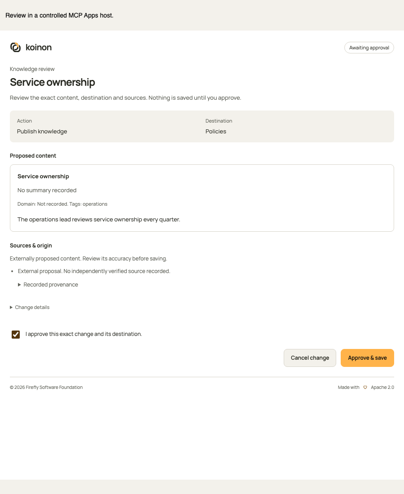
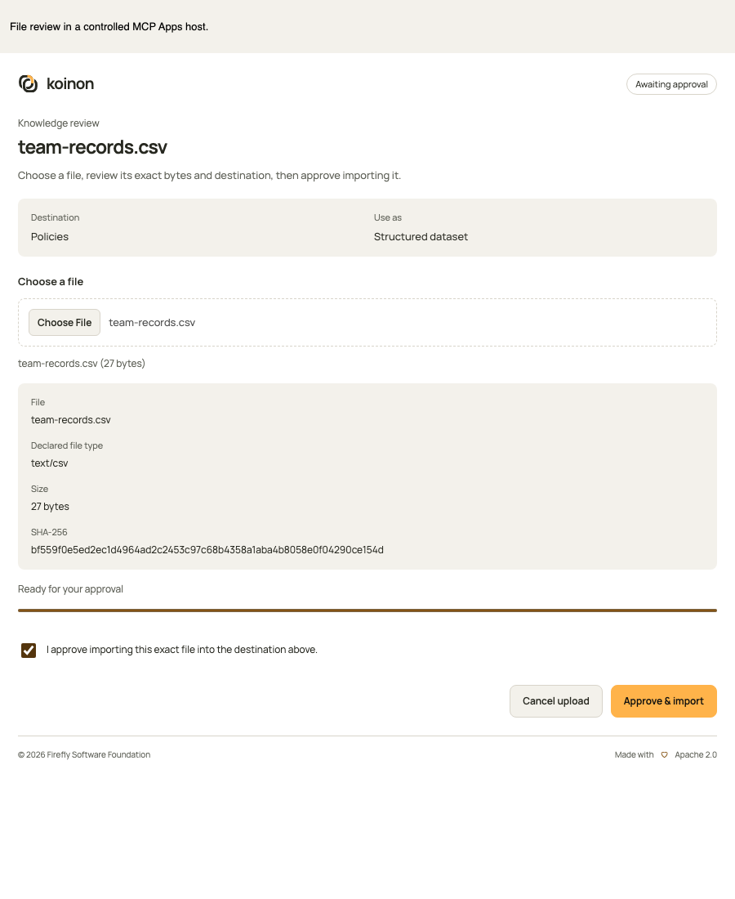

<!-- Copyright 2026 Firefly Software Foundation -->
<!-- SPDX-License-Identifier: Apache-2.0 -->
# Manage knowledge inside an MCP conversation

A connected Claude or ChatGPT conversation can retrieve organization knowledge, propose text changes and upload files. The repository changes only after you review the exact proposal in the embedded koinon component and explicitly approve it. Your current organization role, workspace restrictions and connection permissions apply throughout.

For connection setup, use the [Claude guide](connect-claude.md) or [ChatGPT guide](connect-chatgpt.md). The deployment URL comes from your operator. In your koinon account, open **Authorized applications** and select **Connect an app**. The instructions use the server's configured endpoint, so they follow your installation's address.

*The actual embedded component in a controlled MCP Apps host with example data. This is a local interface test, not a screenshot of Claude or ChatGPT acceptance.*

## Retrieve evidence before proposing a change

Start with `koinon_context`, then select authorized catalog IDs. Use `koinon_search` for document evidence, `koinon_query` for governed dataset calculations and `koinon_fetch` with `kind="document"` for the selected document's chunks.

Supported complete reads return `read_receipt.status="recorded"`, an opaque receipt `id`, a SHA-256 seal, expiry and exact source references. The server records the operation's actual input/result hashes and native read/query provenance. Document references identify the exact chunk or immutable source part read; dataset references retain the observed query and table snapshot identities. Current catalog metadata is never substituted for a missing read-time version.

If the manifest is incomplete, unsupported or exceeds a bound, `status="not_recorded"` explains why and supplies no reusable receipt ID. Catalog entries describe organization structure rather than factual source evidence. Deriving new repository knowledge from curated knowledge versions currently requires qualified transitive provenance and fails closed. Missing version, model or provider information stays unknown.

When staging text, supply `source_receipt_ids` from the same connection. The server loads its own sealed records; it never accepts raw source references invented by the assistant. Receipt IDs are bound to the actual account, organization and credential, including the credential's workspace, resource and scope restrictions. Another connection owned by the same user cannot borrow them. Expired receipts require a fresh read.

The staged intent stores both the selected receipt IDs and copied source references. Approval checks current access and the exact source revision again. An expired selection capability does not erase the retained source snapshot from an existing review or committed knowledge version. Exact ancestry establishes which data was read; it does not certify that the external assistant's conclusion is correct.

## Review a text change

Ask the assistant to call `koinon_stage_knowledge` with the action, destination and proposed content. Supported actions create or update a draft or published item. An update also supplies the exact target item and expected version. Staging needs an idempotency key; reusing it with different content is rejected.

The component displays the destination, proposed title/body and metadata, before/after content when updating, and recorded evidence. It identifies the change as an **external proposal**, with unverified authority. The server records the authenticated actor and credential. It does not claim an observed external model/provider or relabel the text as a user-authored assertion.

Read the proposal, select the explicit approval checkbox and choose **Approve**. Choose **Cancel** to reject it. The component uses a private, one-use nonce bound to the exact revision, digest and originating credential. The nonce is excluded from model-visible content and public review DTOs; there is no public challenge endpoint or autonomous `confirm: true` tool.

If access, the destination, content revision or supporting sources change, obtain a new preview rather than approving stale content. An uncertain commit remains pending until its recorded outcome is reconciled. Retrying uses the original approval key; a timeout is not evidence that the change failed or can safely be repeated as a new operation.

## Select and upload a file

Ask the assistant to call `koinon_prepare_file_upload` with the authorized collection/corpus ID and `mode="document"` or `mode="dataset"`. The embedded component opens a local file picker. Selecting a file does not immediately add it to the organization's searchable repository.

The component calculates its real size and SHA-256, stages the manifest, transfers 64 KiB chunks with per-chunk hashes and seals the complete file. The server enforces its configured private-storage and canonical-ingestion limits; the advertised maximum is their minimum, capped at 32 MiB. No arbitrary remote download URL is accepted.

The review shows the filename, declared media type, byte size and SHA-256. Review these details together with the destination and mode. Approve explicitly to submit it to the normal ingestion path. Cancel to leave repository knowledge unchanged. The component's upload state is separate from ingestion state:

| State | Meaning |
| --- | --- |
| `uploading` | Private chunks are being collected; repository ingestion has not started |
| `preview` | Full selected bytes and digest are verified; explicit approval is still required |
| `ingesting` / `unresolved` | An ingestion attempt has been admitted; its final outcome is not yet established |
| `committed` | The recorded canonical source and receipt are available; inspect `intake_status` for its actual processing state |
| `cancelled` | The staged upload was cancelled before ingestion |

A recorded source identity and protected review marker allow status reconciliation without uploading the file again. Unknown outcomes never trigger automatic ingestion replay. A committed source does not imply that extraction, indexing or every downstream process has finished.

*The same component verifies selected file bytes, destination and approval. Example data in a controlled host; responsive layout is also tested at 390 pixels.*

## Permissions and supported hosts

Every management tool requires `catalog:read`, `catalog:write` and `ingest:write`, intersected with the user's current role and exact resource bounds. Reusing document evidence also requires `knowledge:search`; dataset evidence requires `query:execute`. A scope upgrade cannot repair a foreign workspace or denied organization role. Account-linking OAuth consent authorizes a connection; it does not approve a particular knowledge change.

Model-visible tools start a proposal or file selection. Status, file transfer, sealing, approval and cancellation tools are restricted to the embedded app through MCP Apps visibility metadata. The host must preserve private tool-result metadata and keep app-only tools away from the model. See the [MCP Apps specification](https://modelcontextprotocol.io/extensions/apps/overview).

If the host cannot render the component or preserve that boundary, report the missing capability and leave repository knowledge unchanged. There is no automatic external approval-page fallback. Controlled component and protocol tests remain separate from actual Claude/ChatGPT client acceptance.

## Connection compatibility

The host must negotiate `io.modelcontextprotocol/ui` with `mimeTypes` containing the exact value `text/html;profile=mcp-app`. The server checks that capability before any management tool runs, including private status/nonce access and file preparation. A missing or wrong MIME declaration leaves repository knowledge unchanged and returns a compatible-client instruction. Adding write scopes cannot repair missing UI support.

Legacy initialization retains the declaration in a bounded, credential-owned SDK session. Modern clients can send independent per-request declarations. The credential that created a legacy session must remain valid; a different token cannot borrow that session. Revocation, expiry and current role restrictions still apply to subsequent operations.

For multiple MCP replicas, the operator must provide legacy session affinity. If a session expires or its process restarts, reconnect and refresh the existing review or status. Its canonical data and idempotency keys remain durable; reconnecting does not permit a new ingestion attempt for an unresolved outcome. These session mechanics do not establish that a specific Claude or ChatGPT deployment has passed external-client acceptance.

## Operator limits and retained data

Configure bounded staging limits through `koinon.external_reviews`: `max_active_files` defaults to 8 per owner within an organization, `max_staged_bytes` to 128 MiB, `max_file_bytes` to 32 MiB and `ttl_seconds` to 900. Credential expiry can shorten a review's lifetime. These quotas span the owner's credentials. Cancelled or expired uploads keep consuming staged capacity until their private objects are purged; unresolved ingestion is retained for reconciliation.

Administrators with `settings:write` and the relevant resource access can explicitly clean up selected expired or cancelled uploads using `POST /api/v1/tenants/{tenant_id}/external-file-reviews/cleanup`. Each call selects at most 25 review IDs and processes at most 64 owned objects with a durable cursor. It does not purge committed, uncertain or already admitted ingestion. This maintenance API is available in all three typed SDKs and is not an MCP tool. There is no automatic cleanup scheduler.

Read receipt selection uses `koinon.external_reviews.read_receipts`: `max_active_receipts` defaults to 128 per owner, `ttl_seconds` to 300 and `max_receipt_bytes` to 262144. Only unexpired receipts count against active capacity; sealed historical rows remain append-only. A source manifest is limited to 64 references per receipt and a proposal selects at most 32 distinct receipts. Reaching a limit returns `not_recorded` with its reason; narrow the read or wait for active capabilities to expire. Retained receipts and committed evidence require an explicit deployment retention policy; no historical-lineage deletion is implied.
