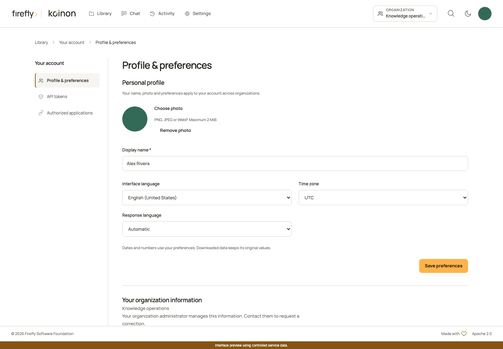
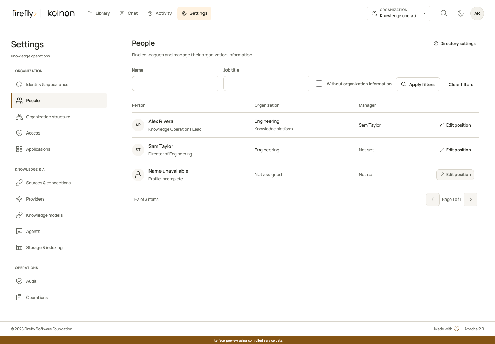
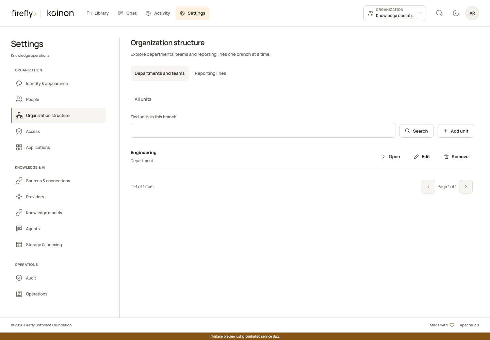

# People, photos and organization structure

koinon keeps a person's preferences separate from their position in an organization. A person can use one photo and preferred language while holding different positions in different organizations. Administrators manage positions and reporting relationships. Each person manages their own personal profile.

## Complete your profile

Open **Your account** and choose **Profile & preferences**. Set your display name, language, time zone and preferred response language. Choose **Automatic** for responses that follow your language. Preview a new photo before saving it, or cancel to keep the current photo. Removing a photo restores the initials shown throughout the interface.

Photos accept PNG, JPEG and WebP up to 2 MiB and 4096 pixels per side. Animated images and SVG are rejected. The server stores a fresh JPEG thumbnail of at most 128 pixels per side, removes image metadata and serves it only after authorization. Photos are not public URLs.

[](../assets/screenshots/organization-profile-photo-1440.png)

These screenshots show the compiled interface with controlled service data and a synthetic photo. They demonstrate the controls and layout; they do not establish synchronization with an external identity provider. [View the mobile profile screen](../assets/screenshots/organization-profile-photo-390.png).

Your organization information shows your job title, department, team or unit and manager when your administrator has supplied them. These fields do not change your roles or access to knowledge. Contact an organization administrator to correct them.

## Build the organization structure

Open **Settings**. The **People**, **Organization structure** and **Access** sections separate corporate information from access management.

1. In **Organization structure**, use **Departments and teams** to create divisions, departments or teams. Give each unit a clear name and choose its parent when it belongs within another unit. **Reporting lines** lets you explore manager relationships.
2. In **People**, find an existing member by name or job title. Use **Without organization information** to find people whose position still needs completing. Apply or clear filters explicitly; page controls retain the current filters.
3. Choose **Edit position** to set a job title, unit and manager. The department is derived from the person's place in the unit hierarchy. A person cannot report to themselves, and reporting or unit relationships cannot form a cycle. Hierarchies are limited to 32 levels.
4. Save the position. If another administrator has changed it since you opened the form, refresh and review the latest values before saving again.

[](../assets/screenshots/organization-people-1440.png)

On a phone, choose **People** in **Settings section**. Open **Filters**, enter your criteria and choose **Apply filters**. Closing the filter panel keeps the applied criteria. Each person's card retains the position, organization, manager and edit action without requiring horizontal scrolling. [View the mobile people list](../assets/screenshots/organization-people-390.png).

[](../assets/screenshots/organization-structure-1440.png)

Use the same parent and revision controls on smaller screens. [View the mobile structure screen](../assets/screenshots/organization-structure-390.png).

People who have not completed a profile may have no display name or profile identifier yet. Their missing information is shown explicitly. Do not create a second identity to fill that gap; ask them to sign in and complete their profile first.

Reparenting a unit checks its whole subtree. A unit with children or assigned people cannot be deleted until those relationships have been moved. Position changes never grant membership, change roles or broaden an API token.

## Choose who can see colleagues

Open **Directory settings** in **People**. The default is **Organization administrators**. Choosing **People in the same workspace** lets eligible members browse colleagues who have access to their selected workspace. It does not expose every person in the organization.

Names, positions, manager references, photos, unit branches and result counts follow that visibility policy. Hidden managers appear as unavailable. Directory responses do not include email addresses, private preferences or canonical identity subjects. Revoking access also invalidates the corresponding view in the interface.

Members can view their own organization information. Editing positions, structure and directory visibility requires organization-level `members:write`; being an administrator of one workspace is insufficient. Configuring corporate profile mappings additionally requires `identity:manage`.

## Maintain positions from corporate sign-in

**Corporate profile mapping** lets an administrator select organizational claims already supplied by a configured identity provider during verified sign-in. Review the selected provider and mapping, then enable it. Changes take effect on a later verified sign-in; enabling a mapping does not immediately synchronize a directory.

The supported fields are job title, unit reference and manager reference. Unit and manager references must already identify records from the same provider in the same organization. Names and email addresses are never used to guess an identity. A missing claim preserves the existing value; an explicit null can clear it. An unresolved unit reference retains the last known unit. An unresolved manager reference clears that link and marks the manager as unavailable, so the interface does not present an unverified reporting relationship.

This feature does not make additional Microsoft Graph or Google directory requests. Availability depends on the claims this installation actually receives. Configure the identity provider to supply the required verified claims before enabling a mapping. Identity, role and credential claims cannot be selected as presentation fields.

Provider-managed positions identify their provider and managed fields. Your account also shows the observation status of your own organization information. An authorized administrator can choose local management before editing managed fields, or reconnect the position to an active configured mapping. Reconnecting retains the existing values until a subsequent verified sign-in supplies new information. Personal photos and preferences remain separate.

## Use the headless API and SDKs

Position, structure and visibility operations support personal API tokens as well as OIDC credentials and the browser. A token must include the required scopes and its owner must retain the required organization permissions. A token cannot authorize access beyond its owner or resource limits. Corporate profile mapping reads and writes require an ordinary verified identity; personal API tokens cannot configure this identity integration, even with management scopes. See [API permissions and writes](api-permissions.md) for token setup.

All directory operations live under `/api/v1/tenants/{tenant_id}/organization`. The [SDK reference](../reference/sdk-api.md) lists the typed requests, responses and all 15 directory operations. Lists use one-based pages, default to 25 results and accept at most 50 results per page. Creating a position is an explicit write; reading a person or their photo never creates an assignment.

These examples assume an authenticated `client` and an existing `tenant_id`. Read the position first so the update carries its actual revision. Explicit `null` clears a unit or manager relationship; omitting a field preserves it. Provider ownership is different: release it with `manage_locally: true`, rather than sending a null provider identifier. A revision conflict must be reviewed rather than automatically retried.

### Python

```python
from koinon_sdk import OrganizationPersonPatch

page = await client.organization_people(tenant_id, q="Alex", page=1, page_size=25)
person = next((item for item in page.items if item.id is not None), None)
if person is None or person.id is None:
    raise LookupError("No assigned person matches the filter.")
updated = await client.update_organization_person(
    tenant_id,
    person.id,
    OrganizationPersonPatch(
        expected_revision=person.revision,
        job_title="Knowledge Operations Lead",
        manager_id=None,
    ),
)
```

### TypeScript

```typescript
const page = await client.organizationPeople.list(tenantId, {
  q: 'Alex', page: 1, page_size: 25,
});
const person = page.items.find(item => item.id !== null);
if (person?.id && person.revision !== undefined) {
  const updated = await client.organizationPeople.update(tenantId, person.id, {
    expected_revision: person.revision,
    job_title: 'Knowledge Operations Lead',
    manager_id: null,
  });
}
```

### Java

```java
import org.fireflyframework.koinon.sdk.model.OrganizationPeopleFilter;
import org.fireflyframework.koinon.sdk.model.OrganizationPersonPatch;

var directory = client.organizationPeople(tenantId);
var page = directory.list(OrganizationPeopleFilter.empty()
    .withQ("Alex").withPage(1).withPageSize(25));
var person = page.items().stream()
    .filter(item -> item.id() != null).findFirst().orElseThrow();
var updated = directory.update(person.id(), OrganizationPersonPatch.empty()
    .withExpectedRevision(person.revision())
    .withJobTitle("Knowledge Operations Lead")
    .clearManagerId());
```

Java exposes asynchronous variants of these methods as well. TypeScript accepts an abort signal through request options. Python uses its asynchronous client context for transport cleanup. Photo helpers return authenticated binary responses; do not convert them into public links or retain them after the relevant user's access ends.

Copyright 2026 Firefly Software Foundation. Licensed under Apache-2.0. Made with <3.
