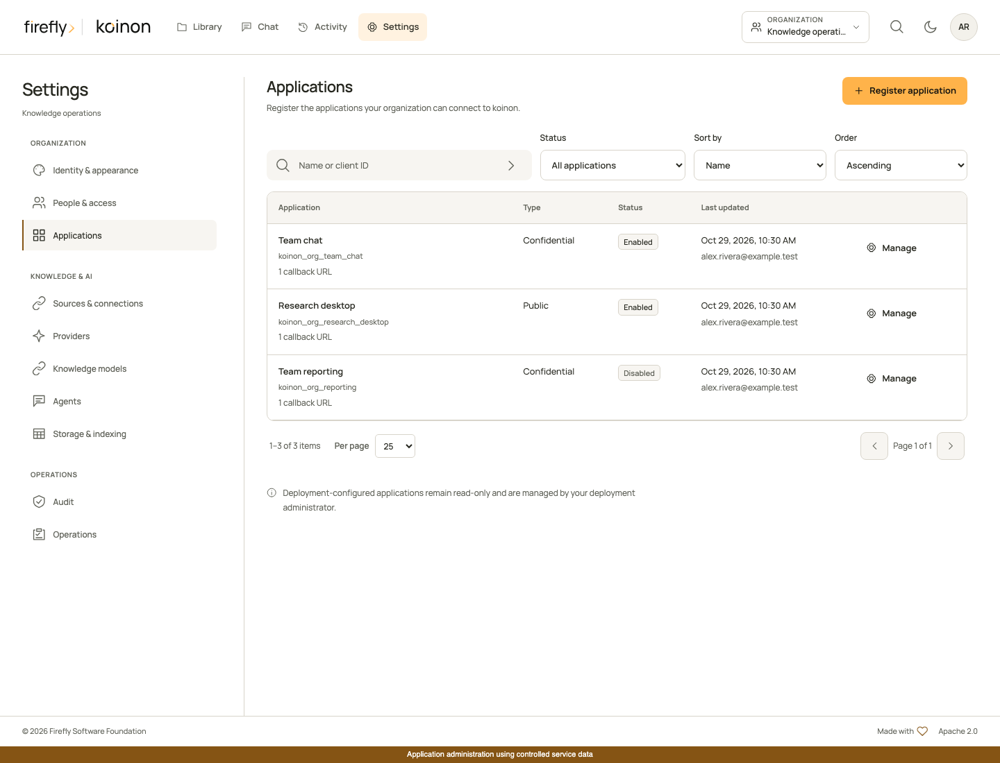
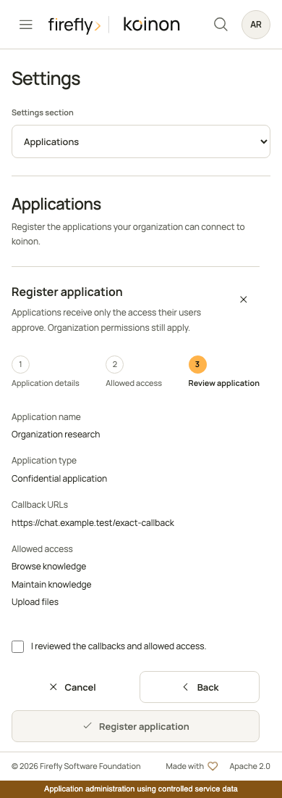

<!-- Copyright 2026 Firefly Software Foundation -->
<!-- SPDX-License-Identifier: Apache-2.0 -->
# Register an application

Organization administrators register OAuth applications under **Settings**, in **Applications**. A registration identifies a client, its exact callback URLs and the permissions it may request. Users still sign in and approve a separate connection to one authorized space. Registration never grants knowledge access by itself.

Use [Authorized applications](authorized-applications.md) in your account to inspect or revoke your own connections. Use **API tokens** for credentials supplied manually to scripts or SDKs. These are separate operations with separate permissions.



*The actual Angular interface using controlled service data. This capture does not establish a connection from Claude or ChatGPT.*

## Check installation readiness

The Applications page checks whether MCP, OAuth and the dedicated encryption key are configured. An incomplete installation shows what its operator must configure before users can connect; it never displays the encryption key. Administrators can prepare registrations while MCP or OAuth is disabled. Application registration cannot change the public server URL or deployment secrets.

A fresh local configuration generated by the installation helper enables MCP and OAuth and creates a dedicated Fernet key. Its application registry starts empty: an administrator registers the first client after signing in. Existing installations keep their configuration and must apply the reviewed native migrations, including `koinon_0021_mcp_oauth_clients`. See [MCP authentication](../operations/mcp-authentication.md) for deployment settings and [migrations](../operations/migrations.md) for the upgrade procedure.

## Register the client

1. Select the intended organization, open **Settings**, then **Applications**.
2. Choose **Register application** and give it a name your team will recognize.
3. Choose the authentication type supported by the chat application. A public client uses PKCE without a client secret. A confidential client also authenticates with a generated secret. Both types require PKCE S256.
4. Enter the exact callback URL shown by the client's connection setup. Each registration accepts up to eight distinct callbacks. Wildcards, credentials and fragments are rejected. HTTPS is required except for explicitly supported loopback development addresses.
5. Select the permissions the application may request. Start with the operations its users need, review the registration, then save it.



*The mobile interface in a controlled browser test. Saving stays disabled until the administrator reviews and acknowledges the registration.*

The server generates the client ID. It cannot be changed or moved to another organization. Public clients return no secret. For a confidential client, copy the secret directly into the client's protected OAuth configuration before closing the result. The database stores only its hash; the plaintext cannot be retrieved later. Never paste it into a conversation or include it in a screenshot.

| Permission | Allows the client to request |
| --- | --- |
| `catalog:read` | Browse authorized knowledge; required for every registration |
| `knowledge:search` | Retrieve document evidence |
| `query:execute` | Run governed dataset queries |
| `chat:use` | Access supported chat and existing-answer audit operations |
| `evidence:read` | Read supported evidence and provenance |
| `catalog:write` | Create or maintain knowledge within the user's role |
| `ingest:write` | Stage and ingest content; requires `catalog:read` and `catalog:write` |

These are ceilings for consent, not additional user permissions. Knowledge writes still require the current role, resource access and [explicit in-chat review](mcp-knowledge-management.md). The client cannot request organization administration scopes.

## Connect users

Users open their avatar menu, select **Authorized applications**, then **Connect an app**. That page loads enabled registrations for their current organization and the installation's actual MCP URL. They can copy the client ID without an administrator sending it manually. Confidential secrets remain visible only in the one-time administrator result and the external client's protected configuration.

Follow [Connect Claude](connect-claude.md) or [Connect ChatGPT](connect-chatgpt.md) to finish client setup. Callback URLs come from that client, not from a hardcoded koinon preset. A local listener URL works only for clients that can reach it; hosted chat services require a reachable HTTPS deployment.

## Change, disable or rotate

Search by application name, filter enabled or disabled registrations, and sort by name or last update. Paging and sorting happen on the server. Open a registration to inspect its callbacks, permissions, creator, last updater and revision before editing.

Saving a change, disabling a registration or rotating its secret revokes the affected authorized connections and their private credentials in the same transaction. Users must reconnect and approve again. Re-enabling a registration does not restore revoked grants. Changes to other applications or organizations are unaffected.

Secret rotation is available only for confidential clients. It produces a replacement secret once and invalidates the previous one. If the result is lost, reload the current registration and rotate again; a retry does not recover the original plaintext. A revision conflict requires reloading and reviewing the latest registration before another write. Do not automatically replay an uncertain creation, edit or rotation.

Deployment-configured static clients remain supported and read-only. They are not silently imported into the organization registry. Ask the operator to update those entries through deployment configuration. Client ID collisions are rejected.

## Use the typed SDKs

Registry management requires an ordinary verified user identity with the organization's `identity:manage` permission. Personal API tokens and OAuth application credentials cannot manage registrations, even when they carry other management scopes. Configure each SDK's normal identity supplier with an administrator's verified API identity. Never log one-time credential responses.

Python exposes typed inputs and responses:

```python
from koinon_sdk import McpOAuthClientInput, McpOAuthClientPatch

readiness = await client.mcp_oauth_clients_readiness(tenant_id)
page = await client.mcp_oauth_clients(
    tenant_id, status="enabled", sort="updated_at", order="desc", page=1, page_size=25
)
issued = await client.create_mcp_oauth_client(
    tenant_id,
    McpOAuthClientInput(
        name="Team chat",
        client_type="public",
        redirect_uris=[exact_callback_from_client],
        scopes=["catalog:read", "knowledge:search"],
    ),
)
current = await client.mcp_oauth_client(tenant_id, issued.client.id)
disabled = await client.update_mcp_oauth_client(
    tenant_id,
    current.id,
    McpOAuthClientPatch(expected_revision=current.revision, enabled=False),
)
connection = await client.organization_mcp_connection(tenant_id)
```

TypeScript exposes the organization registry as a separate method group:

```typescript
const readiness = await client.mcpOAuthClients.readiness(tenantId);
const page = await client.mcpOAuthClients.list(tenantId, {
  query: { status: 'enabled', sort: 'updated_at', order: 'desc', page: 1, page_size: 25 },
});
const issued = await client.mcpOAuthClients.create(tenantId, {
  name: 'Team chat',
  client_type: 'public',
  redirect_uris: [exactCallbackFromClient],
  scopes: ['catalog:read', 'knowledge:search'],
});
const current = await client.mcpOAuthClients.get(tenantId, issued.client.id);
await client.mcpOAuthClients.update(tenantId, current.id, {
  expected_revision: current.revision,
  enabled: false,
});
const connection = await client.mcp.organizationConnection(tenantId);
```

Java provides synchronous and asynchronous methods:

```java
var applications = client.mcpOAuthClients(tenantId);
var readiness = applications.readiness();
var page = applications.list(McpOAuthClientFilter.empty()
    .withStatus(McpOAuthClientStatus.ENABLED)
    .withSort(McpOAuthClientSort.UPDATED_AT)
    .withOrder(McpOAuthClientOrder.DESC)
    .withPage(1).withPageSize(25));
var issued = applications.create(McpOAuthClientInput.empty()
    .withName("Team chat")
    .withClientType(McpRegisteredClientClientAuth.PUBLIC)
    .withRedirectUris(List.of(exactCallbackFromClient))
    .withScopes(List.of(McpOAuthScope.CATALOG_READ, McpOAuthScope.KNOWLEDGE_SEARCH)));
var current = applications.get(issued.client().id());
applications.update(current.id(), McpOAuthClientPatch.empty()
    .withExpectedRevision(current.revision()).withEnabled(false));
var connection = client.mcp().organizationConnection(tenantId);
```

Each SDK also exposes secret rotation with a typed `McpOAuthClientRevision` body. Only call it for a confidential registration, using the revision you reviewed. The global installation descriptor remains available as `mcp_connection()`, `mcp.connection()` and `mcp().connection()` for existing consumers. It does not include organization-managed registrations; use the tenant method for a member's connection setup. See the [complete generated API reference](../reference/sdk-api.md) for all operations and response fields.
