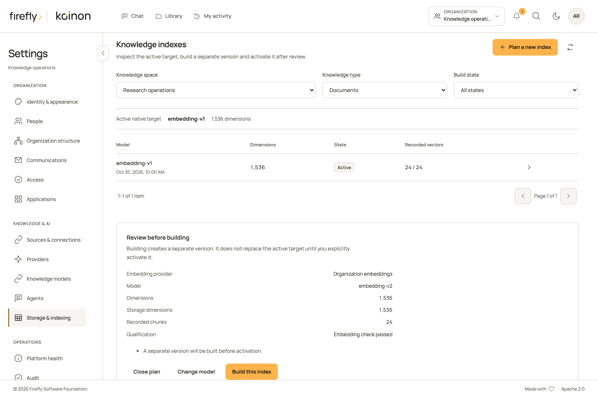
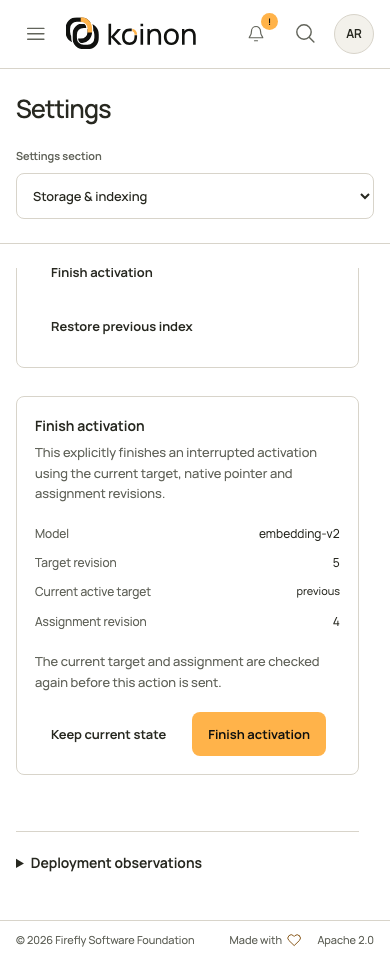

<!-- Copyright 2026 Firefly Software Foundation -->
<!-- SPDX-License-Identifier: Apache-2.0 -->
# Build and activate a knowledge index

Use this procedure when an existing workspace needs a new compatible embedding index, such as after a reviewed model change. The lifecycle creates a separate target, builds it through durable work and activates it explicitly. It does not require deleting the active index or its retained source history.

Use **Settings**, then **Storage & indexing**, for the guided lifecycle below. The same operations are available through the authorized API and typed SDKs in the [knowledge connections and indexes reference](../reference/api/knowledge-services.md). Database extension installation, control-role grants and storage bindings remain deployment work.

## Use the administration panel

Start with a knowledge space you are authorized to manage. **Knowledge type** separates **Documents** from **Datasets**; a plan or action for one does not apply to the other. The **Build state** filter narrows the managed records, and the list is paged. **Refresh indexes** rereads records without calling an embedding model or repeating a mutation.

The **Active native target** strip is read separately from the managed list. It can describe a retained native target without a lifecycle record. A record marked **Recorded active, not confirmed** is not proof that the native pointer currently selects it. If the native inventory cannot be verified completely within the bounded inspection, correct that condition before proceeding; an empty or partial response does not establish an inactive workspace.

1. Choose **Plan a new index**, then select an enabled **Embedding provider** and one of its declared models. Read the usage notice before choosing **Check embeddings and prepare plan**. This is an explicit provider request, not a passive configuration refresh.
2. In **Review before building**, check the provider, model, measured dimensions, storage dimensions, recorded chunks, qualification and warnings. Choose **Change model** to return to selection or **Close plan** to leave without building.
3. Choose **Build this index** only after review. The panel rereads the provider configuration, native target and selected embedding assignment before submitting a keyed request. A changed revision requires a new plan. The panel uses a batch size of 32; other supported batch sizes are available through the API.
4. Inspect the selected **Index details** and use **Refresh indexes** to read progress. **Queued**, **Building** and **Awaiting physical index** mean work remains. The details show recorded chunks and vectors, dimensions, qualification, revision and retained identities. No timer automatically submits work.
5. When the target is ready, choose **Activate index**. Review the current active target, target revision and assignment revision, then confirm **Activate index** in that review. The panel checks them again before sending. Read back the native active target and perform the small functional check described below.



This desktop capture uses controlled example data. The measured dimensions and provider qualification in a real installation come from its explicit plan request.

The available controls follow the current record and authority. **Cancel build**, **Resume build**, **Finish activation** and **Restore previous index** each open a separate review; they are not one-click substitutes for inspection. A native active target cannot be resumed. Cancellation does not delete knowledge, and a provider may still be completing work after the request.

### If the browser cannot confirm an action

An **Index action not confirmed** notice retains the exact request in session storage for this browser tab, bound to the signed-in subject, organization, space and knowledge type. It contains operation fields and, for keyed operations, the original idempotency key; it contains no credentials or provider endpoint. Session storage must be usable before the panel sends mutations. This bounded tab journal holds at most eight actions and 16 KiB and is not a durable operator change record. Closing the tab can remove it.

**Inspect current state** performs reads only. A newly visible target alone does not prove that an uncertain create request produced it. For create or resume, **Review saved request** explains the consequences before **Submit saved request** explicitly sends the original body and original key. If the earlier request was not accepted, this can start work and incur usage. Signing in, refreshing the page and restoring the notice never resend it automatically. Current authority is checked again; a saved request cannot preserve a revoked permission.

Activation and cancellation are not automatically replayed. Inspection may establish the current target state without attributing it to a particular request. An unfinished activation requires a fresh review of **Finish activation** or **Restore previous index**, using the currently observed revisions. Keep uncertain server and provider outcomes in the operator record rather than clearing database rows or creating replacement keys.

{ width="390" }

This controlled example shows a fresh **Finish activation** review. It is not a recommendation to finish every failed transition; inspect the current target and assignment first.

### Inspect deployment observations separately

Expand **Deployment observations** below the lifecycle panel for the read-only file-store, search-index and datasource descriptor. **Refresh deployment observations** rereads that descriptor; it does not build an index, migrate storage or install an extension. Interpret **Checked**, **Not checked** and each reason as described in [configuration observations](configuration.md).

## API and SDK procedure

## Before starting

Confirm the organization, canonical workspace and domain: `documents` or `structured`. The caller needs current workspace authority for `indexes:manage` and `providers:write`, together with the applicable credential scopes and resource bounds. A token does not inherit more access than its owner. An asset-restricted credential is not a general workspace index-inspection credential.

The operator must prepare the native databases, required vector support and narrow provisioning grants. The selected embedding provider must be enabled, belong to this organization and declare the actual model. The current native embedding planner supports the `openai` and `ollama` provider kinds; this is not a promise that an arbitrary model served by either endpoint produces compatible embeddings.

Keep the worker process running for index jobs and preserve enough database, model and processing capacity for the build. Review [worker roles](workers.md) before increasing concurrency. Take a tested backup and retain the current model assignment and active index identities.

Planning is an explicit operation. It performs bounded synthetic embedding qualification against the selected provider and may incur provider usage. It is different from refreshing passive [Platform health](platform-health.md).

## 1. Inspect the current target and assignments

List native choices with `GET /api/v1/tenants/{tenant_id}/knowledge-index-choices` for the selected `workspace_id` and `domain`. List managed lifecycle records separately through `/knowledge-indexes` with the same scope. Both support `limit` and `offset`; read all relevant pages before treating a partial list as the inventory. Optional filters include status, dimensions, model ID and provider kind.

A native choice describes the actual target, including its native identity, space, dimensions, `active`, `indexed`, chunk/vector counts and qualification. A managed record additionally describes its durable job, revision and recovery state. A target being present does not make it active or complete.

Read the current embedding-role assignment too. Document and structured assignments have separate identities. A disabled workspace override prevents fallback to the organization default; do not change inheritance unintentionally while rebuilding.

## 2. Request and review a plan

Send `POST /api/v1/tenants/{tenant_id}/knowledge-indexes/plan` with `IndexPlanInput`. Replace these fictional identifiers with the records you inspected:

```json
{
  "workspace_id": "your-existing-workspace-id",
  "domain": "documents",
  "provider_id": "your-existing-embedding-provider-id",
  "model_id": "the-model-declared-by-that-provider"
}
```

`expected_dimensions` is optional. Supply it only when the intended dimensions are known; the planner verifies the result rather than trusting the number. Read the returned `dimensions`, `storage_dimensions`, `qualification`, `chunk_count` and any warnings. Preserve `active_index_id` and `expected_connection_revision` from that same plan.

An unavailable provider or incompatible model is a failed plan. It does not authorize selecting another model silently or creating an index with guessed dimensions. Read the reported condition and correct the intended connection before planning again.

## 3. Create the durable build

Use `IndexCreateInput` with the reviewed plan's `workspace_id`, `domain`, `provider_id` and `model_id`, plus any intended `expected_dimensions`. Set:

- `expected_active_id` to the returned `active_index_id`, including explicit null when there is no active target.
- `expected_connection_revision` to the plan's returned value, including explicit null when no assignment exists.
- `batch_size` to a bounded processing size, from 1 to 64; the default is 32.

Send `POST /api/v1/tenants/{tenant_id}/knowledge-indexes` with an explicit, durably saved `Idempotency-Key`. Keep the complete request and returned `index.id` and `job_id` in the operator's change record. The server compares the reviewed active target and assignment revision again. HTTP202 acknowledges queued work; it does not mean that the index is ready.

A conflict such as `INDEX_REVISION_CONFLICT` requires a new inspection and reviewed plan. `INDEX_BUILD_CONFLICT` means another build or activation owns the native workspace. Do not create another key repeatedly to bypass either condition.

## 4. Observe the build

Read `GET /api/v1/tenants/{tenant_id}/knowledge-indexes/{index_id}` and the recorded job outcome. Expect intermediate states such as `queued`, `building` or `awaiting_index`; a waiting state is not successful activation. Inspect `qualification`, `indexed`, `chunk_count`, `vector_count`, `revision`, `native_status` and any safe error information.

Before activation, the target must be qualified and its physical index and coverage must be complete. A stale count or an older ready target does not satisfy the current build. Provider/configuration changes and lost original authority can stop work. Preserve the failed record for diagnosis rather than deleting it and starting an indistinguishable replacement.

## 5. Activate the reviewed target

Read the target again immediately before activation, along with the current active target and embedding assignment. Send `IndexActivateInput` to `POST /api/v1/tenants/{tenant_id}/knowledge-indexes/{index_id}/activate` with:

- `expected_revision`: the target's current revision.
- `expected_active_id`: the active target currently observed in this domain/workspace, or explicit null.
- `expected_connection_revision`: the current selected embedding-assignment revision, or explicit null.

Omit `recovery` for a normal activation. The service checks the native pointer, provider fingerprint, physical index and coverage, then coordinates the compatible embedding assignment. Replacing an active managed target retains the previous record as retired history. This is a recoverable cross-datasource transition, not a claim that separate databases commit as one atomic transaction.

Read back `active`, `status`, `space_id`, dimensions and the resulting assignment. Run a small search or dataset question whose expected result is known, then inspect the source and query evidence. A saved activation response does not replace that functional check. **Platform health** is a useful additional observation, but not an automatic acceptance of every retrieval path.

## Cancel, resume or recover deliberately

| Situation | Supported action | What must be retained |
| --- | --- | --- |
| A build is queued, building or awaiting its index | Use `/cancel` with its current `expected_revision` | The target, job and cancellation outcome; cancellation is not deletion. |
| A failed, cancelled, ready or retired nonactive target needs more build work | Review `/resume` with the current revision and a saved new action key | The target's original model fingerprint and the returned job identity. |
| An activation is unfinished and reports `recovery_required` | Inspect the transition, then use activation with `recovery: finish` or `recovery: restore_previous` | Current target, active pointer, assignment revision and the operator's explicit recovery decision. |
| The endpoint, model or embedding dimensions changed incompatibly | Plan a reviewed replacement target | Retained source versions, prior assignments and the old target's evidence. |

Resume rejects an active native target; rebuild into a separate target instead. Recovery applies only to an unfinished activation. Do not submit a recovery action merely because a normal activation failed before any transition began. The service checks the current revision and permitted state for each action.

Keep idempotency keys with their exact requests. SDK methods send a mutation once; a timeout is not evidence that it failed before taking effect. Inspect the retained index/job/transition before deciding whether the same action can be replayed. Never reset rows, force an active pointer or grant runtime DDL to make an uncertain operation look complete.

For complete request types and language-specific method names, use the [generated API reference](../reference/api/knowledge-services.md) alongside [Python](../guides/headless-python.md), [TypeScript](../guides/headless-typescript.md) or [Java 21+](../guides/headless-java.md) authentication and request guidance. For database recovery, follow [backup and restore](backup-restore.md).
