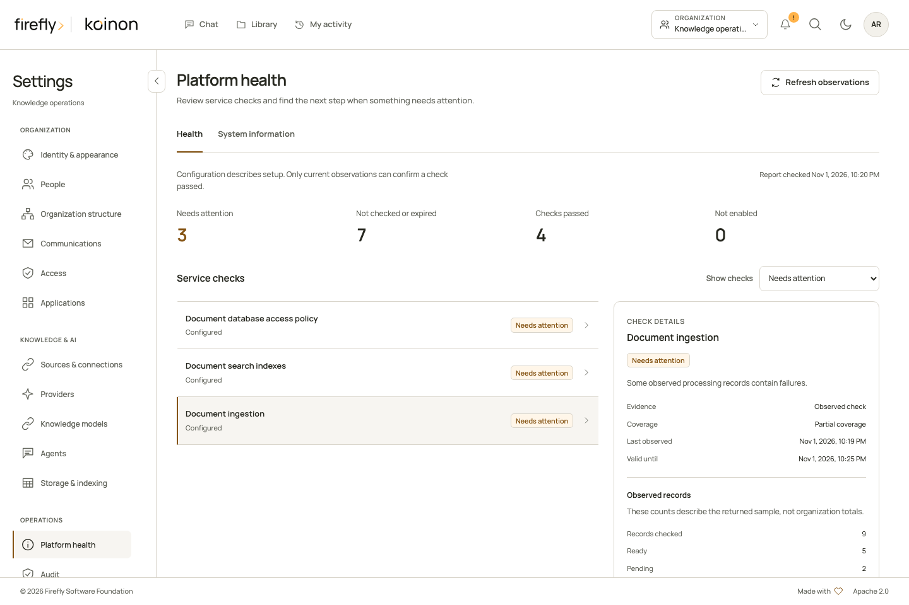

<!-- Copyright 2026 Firefly Software Foundation -->
<!-- SPDX-License-Identifier: Apache-2.0 -->
# Inspect platform health and system information

Platform health provides passive operational observations for the current organization. It separates observed checks from declared configuration and unavailable evidence. Refreshing the page does not send email, invoke a model, upload a file or test storage by writing an object.

Open the account menu, choose **Settings**, then select **Platform health** under **Operations**. On a small screen, use the Settings section selector. The **Health** tab shows separate counts for checks needing attention, checks not performed or expired, checks passed and components not enabled. These are counts of the returned checks, rather than a declaration that the whole installation is healthy.

Choose a service row to inspect its reason, evidence basis, observation validity and coverage. **Observed records** describes a bounded sample. A partial sample does not establish an organization-wide total. **Refresh observations** performs a fresh read; an existing settings destination appears only when the current user can open it.

[](../assets/screenshots/platform-health-1440.png)

This example uses controlled service data. Counts and times explain the controls; they are not measurements of an installation. On a phone, the same summary and filter use a single column. [View the mobile health page](../assets/screenshots/platform-health-390.png).

## Authority

Both reads require a current organization-wide administrator membership and `catalog:read` plus `audit:read`. A workspace administrator does not qualify. Personal tokens must carry both scopes and have no workspace, asset or resource restriction. The service rechecks current primary-store authority before returning its result. Revocation committed before that final policy snapshot is checked; this does not promise physical response linearization against a concurrent change after the snapshot begins.

The same operations are available through bearer-authenticated API routes and browser-session BFF routes. The BFF uses the signed-in session, rather than accepting a bearer fallback.

| Read | Canonical path |
| --- | --- |
| Health | `GET /api/v1/tenants/{tenant_id}/platform/health` |
| System information | `GET /api/v1/tenants/{tenant_id}/platform/system-information` |

The two MCP tools, `koinon_platform_health` and `koinon_system_information`, use this same authority. They are listed only for a freshly verified organization-wide administrator PAT with both scopes. `audit:read` is accepted for these PAT reads, but is not advertised or accepted as an OAuth-requestable scope. Workspace-bound OAuth connections cannot use them and do not receive a request to expand consent. Ordinary knowledge tools retain their existing discovery behavior.

## Read the evidence

A **passed** check requires a current, time-bounded observation. Configuration alone does not establish working storage, a reachable model or successful email delivery. Observations expire after 30 seconds; consumers should treat expired passes as stale until refreshed.

Database checks reuse native connection and runtime-role observations. Index checks require a current active target in every observed workspace, matching the native active pointer and status, qualified physical index, dimensions and chunk/vector coverage. Retired history does not satisfy or invalidate a valid current serving target. Ready targets without activation, and queued or building targets, remain incomplete. Ingestion checks report bounded native job states; intentionally cancelled jobs are not counted as platform failures, and historical successful jobs do not establish that a worker is alive. Worker liveness stays unknown when no retained heartbeat evidence exists.

The reader admits at most 100 index targets and 32 native workspace bindings per domain, and returns at most 1,000 ingestion or fallback catalog status records. Reaching a bound marks coverage partial or unavailable. Individual native reads have cooperative timeouts and the complete operation has a cooperative six-second timeout. An unavailable observation contains a safe reason code; raw SQL errors, provider responses and credentials are excluded.

## Diagnose a problem in order

Start with a concrete symptom, such as a file that is still processing or a conversation that cannot run. Confirm the current organization, then choose **Refresh observations**. Read the observation time and coverage before interpreting a status. The summary counts checks; it does not estimate availability, uptime or healthy replica counts.

1. **Check the database observations.** Open an affected database row and read its safe explanation. Connection availability and runtime-role safety are separate checks. Ask the deployment operator to inspect the appropriate datasource, private network, TLS and role configuration. Do not paste connection URLs or credentials into an incident report.
2. **Check the relevant document or structured index.** Inspect the active target and the returned coverage. A ready historical target does not satisfy the current active pointer. Queued or building work is incomplete; a failed physical-index check requires the supported [index lifecycle](knowledge-indexes.md) or operator provisioning procedure, not broader runtime DDL permissions.
3. **Check processing records.** Open **Operations** and the affected Library resource for the job's current outcome. A successful old job does not prove that a worker is currently alive. Queued bulk files require both durable staging and an explicitly enabled file-batch consumer; see [worker roles](workers.md) and [durable bulk deployment](durable-bulk.md).
4. **Check configuration without assuming provider health.** A model connection or email sender may be configured while its live operation remains unobserved. Use the corresponding provider check or a deliberately authorized test. Refreshing Platform health does not perform that test.
5. **Repeat the original operation after the correction.** Confirm the file's actual availability or the completed answer and its audit. Keep the failed observation and successful verification together. A changed status alone does not replace that functional result.

| Observation | What it establishes | What to do next |
| --- | --- | --- |
| Current passed database/index check | The bounded check succeeded for its recorded scope and time | Continue with the affected operation; refresh after expiry. |
| Failed check | A known prerequisite or observed condition needs attention | Read the row's remediation and the related settings or operator guide. |
| Configured model, storage or email with unknown status | Configuration exists; this read did not prove a successful external operation | Qualify that exact connection using owned test data and the intended deployment identity. |
| Worker liveness unknown | No retained heartbeat evidence establishes current liveness | Inspect the deployed worker process and actual queue progress. Do not infer a replica count from historical jobs. |
| Partial coverage | The returned records are a bounded sample | Inspect the relevant workspace or job directly; do not report the sample as a total. |
| Disabled component | The component is not enabled for this installation | Enable it only when needed and after preparing its prerequisites. |

**Storage & indexing** also exposes deployment observations. Its local filesystem round-trip probe has different behavior from this passive page: it can create and remove its own bounded probe file in an existing configured root. Neither page automatically writes to a cloud bucket. See [configuration and observations](configuration.md) before choosing a diagnostic for a read-only incident review.

A recent **Checked** timestamp in that deployment descriptor can accompany **Not checked** for configured Blob Storage. The timestamp records the descriptor observation, not a successful object request. In Platform health, a configuration-only component has no live observation time or expiry; the response's `checked_at` is the time of the snapshot. Keep those meanings separate when reporting readiness.

## System information

The **System information** tab lists six known installed distributions, the logical serving role, declared capabilities and validated limits. Process limits apply separately to each replica; file limits apply to individual files. A configured capability is not a successful health check.

Only allowlisted installed license, notice and SBOM artifacts are inspected, with a 64 KiB limit per file. **Included** means the installed artifact was read and its SHA-256 is provided. **Not provided** means a known license or notice artifact was absent. **Unknown** means presence could not be established; an absent SBOM remains unknown. The page does not invent download links or infer trusted build provenance from environment variables. A missing trusted build revision remains empty.

These reads do not expose configuration dumps, datasource URLs, paths, keys, request contents or personal records. They also do not prove external client acceptance or a completed live ingestion and retrieval journey. Use the [qualification guide](qualification.md) to record those separate checks.

When reporting an incident, include the product/component versions, serving role, observation time, safe reason, coverage and the affected action. Keep internal deployment identifiers and private operator logs in the appropriate protected channel. An included license or SBOM hash identifies an inspected artifact; it is not a successful security scan or proof that every runtime dependency is healthy.

## Typed clients

Python exposes `platform_health(tenant_id)` and `system_information(tenant_id)` on `KoinonClient`. Java exposes `client.platformHealth(tenantId).health()` and `.systemInformation()`, with asynchronous counterparts. TypeScript keeps this feature in a separate entrypoint:

```typescript
import { createPlatformHealthApi } from "@fireflyframework/koinon-sdk/platform-health";

const platform = createPlatformHealthApi(transport);
const health = await platform.health(tenantId, { signal: controller.signal });
const information = await platform.systemInformation(tenantId);
```

Pass the existing authenticated `KoinonTransport`. Preserve unknown values and coverage in downstream displays. See the [generated API reference](../reference/api/platform.md) for complete response fields, and the [SDK connection guide](../guides/headless.md) for connection ownership.
