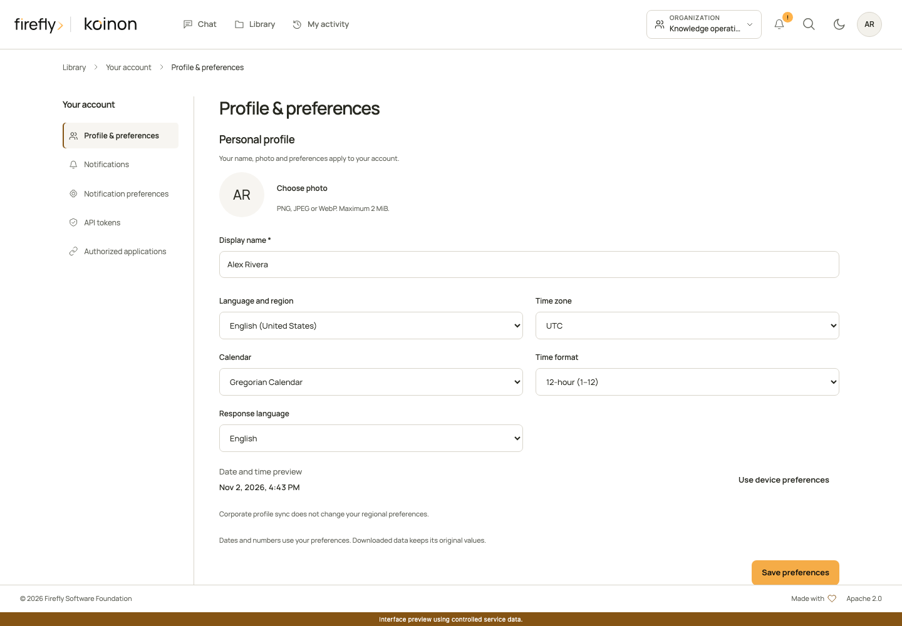

# Profiles and personal access tokens

To create a credential through the interface, follow [Create a personal access token](../guides/create-personal-token.md). It shows where to find the page, how to choose workspace limits and permissions, and where to copy, replace or revoke the secret.

For photos, job titles, departments, managers and directory visibility, see [People and organization](../guides/people-and-organization.md). Personal preferences belong to the verified user; corporate positions belong to the selected organization and never grant access permissions.

For file uploads, catalog maintenance, administrator operations and examples in all three SDK languages, see [API permissions and writes](../guides/api-permissions.md). The token form groups reading, knowledge maintenance, organization management and profile access. Choosing **Administration** explicitly removes resource limits and selects available organization permissions; review and narrow that selection before creating a token.

A profile belongs to the canonical verified issuer/subject pair. Initial display name, locale and IANA time zone can come from verified `name`, `locale` and `zoneinfo` claims; self edits never change identity, roles or memberships. Use `GET/PATCH /api/v1/profile` or the browser BFF projection. Editable preferences are `display_name`, `locale`, `time_zone` and `response_language`; timezone values must exist in the IANA database. Machine-readable API values remain canonical. Applications apply formatting in their presentation layer and preserve per-answer presentation metadata when available.

## Choose language, calendar and time zone

Open your avatar menu and choose **Your account**, then **Profile & preferences**. The regional controls sit below your display name and photo.

1. Choose **Language and region** to set interface language, number formatting and regional conventions. The interface currently supports English and Spanish; other locales still control formatting.
2. Choose your **Time zone** using its IANA name, such as `Europe/Madrid`. This also accounts for daylight-saving changes.
3. Choose a **Calendar** and **Time format**. The date and time preview shows how the combination will look before you save it.
4. Choose **Response language** independently. **Automatic** lets the assistant follow the current message; an explicit language request in that message takes priority.
5. Select **Save preferences**. **Use device preferences** fills the regional controls from the browser's reported settings without saving them immediately or changing your response language.

On a new user's first browser visit, koinon initializes regional preferences from the device once. Browsers may expose less information than the operating system's settings; the profile controls let you correct that. If device detection is unavailable, the fallback is English (United States) and UTC. Verified sign-in defaults remain available to headless users until they set their preferences. Existing profiles keep their saved values when upgrading, including an explicit `en-US` and `UTC`. Changing devices or signing in again does not reset them.

These preferences are personal. Entra ID, Google Workspace and Keycloak can continue maintaining corporate names, photos and positions through [corporate profile synchronization](../guides/corporate-profile-sync.md); those updates do not replace your regional settings or grant new permissions.

Times are stored as canonical UTC instants. The chosen calendar and time format affect presentation, not expiry calculations, source data or downloadable values. Date-only values keep their original day. Native browser date inputs use their browser/operating-system conventions. Historical answers retain their recorded presentation preferences, so changing your profile does not rewrite an earlier answer's evidence.



*The product interface with controlled demonstration data. Open your avatar menu, choose Your account, then Profile & preferences.*

## Update preferences through an SDK

All three SDKs use the same self-owned `PATCH /api/v1/profile` operation. The token needs `profile:write`, which includes profile read. No user identifier is supplied: the authenticated user is always the profile owner. A partial update preserves omitted fields. Supply valid strings rather than `null` to change a preference.

Calendar and hour cycle are standard Unicode extensions in the locale tag. For example, `es-ES-u-ca-gregory-hc-h23` means Spanish (Spain), Gregorian calendar and hours from 0 to 23. `hc-h12` uses hours from 1 to 12. Keeping these preferences in the locale makes them portable across browsers and SDKs without a second, conflicting formatting setting.

=== "Python"

    ```python
    import asyncio
    import os
    from koinon_sdk import KoinonClient
    from koinon_sdk.models import ProfileUpdate

    async def main() -> None:
        async with KoinonClient(
            os.environ["KOINON_API_URL"],
            token_provider=lambda: os.environ["KOINON_TOKEN"],
        ) as client:
            profile = await client.update_profile(ProfileUpdate(
                locale="es-ES-u-ca-gregory-hc-h23",
                time_zone="Europe/Madrid",
                response_language="auto",
            ))
            print(profile.locale, profile.time_zone)

    asyncio.run(main())
    ```

=== "TypeScript"

    ```typescript
    import { FetchTransport, KoinonClient } from '@fireflyframework/koinon-sdk';

    const apiUrl = process.env['KOINON_API_URL'];
    const token = process.env['KOINON_TOKEN'];
    if (!apiUrl || !token) throw new Error('Set KOINON_API_URL and KOINON_TOKEN.');
    const client = new KoinonClient({
      transport: new FetchTransport({ baseUrl: apiUrl, accessToken: () => token, credentials: 'omit' }),
    });
    const profile = await client.profile.update({
      locale: 'es-ES-u-ca-gregory-hc-h23',
      time_zone: 'Europe/Madrid',
      response_language: 'auto',
    });
    console.log(profile.locale, profile.time_zone);
    ```

=== "Java 21+"

    ```java
    import java.net.URI;
    import java.util.Objects;
    import org.fireflyframework.koinon.sdk.KoinonClient;
    import org.fireflyframework.koinon.sdk.model.ProfileUpdate;

    public final class UpdatePreferences {
        public static void main(String[] args) {
            var apiUrl = Objects.requireNonNull(System.getenv("KOINON_API_URL"));
            var token = Objects.requireNonNull(System.getenv("KOINON_TOKEN"));
            try (var client = KoinonClient.builder(URI.create(apiUrl))
                    .bearerToken(() -> token).build()) {
                var input = ProfileUpdate.empty()
                    .withLocale("es-ES-u-ca-gregory-hc-h23")
                    .withTimeZone("Europe/Madrid")
                    .withResponseLanguage("auto");
                var profile = client.profile().update(input);
                System.out.println(profile.locale() + " " + profile.timeZone());
            }
        }
    }
    ```

Set `KOINON_API_URL` to your installation's HTTPS API root ending in `/api/v1`, and provide a current token through your environment or secret manager. These examples change your own profile and return the saved preferences.

An embedding application can initialize a new profile with the same update operation and `initialize_only: true` (`initialize_only=True` in Python or `withInitializeOnly(true)` in Java). In that mode only `locale` and `time_zone` are accepted. The server locks the profile row, applies the values once, and returns the saved profile unchanged if preferences were already initialized. Check `preferences_initialized` on the profile response. An ordinary explicit regional update marks preferences initialized too, so a late browser request cannot overwrite it. Do not use the initialization flag for a user's deliberate change; omit it instead.

Upload an avatar as raw PNG, JPEG or WebP bytes to `POST /profile/avatar` with the corresponding Content-Type. The limit is 2 MiB and 4096 pixels per side. Animated images and SVG are rejected. The service creates a fresh JPEG thumbnail of at most 128 pixels per side, strips metadata and stores only that thumbnail in PostgreSQL. It never fetches an external avatar URL. Authenticated GET returns JPEG with private conditional caching; DELETE removes it. Directory avatars are reauthorized before even a conditional 304 response.

The member picker used for access management requires `members:write` in the selected validated tenant/workspace. The organization directory has a separate visibility policy, with administrator-only visibility by default and optional sharing among eligible colleagues in the same workspace. Neither response includes private locale/timezone preferences or email. Catalog actor summaries are available only after content authorization and are deduplicated by subject. Display names and pictures are presentation data, never authorization keys.

Create personal access tokens through an interactive verified identity. `GET /tokens/scopes?tenant_id=...&workspace_id=...` returns current scope descriptors and policy bounds. `POST /tokens` accepts a name, tenant, explicit scopes, aware ISO expiry, and optional workspace/asset limits. The default policy permits at most 100 active tokens per owner and expiry up to 365 days. Restrict tokens to the smallest useful scope and lifetime. Management scopes require organization scope.

The token secret is returned once at creation. Store it in a secret manager; list responses expose metadata only. The database stores a digest, not the plaintext credential. Send the token as an API bearer credential. It cannot mint more tokens. `DELETE /tokens/{id}` revokes it. Authentication rechecks expiry/revocation; governed reads/writes intersect current owner memberships and resource limits, and delegated durable chat retains the originating token restriction.

Profile scopes are separate: a search-only token cannot read or change the owner's profile. `profile:write` includes profile read. Directory operations additionally enforce tenant/workspace bounds. SDK token callbacks can supply either an OIDC access token or a personal token and are reread for each request. The SDK never retries writes automatically.

Copyright 2026 Firefly Software Foundation. Licensed under Apache-2.0. Made with <3.
